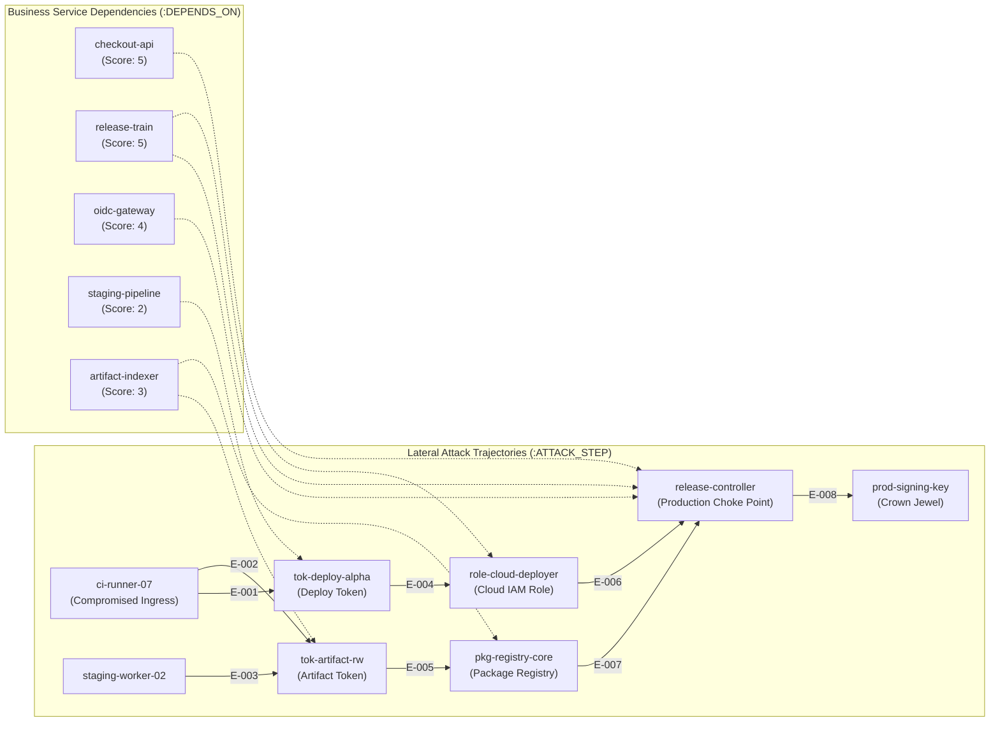

<p align="center">
  
</p>

# TEZCATL — Graph-Native Breach Containment on FalkorDB

[](https://tezcatl-engine.onrender.com)
[](https://www.falkordb.com/)
[](#)
[](https://github.com/Aadrit555)
[](https://www.python.org/)
[](https://pydantic.dev/)
[](https://fastapi.tiangolo.com/)
[](tests/)
[](#)

> **TEZCATL** is a graph-native incident containment engine submitted under **Track 01: Agents That Act on Connected Data** (WeMakeDevs & FalkorDB Graph Hacks). It isolates multi-hop lateral movement across synthetic modeled infrastructure graphs in FalkorDB using graph traversals, native graph centrality algorithms (`algo.betweenness`), dynamic service impact analysis, and isolated shadow-graph sandbox verification (`tezcatl_mirror`).
>
> *All containment actions operate on graph state within FalkorDB; TEZCATL models and mathematically proves zero-reachability containment deterministically without issuing live AWS, GCP, or Kubernetes API calls. Powered by native FalkorDB algorithms and 100% first-party deterministic graph orchestration. Zero external APIs. Zero third-party agent wrappers.*

---

## The "Take FalkorDB Out" Test: Why the Product Fails Without the Graph

> [!IMPORTANT]
> *"If the product still works once FalkorDB is taken out, the graph is decoration rather than the thing the product runs on — and is disqualified."*

If FalkorDB is removed from TEZCATL, the product cannot function:
1. **Multi-Hop Traversal Collapses:** Identifying lateral movement trajectories requires evaluating variable-length directed paths (`*1..8`). In relational SQL, this demands recursive common table expressions (CTEs) or deep nested self-joins that collapse as topological depth grows.
2. **Vector RAG Cannot Reason Over Reachability:** Embeddings compress semantic proximity, not topological connectivity or directional permissions. A vector database cannot compute whether severing an intermediate token cuts 100% of reachability to crown jewels.
3. **Native Betweenness Centrality Disappears:** TEZCATL executes `algo.betweenness` directly inside FalkorDB to locate structural choke points across entity nodes in sub-5ms latency.
4. **Service Impact Blast Radius Is a Reverse Graph Traversal:** Computing business disruption is not a static lookup table—it executes dynamic multi-hop reverse dependency traversals (`(s:Service)-[:DEPENDS_ON*1..4]->(e:Entity)`) to sum real revenue impact scores.
5. **No Simulation Allowed:** The frontend contains zero mock arrays or simulated state. If FalkorDB is offline, the interface displays an explicit engine connection error banner.

---

## Graph Data Model & Synthetic Schema

TEZCATL runs across two isolated graphs inside FalkorDB: `prod_graph` (the primary synthetic graph representing modeled workloads, tokens, and services) and `tezcatl_mirror` (shadow-graph sandbox for pre-commit verification). Containment actions mutate node states in the graph to sever attack trajectories without requiring destructive external cloud infrastructure commands.



### Node Schema

| Label | Canonical ID | Kind | Criticality | Raw Cost | Revenue Impact Score | Description |
| :--- | :--- | :--- | :--- | :--- | :--- | :--- |
| `:Entity` | `ci-runner-07` | `workload` | `high` | 10 | 0 | Compromised CI build runner |
| `:Entity` | `staging-worker-02` | `workload` | `medium` | 8 | 0 | Secondary staging build worker |
| `:Entity` | `tok-deploy-alpha` | `credential` | `high` | 2 | 0 | Deploy credential token |
| `:Entity` | `tok-artifact-rw` | `credential` | `high` | 3 | 0 | Artifact registry read-write token |
| `:Entity` | `role-cloud-deployer` | `iam_role` | `high` | 6 | 0 | Cloud deployer IAM role |
| `:Entity` | `pkg-registry-core` | `registry` | `high` | 7 | 0 | Core package repository |
| `:Entity` | `release-controller` | `service` | `critical` | 10 | 0 | Central release orchestrator |
| `:Entity` | `prod-signing-key` | `key` | `crown_jewel`| 9999 | 0 | Production release signing key |
| `:Service` | `checkout-api` | `service` | `critical` | 10 | 5 | Global checkout transaction API |
| `:Service` | `release-train` | `service` | `critical` | 10 | 5 | Zero-downtime release pipeline |
| `:Service` | `oidc-gateway` | `service` | `high` | 8 | 4 | Edge authentication gateway |
| `:Service` | `staging-pipeline` | `service` | `medium` | 4 | 2 | Staging build validation pipeline |
| `:Service` | `artifact-indexer` | `service` | `medium` | 5 | 3 | Artifact catalog indexer worker |

### Relationship Schema

| Type | Direction | Properties | Semantic Purpose |
| :--- | :--- | :--- | :--- |
| `:ATTACK_STEP` | `(:Entity)->(:Entity)` | `active: bool`, `mechanism: string`, `evidence_id: string` | Directional privilege escalation or credential access |
| `:DEPENDS_ON` | `(:Service)->(:Entity)` | `purpose: string` | Reverse operational dependence for dynamic blast radius |

---

## Core OpenCypher Queries (100% Parameterized)

All Cypher queries in TEZCATL use strict parameter binding with zero raw string interpolation or f-string injection.

### 1. Multi-Hop Attack Path Discovery (`*1..8`)
```cypher
MATCH p = (src:Entity {id: $source_id})-[:ATTACK_STEP*1..8]->(target:Entity {id: $target_id})
WHERE ALL(r IN relationships(p) WHERE r.active = true)
  AND ALL(n IN nodes(p) WHERE n.status <> 'disabled' AND n.status <> 'isolated')
RETURN
    [n IN nodes(p) | n.id] AS node_ids,
    [n IN nodes(p) | n.name] AS node_names,
    [n IN nodes(p) | n.kind] AS node_kinds,
    [r IN relationships(p) | r.mechanism] AS mechanisms,
    [r IN relationships(p) | r.evidence_id] AS evidence_ids,
    length(p) AS hops
ORDER BY hops ASC
```

### 2. Native FalkorDB Betweenness Centrality
```cypher
CALL algo.betweenness({
    nodeLabels: ['Entity'],
    relationshipTypes: ['ATTACK_STEP']
})
YIELD node, score
RETURN
    node.id AS id,
    node.name AS name,
    node.kind AS kind,
    score
ORDER BY score DESC, id ASC
```

### 3. Dynamic Service Blast Radius via Reverse Dependency Traversal
```cypher
MATCH (s:Service)-[:DEPENDS_ON*1..4]->(e:Entity)
WHERE e.id IN $candidate_ids
RETURN
    e.id AS entity_id,
    count(DISTINCT s) AS downstream_service_count,
    sum(s.revenue_impact_score) AS blast_radius_cost,
    collect(DISTINCT s.name) AS impacted_services
```

### 4. Shadow Graph Sandbox Containment & Verification
```cypher
// Sever candidate entities in isolated tezcatl_mirror graph
UNWIND $blocked_ids AS blocked_id
MATCH (n:Entity {id: blocked_id})
SET n.status = 'isolated'
RETURN collect(n.id) AS disabled_ids;

// Verify reachability in mirror drops to 0
MATCH p = (src:Entity {id: $source_id})-[:ATTACK_STEP*1..8]->(target:Entity {criticality: 'crown_jewel'})
WHERE ALL(r IN relationships(p) WHERE r.active = true)
  AND ALL(n IN nodes(p) WHERE n.status <> 'disabled' AND n.status <> 'isolated')
RETURN count(p) AS remaining_paths;
```

---

## Containment Decision Matrix

| Option | Selected Action(s) | Operational Disruption Cost | Downstream Services Impacted | Verdict |
| :--- | :--- | :--- | :--- | :--- |
| **Option A (Optimal Cut)** | Revoke `tok-deploy-alpha` + `tok-artifact-rw` | **5** ($2 + 3$) | `staging-pipeline` (2) + `artifact-indexer` (3) | **SELECTED BY SOLVER** |
| **Option B (Suboptimal)** | Disable `role-cloud-deployer` + `pkg-registry-core` | **8** ($5 + 3$) | `release-train` (5) + `artifact-indexer` (3) | Rejected (higher cost) |
| **Option C (Brute Force Sledgehammer)** | Sever `release-controller` | **14** | `checkout-api` (5) + `release-train` (5) + `oidc-gateway` (4) | Rejected (nearly 3x cost) |
| **Option D (Incomplete)** | Revoke `tok-deploy-alpha` alone | 2 | Leaves artifact route active | Rejected (1 path remains) |
| **Option E (Incomplete)** | Revoke `tok-artifact-rw` alone | 3 | Leaves deploy route active | Rejected (1 path remains) |

---

## Why Zero External APIs Are Needed

Security containment demands exact mathematical proofs, zero hallucinations, and absolute reliability under pressure:
- **Exact Minimum-Cost Vertex-Cut Math:** TEZCATL models breach containment as a minimum-weight vertex-cut / hitting-set problem over candidate graph nodes. The solver guarantees 100% path severance with lowest operational disruption.
- **Zero Hallucination:** Every recommendation is backed by a verifiable Cypher query record, execution latency timestamp, and SHA-256 graph state hash.
- **Self-Contained:** Runs without OpenAI, Anthropic, Gemini, Groq, or third-party agent orchestration frameworks (`langchain`, `llamaindex`, `crewai`).

---

## Quickstart (Zero Configuration)

TEZCATL requires **no external API keys, no cloud credentials, and no .env configuration**.

### Option A: Docker Compose (Recommended)

```bash
# Clone repository & launch stack
git clone https://github.com/Aadrit555/we-make-devs-GRAPH_HACKS.git
cd we-make-devs-GRAPH_HACKS
docker compose up --build
```

Access points:
- **Interactive Graph Console:** `http://localhost:8000`
- **FalkorDB Instance:** `localhost:6379`

### Option B: Local Python Virtual Environment

```bash
# 1. Start FalkorDB
docker run -d --name tezcatl-falkordb --restart unless-stopped -p 127.0.0.1:6379:6379 falkordb/falkordb:latest

# 2. Setup Virtual Environment & Install Dependencies
python -m venv venv
source venv/bin/activate  # On Windows: .\venv\Scripts\Activate.ps1
pip install -r requirements.txt

# 3. Seed Topology & Run Pytest Suite
python -m backend.seed
pytest -v

# 4. Run Live Feature Audit
python verify_live_features.py

# 5. Launch Application
uvicorn backend.main:app --reload --port 8000
```

---

## Live Audit Latencies & Verification

Run the live feature audit to measure exact millisecond latencies across all 6 features:
```bash
python verify_live_features.py
```

```text
======================================================================
TEZCATL // FALKORDB LIVE FEATURE AUDIT & LATENCY BENCHMARK
Target: 127.0.0.1:6379
Prod Graph: prod_graph | Mirror Graph: tezcatl_mirror
======================================================================
[0] SEED DATABASE: OK in 41.40 ms
[1] FEATURE 1: MULTI-HOP ATTACK PATH DISCOVERY          Latency: 9.14 ms (2 paths found)
[2] FEATURE 2: NATIVE FALKORDB ALGO.BETWEENNESS         Latency: 2.26 ms (Top bottleneck: release-controller)
[3] FEATURE 3: REVERSE DEPENDENCY SERVICE BLAST RADIUS  Latency: 3.17 ms (Calculated dynamic costs)
[4] FEATURE 4: DETERMINISTIC VERTEX-CUT SOLVER          Latency: 0.13 ms (Optimal cut: 5 vs 14)
[5] FEATURE 5: LIVE SHADOW-GRAPH CLONING & VERIFY       Latency: 27.46 ms (Remaining in mirror: 0)
[6] FEATURE 6: BYPASS EDGE INJECTION & DYNAMIC RE-SOLVE Latency: 10.85 ms (Shifted cut to release-controller)
======================================================================
ALL 6 LIVE FALKORDB FEATURES VERIFIED WITH ZERO SIMULATION!
Total Audit Pipeline Time: 94.41 ms
======================================================================
```

---

## Repository Structure

```text
we-make-devs-GRAPH_HACKS/
├── backend/
│   ├── __init__.py           # Package marker
│   ├── config.py             # FalkorDB host/port environment bindings
│   ├── models.py             # Strict Pydantic v2 schemas
│   ├── seed.py               # Idempotent database bootstrap for entities & services
│   ├── graph_client.py       # Parameterized OpenCypher client, shadow cloner, telemetry
│   ├── solver.py             # Deterministic minimum-cost vertex-cut combinatorial engine
│   └── main.py               # Production FastAPI application & REST endpoints
├── frontend/
│   ├── index.html            # Minimal Meadow landing view with on-demand interactive console
│   └── assets/
│       └── tezcatl.jpg       # High-res Aztec obsidian crest brand mark
├── tests/
│   └── test_tezcatl.py       # Live FalkorDB test suite (10/10 automated tests passing)
├── Dockerfile                # Production container deployment for Render
├── docker-compose.yml        # Local orchestrated spin-up (FalkorDB v4.4.1 + app)
├── render.yaml               # Render Blueprint (Private FalkorDB + Public Web in Singapore)
├── requirements.txt          # Pure first-party dependencies
├── verify_live_features.py   # Live FalkorDB benchmark & feature audit script
├── pytest.ini                # Pytest configuration
├── README.md                 # Complete hackathon submission documentation
└── SUBMISSION_GUIDE.md       # WeMakeDevs & FalkorDB portal answers & demo script
```

---

## Mandatory Engineering & AI Tooling Disclosure

In accordance with official hackathon submission guidelines:
- **Architect & Author:** Aadrit555 (`https://github.com/Aadrit555`)
- **First-Party Codebase:** 100% first-party systems engineering, graph algorithms, and determinism.
- **AI Tooling Usage:** Google Antigravity coding assistant was utilized as a pair programmer for refactoring boilerplate, drafting Pytest suites, running Docker commands, and formatting documentation.
- **Execution Sovereignty:** Zero proprietary LLMs, zero third-party agent frameworks, and zero external APIs are invoked at runtime. Every graph traversal and calculation executes strictly inside the local FalkorDB and Python stack.
