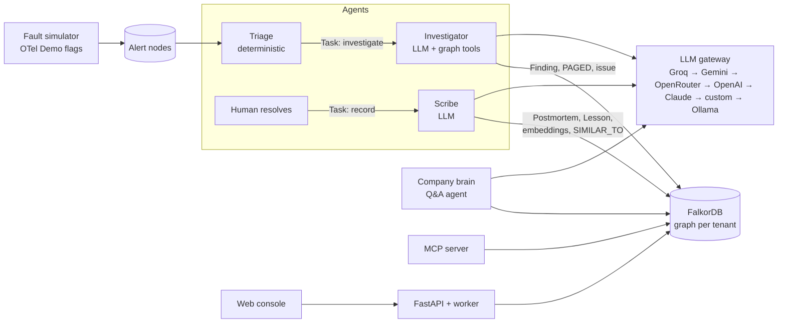
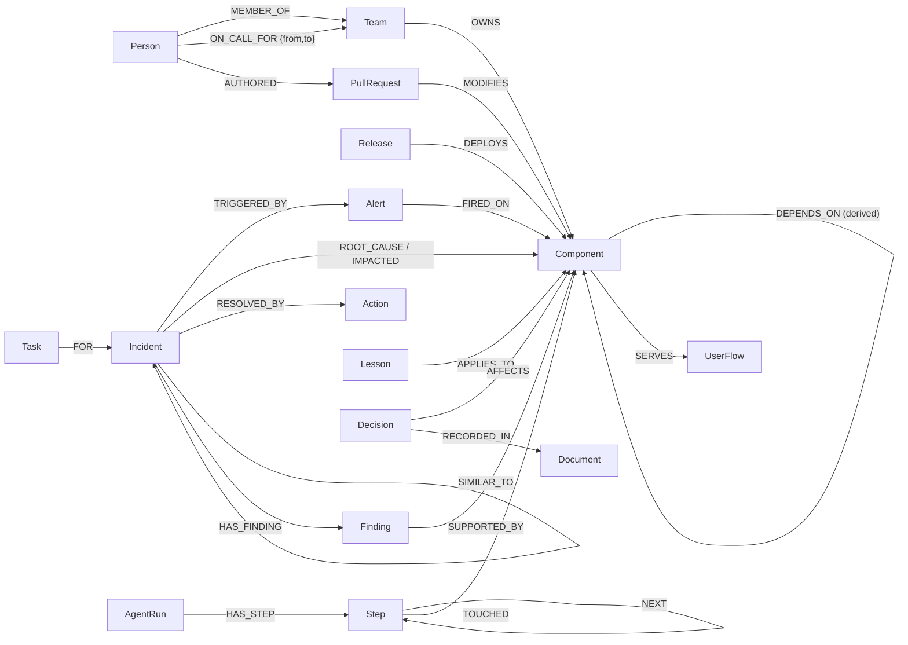

# Blast Radius

**AI on-call agents that run on a graph.** When production breaks, Blast Radius finds *why*, works out *what* is
affected and *who* should fix it, and pages them. It remembers every incident, so the next one is faster, and it shows
the exact graph path behind each answer.

FalkorDB is the agents' shared brain. It holds the system topology, ownership, change history, incident memory,
agent checkpoints and the evidence trail.

Built for **Graph Hacks 2026** (WeMakeDevs × FalkorDB).

**Tracks entered:** ① Agents That Act on Connected Data · ② Agent Memory and Coordination · ③ Company Brain

Issues opened by the agent during demos: [AgentAhmed/blast-radius-sandbox](https://github.com/AgentAhmed/blast-radius-sandbox/issues)


## The problem
Eight services are alerting. Only one of them is the cause. Which one is it? What changed? Who do you wake up?
Has this happened before?

Each of those is a **relationship question**. The answers sit across tracing, Git, on-call schedules, runbooks and
postmortems. LLM agents that see only fragments guess, forget past incidents, and can't explain their reasoning.

## What it does
| | Track | What happens |
|---|---|---|
| 🕵️ | **1 · Acts on connected data** | An alert fires and the **investigator agent** walks the dependency graph to rank root causes. It finds recent changes near the failure, uses **PageRank** and **shortest path** as tools, then **pages the on-call owner**, opens a **GitHub issue** with the evidence and posts the incident to **Slack or Discord**. The same tools are available over **MCP**. |
| 🤖 | **2 · Memory and coordination** | **Triage → investigator → scribe** hand work to each other through `Task` nodes, claimed atomically. On resolution, the scribe writes a postmortem, a lesson and embeddings, so the **same fault next time is recalled with its fix**. Every agent step is a `Step` node, so runs **pause on LLM rate limits and resume** after crashes. Each org has **its own graph**. |
| 🧠 | **3 · Company brain** | Ask *"who should I page for payment and who knows it best?"*, *"why does checkout use Kafka?"* or *"which services only one person understands?"*. Answers come from owners, on-call, change history, ADRs and postmortems, **with sources**. |

## Does it work? Measured on every fault
`python -m blastradius.eval` injects each of the OpenTelemetry Demo's 8 fault flags into a fresh graph and runs the
real investigator on free-tier Groq models. It scores the result against hidden ground truth, then resolves the
incident and injects the same fault again.

| | First occurrence | Same fault again |
|---|---|---|
| Root cause correct | **8/8** | **8/8** |
| Cited the incident it had just learned from | — | **7/8** |
| Avg LLM calls / graph queries | 5.6 / 4.5 | 5.0 / 4.8 |

This includes faults where the cause never alerts itself (the Kafka topic `orders`). During the run, free-tier rate
limits caused 24 model fallbacks and 34 full pauses, and every paused run resumed from its checkpoint and finished.
A **graph consistency check** sends back conclusions the topology contradicts, for example a root cause that only some
of the alerting services depend on. That check fixed the misses we saw in earlier runs.
Details: [docs/EVALUATION.md](docs/EVALUATION.md).

## Why a graph, and why FalkorDB
- **Root cause** is the dependency that all alerting components share, which is a multi-hop traversal.
- **Blast radius** is everything that transitively depends on X: a variable-length path, walked backwards.
- **What changed near the failure** means PRs in X *and its dependencies*, filtered by time.
- **Memory** links incidents to the exact components, fixes and lessons involved. Recall combines vector similarity
  with graph structure.
- **Explainability:** every tool call records which nodes it `TOUCHED`, and each finding is `SUPPORTED_BY` the
  entities it cites. The UI draws that subgraph.
- FalkorDB is fast enough to query on every agent step. It has built-in **PageRank, shortest paths and label
  propagation**, **vector and full-text indexes**, and **one graph per tenant** in a single instance.

**Remove FalkorDB and nothing works:** there is no topology, no memory, no checkpoints, no handoffs and no
evidence.

## Architecture

More detail: [docs/ARCHITECTURE.md](docs/ARCHITECTURE.md) · [docs/AGENTS.md](docs/AGENTS.md)

## Graph data model
One graph per tenant (`org_astroshop`, `org_nebula`) in one FalkorDB instance. Full model:
[docs/GRAPH_MODEL.md](docs/GRAPH_MODEL.md).



The Cypher queries and graph algorithms the product depends on: **[QUERIES.md](QUERIES.md)**.

## Quick start (local)
Requirements: Docker, Python 3.12, [uv](https://docs.astral.sh/uv/), Node 20+. You need **one** of:
a free [Groq key](https://console.groq.com/keys), or [Ollama](https://ollama.com/download) with `ollama pull qwen3:8b`.

```bash
git clone https://github.com/AgentAhmed/blast-radius && cd blast-radius
cp .env.example .env                      # add GROQ_API_KEY (or leave empty and run Ollama)
docker compose up -d                      # FalkorDB; Browser UI at http://localhost:3006

uv venv blastradius-venv --python 3.12 --prompt blast-radius
# Windows: blastradius-venv\Scripts\activate    macOS/Linux: source blastradius-venv/bin/activate
uv sync --active

python -m blastradius.ingest --tenant astroshop --reset      # demo org (first run downloads a 130 MB embedding model)
python -m blastradius.ingest --tenant nebula --seed 7 --reset
python -m blastradius.llm status                             # which LLM providers are ready

cd ui && npm install && npm run build && cd ..
uvicorn blastradius.api:app --port 8007                      # console at http://localhost:8007
```
To work on the UI with hot reload, run `cd ui && npm run dev` and open http://localhost:3007.

**Or run everything in Docker:** `docker compose --profile app up -d --build`, then open http://localhost:8007.

### Try it
1. **Inject `paymentFailure`.** Four services alert. The investigator traces them to `payment` and the v3 SDK change
   merged 2 hours ago, then pages the on-call owner.
2. **Resolve it** with the fix, for example *"Rolled back payment 1.4.0"*. The scribe writes a postmortem and a lesson
   into the graph.
3. **Inject `paymentFailure` again.** The investigator recalls the incident you just resolved and recommends the same fix.
4. **Inject `kafkaQueueProblems`.** The root cause is the `orders` topic, which never alerts itself.
5. **Ask the company brain** *"Why does checkout publish orders to Kafka, and who decided that?"*
6. **Switch tenant** to `nebula`. It has separate memory and none of astroshop's incidents.
7. **Click any node** to see its owner, on-call person, experts, decisions and memory.

### Other entry points
```bash
python -m blastradius.cli root-cause payment checkout frontend frontend-proxy   # graph tools from the terminal
python -m blastradius.agents.worker                                            # standalone worker(s)
python -m blastradius.mcp_server                                               # MCP server (stdio)
pytest                                                                          # 52 tests (FalkorDB must be running)
```

## Run it on real data
The demo company is synthetic, but the system isn't tied to it. **Connectors** build a tenant graph from real
sources, and every agent and view works on it unchanged ([docs/CONNECTORS.md](docs/CONNECTORS.md)):

- **Connect any public GitHub repo** (console or `python -m blastradius.connectors.github owner/repo`):
  - services and dependencies from its compose files (or a `blastradius.yaml` catalog)
  - owners from `CODEOWNERS`
  - experts and recent changes from real merged PRs
  - design decisions from ADR files
  - people get stable pseudonyms by default
- **Send real alerts** to `POST /api/alerts?tenant=...` in **Prometheus Alertmanager** format, or simple JSON.
  Labels like `service`, `app` or a pod name are mapped to components, and the agents investigate as usual.

- **Act in real tools** (optional, in `.env`): `GITHUB_TOKEN` + `GITHUB_REPO` open real issues;
  `SLACK_WEBHOOK_URL` and/or `DISCORD_WEBHOOK_URL` post each incident to a channel when it is identified and
  when it is resolved. Without them, actions are recorded in the graph only.

Tested on `open-telemetry/opentelemetry-demo`:
- **Topology:** 26 components and 43 dependencies, read automatically from its 4 compose files.
- **Alerts:** an Alertmanager alert sent to the webhook was traced to the right root cause.

## LLM providers: free tiers first, paid next, local last
Agents call LLMs through a provider-neutral gateway ([blastradius/llm/](blastradius/llm/)). Slots are tried in
order, and within a slot its models are tried in order. Every slot is a ready-made template: add a key to `.env`
and it joins the chain, with no code change.

| # | Slot | Needs | Default models | How it's called |
|---|---|---|---|---|
| 1 | Groq | `GROQ_API_KEY` (free) | gpt-oss-120b → gpt-oss-20b → qwen3.8-27b | OpenAI-compatible |
| 2 | Gemini | `GEMINI_API_KEY` (free) | gemini-2.5-flash | OpenAI-compatible |
| 3 | OpenRouter | `OPENROUTER_API_KEY` | free models | OpenAI-compatible |
| 4 | OpenAI | `OPENAI_API_KEY` | gpt-5-mini | OpenAI API |
| 5 | Anthropic Claude | `ANTHROPIC_API_KEY` | claude-opus-5-5 | **Official Anthropic SDK** adapter |
| 6 | Custom | any OpenAI-compatible URL + key | your choice | OpenAI-compatible |
| 7 | Ollama | nothing, runs locally | qwen3:8b | OpenAI-compatible |

The Claude adapter ([anthropic_adapter.py](blastradius/llm/anthropic_adapter.py)) converts the agents'
conversation to Claude's format. It passes Claude's thinking blocks back unchanged on every turn, so they are saved
with each step and replayed byte-identically after a resume. It also turns on server-side refusal fallbacks.
Models that reject a `temperature` (OpenAI reasoning models, Claude) don't get one.

- **Empty key:** the slot is skipped.
- **Rate limits:** a rate-limited model cools down for the `retry-after` time and the next model is tried.
- **Outages:** a provider that is down is skipped briefly.
- **Bad keys:** a provider with a bad key is disabled.
- **Own budget:** a per-provider requests-per-minute budget keeps us under free-tier limits.
- **Everything exhausted:** the agent run **pauses** with a resume time and continues later from its checkpoint.

The graph does the heavy lifting with fixed, tested Cypher tools. The LLM only chooses the next tool and writes the
conclusion, so a typical investigation takes **4–7 LLM calls**.

## Project layout
```
blastradius/
  data/topology.py, data/synthetic.py   public OTel Demo topology + fictional company data
  ingest.py, schema.py, memory.py       load graph, indexes, derived edges, PageRank, embeddings
  queries.py                            all Cypher (see QUERIES.md)
  incidents.py                          alerts, incidents, fault simulator
  agents/runtime.py, agents/store.py    agent loop + checkpoints/tasks in FalkorDB
  agents/tools.py                       graph tools exposed to the LLM
  agents/incident_agents.py             triage, investigator, scribe, company brain
  agents/worker.py                      claims tasks, resumes paused runs
  llm/                                  provider fallback gateway
  actions.py                            page owner, GitHub issue, Slack/Discord post (idempotent)
  api.py, mcp_server.py, cli.py         HTTP API + worker, MCP server, CLI
ui/                                     React + Cytoscape console
docs/                                   architecture, graph model, agents, guides
```

## Data
- **Topology:** the [OpenTelemetry Demo](https://github.com/open-telemetry/opentelemetry-demo) (Astronomy Shop,
  Apache-2.0): 18 services, Valkey, PostgreSQL and a Kafka topic, plus its built-in failure flags.
- **Company data:** synthetic and fictional, covering teams, people, PRs, releases, on-call, incidents, ADRs and
  runbooks. It is generated deterministically by [blastradius/data/synthetic.py](blastradius/data/synthetic.py).
  No real people or private data.

## AI usage disclosure
This project was built with help from an AI coding assistant (Claude Code), used for scaffolding,
boilerplate, test writing and debugging. The graph model, the queries and the design decisions were reviewed,
verified and are understood by the author. Details are kept up to date in this section.

## License
MIT
