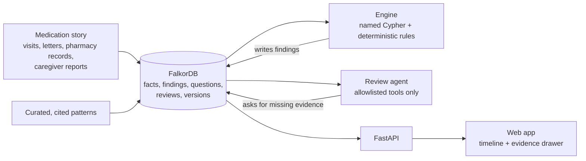

# FirstDomino

**Find the first domino in a medication story.**

FirstDomino reconstructs a patient's medication story across visits, finds **possible** prescribing
cascades from a small set of curated, cited patterns, and asks for the missing evidence a clinician
needs to review them.

> A prescribing cascade happens when a side effect of one medicine is mistaken for a new condition and
> treated with a second medicine. A classic example: a calcium-channel blocker such as amlodipine can
> cause ankle swelling, which is then treated with a loop diuretic such as furosemide.

Built for **Graph Hacks** (WeMakeDevs x FalkorDB, 15-18 Oct 2026).

> [!IMPORTANT]
> **All patient data in this repository is synthetic.** FirstDomino is a hackathon prototype, not a
> medical device. Findings are *possible patterns for a clinician to review*, never conclusions about
> causes, and never advice to change a medicine.

## Who it's for

| Role | What they do |
|---|---|
| **Pharmacist** (primary user) | Runs the medication review and works through the findings |
| **Caregiver** | Supplies facts: when the swelling started, what the doctor said |
| **Clinician** | Decides. Every decision is recorded against the exact revision it was made on |

## How it works



- **FalkorDB holds everything**: every fact, finding, question and review, with versions. One graph
  per family, and every traversal starts from `Patient {id: $pid}`.
- **Facts carry their certainty.** Each one is `documented`, `reported` (by the caregiver),
  `conflicting` or `unknown`, and has both `happened_at` and `recorded_at`. An answer of
  `not_available` is never treated as "no".
- **Deterministic code decides findings.** Named Cypher queries gather the facts and tested Python
  rules set the status. The language model never creates findings: it only picks allowlisted actions
  and phrases text around evidence IDs it was given.
- **Nothing is overwritten.** When evidence changes under a reviewed finding, a new revision is
  created with status `needs_reassessment`, and the clinician's decision stays on the revision it was
  made on. Stale writes are rejected with HTTP 409, and re-sending the same evidence event is harmless.

Finding statuses: `candidate` · `needs_evidence` · `competing_explanation` · `needs_reassessment` ·
`reviewed` · `not_matched`. None of them means "caused".

## Demo stories

Three synthetic patients, all on the same pattern (amlodipine, then ankle swelling, then furosemide):

| Patient | Story | Finding |
|---|---|---|
| `syn-p1` | Nobody recorded why furosemide was started | `needs_evidence`: asks the caregiver for the reason |
| `syn-p2` | A discharge summary documents a different reason (new heart failure) | `competing_explanation`: shown side by side, not dismissed, and the prescriber is never called mistaken. A different reason that is only reported by the caregiver gives the same status, labelled as reported |
| `syn-p3` | A clinician reviewed revision 1; a GP note now moves the swelling onset from day 28 to day 14. Atorvastatin is in no pattern | Confirming the correction creates revision 2, `needs_reassessment`, and keeps the decision on revision 1. Editing atorvastatin re-evaluates nothing and creates no revision |

## Quick start

Requirements: Docker. For local development: Python 3.11 with [uv](https://docs.astral.sh/uv/), and Node 20.

```bash
docker compose up --build
```

No `.env` is needed for the demo. If you copy `.env.example` to `.env`, note that its
`NEXT_PUBLIC_DATA_SOURCE=fixtures` also switches the Docker web build to fixture mode.

| Service | URL |
|---|---|
| Web app | http://localhost:3001 |
| API (OpenAPI docs at `/docs`) | http://localhost:8000 |
| FalkorDB Browser (connect to `localhost:6379`) | http://localhost:3000 |

```bash
curl localhost:8000/health
curl localhost:8000/patients
curl localhost:8000/patients/syn-p1/timeline
```

### Local development

| Task | With `make` | Without `make` |
|---|---|---|
| Start everything | `make up` | `docker compose up -d --build` |
| Stop | `make down` | `docker compose down` |
| API with reload | `make dev-api` | `uv run uvicorn api.main:app --reload --port 8000` |
| Web with reload | `make dev-web` | `cd web && npm install && npm run dev` |
| Tests | `make test` | `uv run pytest` and `cd web && npm run typecheck` |
| Tests in the API container (graph mode) | `make test-stack` | `docker compose --profile test run --rm --build api-test` |
| Restart FalkorDB + API, check nothing is lost | `make test-restart` | `FD_API_URL=http://localhost:8000 FD_STACK_RESTART=1 uv run pytest tests/test_stack.py` |
| Lint | `make lint` | `uv run ruff check .` and `cd web && npm run lint` |
| Seed the graph | `make seed` / `make reseed` | `uv run python -m engine.loaders.seed [--reset]` |
| Regenerate web fixtures | `make snapshots` | `uv run python -m api.snapshots` |

The web app reads data through one adapter, `web/lib/api.ts`:

- `NEXT_PUBLIC_DATA_SOURCE=fixtures` (the default for `npm run dev`) serves saved API responses from
  `data/snapshots/fixtures.json`, so the UI works without a backend.
- `NEXT_PUBLIC_DATA_SOURCE=live` calls the API at `NEXT_PUBLIC_API_URL`. Docker Compose uses this.

In Docker Compose the API runs with `FD_STORE=graph`: FalkorDB holds every fact, version, finding,
revision, decision and evidence event, and survives a restart of either container (append-only file
on the `falkordb_data` volume). `uv run uvicorn …` without `FD_STORE` serves the in-memory fixtures.

> [!NOTE]
> If `next build` fails with `<Html> should not be imported outside of pages/_document`, your shell
> has `NODE_ENV=development` set. Build with `NODE_ENV=production npm run build`
> (PowerShell: `$env:NODE_ENV="production"; npm run build`).

## Repository layout

```
api/        FastAPI (Python 3.11, uv). models.py = contract types, graph_store.py = FalkorDB,
            store.py = fixture stub, main.py = routes
engine/     queries/*.cypher (named, parameterised), cypher.py, rules.py, loaders/
agent/      the bounded review agent and its tool allowlist
web/        Next.js 15, TypeScript, Tailwind, shadcn/ui, framer-motion
data/       patterns/ (cited), stories/ (synthetic fixtures), snapshots/, cases/
docs/       data-model.md, api.md
mcp/        reserved for an MCP server over the same graph
tests/      API behaviour and contract guards
```

## API

| Method | Path | Purpose |
|---|---|---|
| `GET` | `/health` | Service status |
| `GET` | `/patients` | Synthetic patients |
| `GET` | `/patients/{id}/timeline` | Episodes, observations, sources, pending evidence |
| `GET` | `/patients/{id}/findings` | Findings with status and revision |
| `GET` | `/findings/{id}/investigation` | Documented facts, conflicts, unknowns, next question, sources, query trace |
| `POST` | `/patients/{id}/evidence` | Add or correct a fact. 200 with before/after, 409 if `case_version` is stale |
| `POST` | `/findings/{id}/review` | Record a pharmacist or clinician decision on a revision |
| `GET` | `/patients/{id}/packet` | Review packet for the clinician |
| `POST` | `/sandbox/reset` | Restore the demo data |

Full request and response examples: [docs/api.md](docs/api.md). Graph labels, relationships and
queries: [docs/data-model.md](docs/data-model.md).

Live: web app https://firstdomino-web.vercel.app (Vercel), API https://api-production-b29f.up.railway.app
(Railway). How both are deployed: [docs/deploy.md](docs/deploy.md).

## Status

| Piece | State |
|---|---|
| Contract types (Python + TypeScript), docs, synthetic stories | Done |
| API on FalkorDB: timeline, findings, investigation, packet | Done |
| Evidence writes on FalkorDB: fact versions, 409 on stale `case_version`, idempotent `event_id`, re-evaluation of affected findings only, revision history | Done |
| Review decisions on FalkorDB, kept on their revision | Done |
| Stories 2 and 3 on FalkorDB with golden tests (`tests/test_golden.py`) | Done |
| Questions and agent steps: `POST /questions`, `POST /agent-steps`, `GET /patients/{id}/agent-steps` | Done |
| Docker Compose (FalkorDB, API in graph mode, web) | Done |
| Named Cypher queries, checked against FalkorDB | Done |
| Web workspace: Medication River, investigation drawer, review history, interface states | Done (fixture and live modes) |
| Graph loader and finding rules | Done |
| Review agent: six allowlisted tools, `POST /findings/{id}/review-agent`, LLM checks with template fallback | Done |
| Printable packet (`/packet/{id}`), first-visit guide | Done |
| MCP server | Planned |

## Guardrails

- Every Cypher query is a named, parameterised file, and every traversal starts from the patient.
- Every ID is scoped to its patient, and every date is a day number.
- Copy never says "safe", "stop taking", "cleared" or "caused by". A test scans the data, API, agent
  and web code for those words.
- Patterns are curated and cited. Side effects extracted from drug labels are drafts for review, never
  automatic knowledge. Adverse-event report counts are not used as evidence weights.

## Team

| Area | Owner |
|---|---|
| Engine, API | Dev |
| Web, agent | Ajay |
