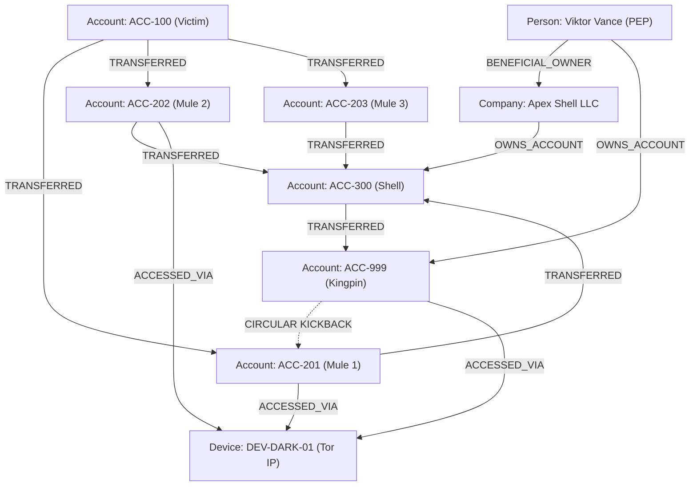

# 🛡️ SentinelGraph: Autonomous Connected-Data Fraud Hunter

> **Submission for Graph Hacks: Context for AI Agents (WeMakeDevs & FalkorDB)**  
> **Track:** **Track 01 — Agents That Act on Connected Data**  
> **Primary Graph Database:** FalkorDB (FalkorDB Cloud)  
> **AI Reasoning Model:** Gemini 2.5 Flash via Function Calling  

---

## 📌 Executive Summary

Traditional fraud detection engines fail when dealing with layered money laundering and synthetic identities. Isolated record queries only observe individual \$4,900 transfers, completely missing organized criminal syndicates.

**SentinelGraph** is an autonomous AI financial crime agent where **FalkorDB is not a passive data store, but the core context engine driving every step of the decision loop**. The agent traverses multi-hop transaction topologies, executes cycle detection to catch layering kickbacks, identifies shared hardware fingerprints across Tor nodes, and actively mutates the graph to quarantine criminal syndicates—producing an explainable, end-to-end evidence audit dossier.

---

## 🎯 Track 01 Alignment Checklist

- [x] **Multi-Hop Reasoning**: Autonomous traversal across 1 to 4 degrees of separation to expose layered mule dispersal.
- [x] **Graph Queries & Algorithms as Tools**: Cypher queries, cycle-detection path matching, and graph topological centrality exposed directly as LLM agent tools.
- [x] **Model Context Protocol (MCP) / Tool Calling**: Structured tool definitions invoked dynamically during reasoning.
- [x] **Real-World Graph Actions**: Agent actively writes back to FalkorDB, mutating node statuses to `FROZEN` and recording quarantine timestamps.
- [x] **Explainable Results**: Every action is accompanied by an audit dossier detailing the exact node-edge traversal chains.

---

## 🏛️ Graph Data Model (FalkorDB Schema)

### **Nodes**
* `(:Account {id, owner, balance, risk_score, status, freeze_reason, quarantined_at})`
* `(:Person {id, name, jurisdiction, flagged_pep})`
* `(:Company {id, name, reg_number, jurisdiction})`
* `(:Device {id, ip, mac_hash, user_agent})`

### **Relationships**
* `(:Company)-[:OWNS_ACCOUNT]->(:Account)`
* `(:Person)-[:OWNS_ACCOUNT]->(:Account)`
* `(:Person)-[:BENEFICIAL_OWNER {shares}]->(:Company)`
* `(:Account)-[:ACCESSED_VIA {last_login}]->(:Device)`
* `(:Account)-[:TRANSFERRED {tx_id, amount, timestamp}]->(:Account)`



---

## ⚙️ Key Cypher Queries & Graph Tools

### 1. Multi-Hop Outbound Traversal
```cypher
MATCH path = (start:Account {id: $account_id})-[t:TRANSFERRED*1..4]->(dest:Account)
RETURN [n in nodes(path) | {id: n.id, owner: n.owner, status: n.status}] AS path_nodes,
       [r in relationships(path) | {tx_id: r.tx_id, amount: r.amount, timestamp: r.timestamp}] AS transfers,
       length(path) AS hops
ORDER BY hops ASC
```

### 2. Circular Flow & Kickback Detection (Cycles)
```cypher
MATCH path = (a:Account {id: $account_id})-[:TRANSFERRED*2..5]->(a)
RETURN [n in nodes(path) | n.id] AS cycle_account_ids,
       [r in relationships(path) | {tx_id: r.tx_id, amount: r.amount}] AS cycle_transfers,
       length(path) AS loop_length
```

### 3. Shared Infrastructure & Hidden Beneficial Ownership Clustering
```cypher
MATCH (a:Account)-[:ACCESSED_VIA]->(d:Device)<-[:ACCESSED_VIA]-(b:Account)
WHERE a.id IN $account_ids AND a.id <> b.id
RETURN a.id, b.id, d.id, d.ip, d.user_agent
```

### 4. Active Graph Quarantine Mutation (Agent Action)
```cypher
MATCH (a:Account)
WHERE a.id IN $compromised_accounts
SET a.status = 'FROZEN',
    a.freeze_reason = $reason,
    a.quarantined_at = timestamp()
RETURN a.id, a.owner, a.status
```

---

## 🚀 Quickstart & Local Setup

### 1. Clone & Setup Virtual Environment
```bash
git clone https://github.com/<your-username>/sentinel-graph.git
cd sentinel-graph
python3 -m venv .venv
source .venv/bin/activate
pip install -r requirements.txt
```

### 2. Configure Environment (`.env`)
```bash
cp .env.example .env
# Edit .env with your FalkorDB host, port, password, and GEMINI_API_KEY
```

### 3. Ingest Synthetic Graph Data
```bash
python seed_data.py
```

### 4. Launch Autonomous Investigation (CLI or Web UI)
* **CLI Mode:**
  ```bash
  python agent.py
  ```
* **Interactive Web Dashboard:**
  ```bash
  uvicorn app:app --port 8000 --reload
  ```
  Open `http://localhost:8000` to interact with the live graph canvas and launch the agent.

---

## 🤖 AI Disclosure (Hackathon Rule #11)

In compliance with Rule #11: AI coding assistants (Google Antigravity) were used for boilerplate scaffolding and graph visualization integration. All graph schemas, Cypher logic, agent decision flow, and architectural implementations were authored and verified for the hackathon.
