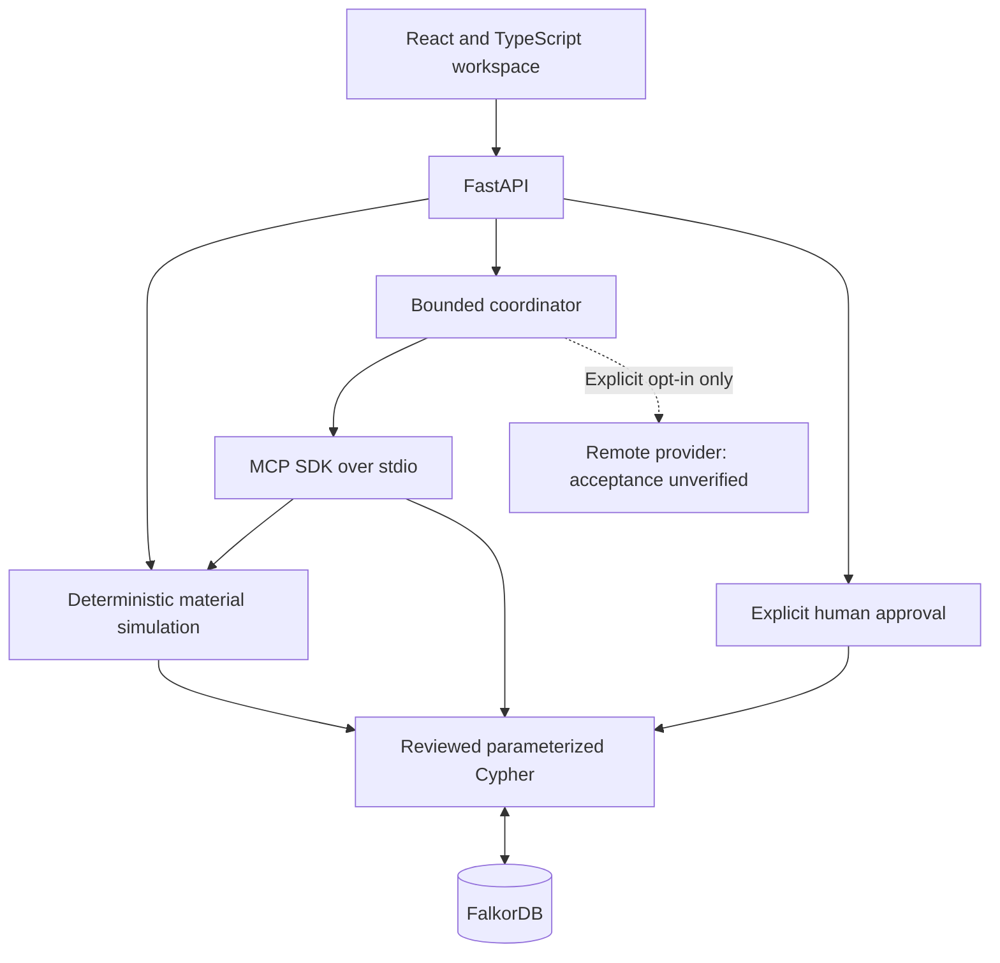

# RippleProof AI

**Explain supplier outages, compare feasible recovery plans, and trace every
recommendation to connected evidence in FalkorDB.**

Built by **MORVE** for **Graph Hacks 2026 — Track 1: Agents That Act on Connected Data**.

### [Watch the three-minute demonstration](https://youtu.be/ttOWMdWxIPU)

The authentic, silent English-captioned demo uses a synthetic supply chain and
genuine MCP tools. **Guided MCP follows a deterministic sequence with zero remote
LLM calls. Real remote LLM acceptance has not been verified.**

## From an outage to an explainable decision

An operations planner needs to know which orders lose material coverage when a
supplier stops shipping, which alternatives qualify, and what recovery costs.
RippleProof connects suppliers, parts, bills of materials, orders, inventory,
inbound shipments and dated certifications, then computes the consequences.

| Capability | What the application does |
| --- | --- |
| Trace dependencies | Return actual supplier → part ← product ← order paths and source properties |
| Simulate disruption | Calculate complete order requirements and allocate shared inventory and receipts once |
| Evaluate suppliers | Enforce lead times, booked daily capacity and every required certificate on arrival |
| Compare recovery | Show baseline, disrupted and mitigated coverage with Decimal procurement costs |
| Inspect MCP execution | Display real SDK stdio tool calls, arguments, evidence and output hashes |
| Retain reviewed decisions | Recalculate a preview, require explicit human approval, and store linked Decision/Evidence in FalkorDB |

<details>
<summary>View the working application</summary>


An authentic local application capture; results are calculated from FalkorDB.

</details>

## Why FalkorDB is essential

FalkorDB is the canonical store for operational facts and decision memory.
Reviewed, parameterized Cypher returns coherent facts and multi-hop evidence.
The deterministic Python engine computes quantities, timing, eligibility and
cost; an optional bounded agent selects constrained tools. Removing the graph
causes explicit failures. There is no parallel knowledge database or fixture
fallback in the application.



The React/Vite frontend uses TanStack Query, Zod and Cytoscape.js. Unprivileged
Nginx proxies same-origin requests to FastAPI. See the [architecture](docs/ARCHITECTURE.md),
[graph model](docs/GRAPH_MODEL.md) and [MCP/security boundaries](docs/SECURITY.md).

## Run locally with Docker

Requires Docker Desktop with Linux containers, or Docker Engine with Compose v2.
No API key, host Python or host Node is required to run the application.

```sh
git clone https://github.com/HIZMALI/rippleproof-ai.git
cd rippleproof-ai
docker compose up --build -d --wait
```

**Only for a fresh, empty demo graph**, initialize the synthetic data:

```sh
docker compose exec backend python -m rippleproof.seed
docker compose exec backend python -m rippleproof.migrate
```

**For an existing populated installation, skip both commands.** The base seed
restores fixture properties; it is not an upgrade command. An explicitly required
base-only graph upgrade uses the additive migration alone. Nothing seeds on startup.
Keep the `graph-data` volume: it stores FalkorDB AOF data at `/var/lib/falkordb/data`.
Do not delete volumes or reseed to troubleshoot an existing installation.

| Local service | Address |
| --- | --- |
| Application | [127.0.0.1:18080](http://127.0.0.1:18080/#/overview) |
| FastAPI / interactive API reference | [127.0.0.1:18000/docs](http://127.0.0.1:18000/docs) |
| Health / OpenAPI | `/health` and `/openapi.json` on the API origin |
| FalkorDB | `127.0.0.1:6379` |

Ports bind to loopback. Images use manifest digests; Python versions and npm's
lockfile are pinned. Compose works without `.env`; if needed, copy `.env.example`
only when `.env` does not already exist. Change `WEB_PORT`, `API_PORT` or
`FALKORDB_PORT` for port conflicts. Inspect `docker compose ps` and service logs
for startup failures. These addresses are local; no public deployment is claimed.

## Reproduce the reference scenario

Open **Scenario Workbench** and run S-04 with as-of **2026-10-15**, outage start
**2026-10-16**, exclusive end **2026-10-24**, and mitigation enabled.

| Actual synthetic result | Value |
| --- | ---: |
| Baseline material coverage | 19 of 21 open orders |
| Disrupted material coverage | 18 of 21 |
| Mitigated material coverage | 20 of 21 |
| Gross additional procurement cost | 1,364.00 synthetic cost units |

The fixture has 145 operational nodes and 291 relationships, including 82 inbound
shipments. O-105 and O-106 become newly at risk and are restored. S-09 qualifies
for P-22; S-10 lacks C-02 for P-22 but can qualify for P-12. The dependency path
`S-04 → P-22 ← PR-05 ← O-101` requires 32 P-22 units; O-101 remains covered.
Reachability and material shortage are distinct. Coverage is not a delivery
guarantee; prices and entities are synthetic. [Demo walkthrough](docs/DEMO.md).

## Query the evidence

This is the executable `IMPACT_PATHS` template from [queries.py](rippleproof/queries.py):

```cypher
MATCH evidence = (supplier:Supplier {id: $supplier_id})
  -[:SUPPLIES {is_primary: true}]->(part:Part)
  <-[:USES]-(product:Product)<-[:CONTAINS]-(purchase_order:Order)
WHERE purchase_order.status = $order_status
RETURN evidence
ORDER BY purchase_order.id, part.id, product.id
```

```sh
curl "http://127.0.0.1:18000/api/impact-paths?supplier_id=S-04"
```

Use `curl.exe` in Windows PowerShell if `curl` is an alias. User-supplied IDs
are validated parameters; no raw Cypher endpoint exists. More [actual queries
and algorithms](docs/CYPHER_AND_EVIDENCE.md), [API examples](docs/REFERENCE_API.md).

## Run tests

With the Compose graph running:

```sh
docker compose --profile test build tests
docker compose --profile test run --rm -e RIPPLEPROOF_RETAIN_TEST_GRAPHS=1 tests
```

The backend suite includes unit tests, mocked-provider transport tests and real
FalkorDB integration tests using unique isolated graphs. Remote providers are
never contacted by tests. For frontend development, use Node 22.12+:

```sh
cd frontend
npm ci
npm test
npm run typecheck
npm run lint
npm run build
```

[Testing instructions and executed results](docs/TESTING.md) cover the full
backend/browser suites, accessibility, isolated approval tests and a fresh
Docker installation. Browser regressions briefly restart their selected Compose
backend; use an isolated stack as documented.

## Limits and safe operation

- Materials-only feasibility and bounded greedy policies; no global optimum,
  factory schedule or delivery guarantee.
- Six read-only MCP tools; no unrestricted Cypher, purchase or approval tool.
  Guided mode is deterministic. The optional remote provider is disabled by
  default; bounded orchestration is implemented, external acceptance unverified.
- Human approval records an internal plan. It places no purchase, reserves no
  stock and contacts no supplier. Credentials stay server-side or in a transient
  manual approval field, never in the frontend bundle or browser storage.
- This one-worker localhost demo is not hardened for public hosting. The approval
  lock does not exclude external graph writers between validation and write.
  Resource bounds do not impose a monetary spending cap. See [security](docs/SECURITY.md).

## AI-assisted development

OpenAI Codex assisted with implementation, synthetic fixtures, tests,
documentation, local verification and demo preparation during Graph Hacks 2026.
The human participant directed scope and reported reviewing the phased work;
they remain responsible for understanding, explaining and validating the code
and this disclosure. No independent human audit or verified remote-agent run is
claimed. Controlled model tests are explicitly distinguished from remote LLM calls.

## Rights

Copyright © 2026 Mert Hızmalı. All rights reserved. [Project rights](RIGHTS.md).
Public visibility does not grant an open-source license for the original code.
Preserve [third-party notices](THIRD_PARTY_NOTICES.md) and their applicable terms,
including the distinction between the SSPLv1 FalkorDB server and MIT Python client.
