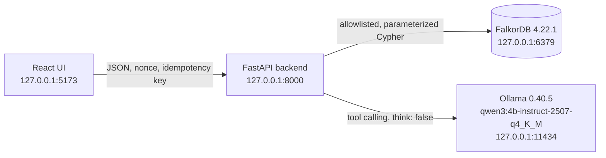

# Campaign Context Agent

When an influencer drops out of a campaign, an agency has to find a replacement it can defend: available on the delivery dates, inside the budget, with an exact fee quote, no exclusive deal with a competitor of the client, and not someone the team already turned down. This app does that job with a **local AI agent over FalkorDB**. The model chooses which tools to call; code checks every rule against graph evidence; a person approves.

- **Graph Hacks (FalkorDB), Track 01: Agents That Act on Connected Data.**
- Runs entirely on one machine: FalkorDB in Docker, a local Ollama model, a FastAPI backend and a React UI, all on 127.0.0.1. No paid service, cloud model or API key.
- All people, brands, agreements and fees are **fictional demo data**.

## What the demo shows

1. Pick a campaign whose creator dropped out (for example *Luma Autumn Launch*).
2. Ask the agent: "Find a replacement for this campaign and explain any conflicts." The local model calls allowlisted tools; FalkorDB answers; code decides eligibility and ranks by fee, then completed campaigns, then ID.
3. Every candidate shows a status, reasons and evidence. Tara Reed is cheapest but ineligible, and the evidence drawer draws why: *Tara Reed → exclusive agreement → Noro Glow → COMPETES_WITH → Luma Skin → RUNS → Luma Autumn Launch*, each step with its source document.
4. Reject a creator for this campaign or for the whole brand. The decision is saved in the graph and still applies in a new session.
5. Edit a fictional fact in the demo editor (end Tara's agreement before the campaign). A new source version is written and earlier results are marked stale.
6. Run again: Tara now ranks first and the agent stages a draft. Approving it re-checks every rule and the revision in one atomic write; the slot fills. Nothing is sent to anyone.

"Rule check (no AI)" evaluates candidates without the model, and the UI labels that result as such.

**Demo video:** the link will be added after recording. To run the same demo yourself, follow [DEMO_RUNBOOK](docs/DEMO_RUNBOOK.md).

## Architecture



- **The model never writes Cypher.** It can call five tools: `get_campaign_requirements`, `evaluate_candidates`, `get_candidate_evidence`, `get_previous_decisions` and `stage_replacement_proposal`. The backend runs queries from a fixed catalog and injects the campaign and run context itself.
- **Code decides.** Nine checks run per creator: roster, exact offer, quote dates, budget, availability, agreement audit, competitor map, competitor conflict and remembered rejections. Each check is pass, fail, unknown or not applicable. Missing, stale (older than 30 days), unverified or conflicting evidence is "Needs information", never treated as clear. Status precedence is ineligible, then unknown, then excluded by memory, then eligible.
- **The answer is validated.** After the tool loop, the model returns schema-constrained JSON. Its recommendations must be a prefix of the server's ranking, and every reason must exist in that creator's checks. The backend writes the summary from those validated fields. A run is capped at 8 turns, 12 tool calls and 180 s, and it can be cancelled.
- **Only a person approves.** Approval re-evaluates the candidate, checks the expected revision and the draft's revision, and writes the decision, the slot and a receipt in one compare-and-set statement. Retries with the same idempotency key replay instead of writing twice.

More detail: [ARCHITECTURE](docs/ARCHITECTURE.md), [AGENT_WORKFLOW](docs/AGENT_WORKFLOW.md), [API_CONTRACTS](docs/API_CONTRACTS.md), [DECISIONS](docs/DECISIONS.md).

## Graph model

The seeded demo graph (`demo_v1`) has 116 nodes and 127 relationships:

| Node | Count | Main relationships |
| --- | --- | --- |
| Workspace | 1 | `HAS_BRAND`, `HAS_CREATOR` |
| Brand | 5 | `RUNS` → Campaign; `COMPETES_WITH` ↔ Brand (stored once, read in either direction) |
| Creator | 12 | `OFFERS` → Offer; `HAS_AVAILABILITY` → Availability; `HAS_AGREEMENT` → Agreement; `HAS_AUDIT` → Audit; `PARTICIPATED_IN` → Campaign |
| Campaign | 8 | Budget, delivery window, deliverable, language, category, dropped-out creator |
| Offer, Availability, Agreement | 12, 13, 3 | `Agreement -WITH_BRAND→ Brand`; each fact `SUPPORTED_BY` a Source |
| Audit | 13 | Agreement-completeness audits (creators) and the competitor map (client brand) |
| Source | 49 | Fictional documents with version, observation date, checksum and attested fact hash; `SUPERSEDES` links edited versions |

The app also writes Session, Message, Run, Proposal, Decision and MutationReceipt nodes. They are linked by `HAS_SESSION`, `HAS_MESSAGE`, `HAS_RUN`, `CONSIDERED`, `USED_SOURCE`, `SELECTS`, `FROM_RUN`, `FOR_CAMPAIGN`, `APPROVES`, `IN_SESSION`, `REVOKES` and `HAS_RECEIPT`. A remembered rejection is a Decision with an explicit scope (this campaign or the whole brand) and a reason stored as a Source.

The competitor conflict is the path this database exists for:

```cypher
(:Creator)-[:HAS_AGREEMENT]->(:Agreement)-[:WITH_BRAND]->(:Brand)-[:COMPETES_WITH]-(:Brand)-[:RUNS]->(:Campaign)
```

Removing that `COMPETES_WITH` edge changes the answer: Tara becomes first (test T15). Full model: [GRAPH_MODEL](docs/GRAPH_MODEL.md).

## Queries the app depends on

Every query is a parameterized `.cypher` file in [`backend/app/queries/`](backend/app/queries/), loaded by ID. Read queries run as `GRAPH.RO_QUERY`.

| IDs | Purpose |
| --- | --- |
| `Q00` | Workspace revision and seed state; every evaluation reads it before and after (`STALE_CONTEXT` if it moves twice) |
| `Q01`–`Q05`, `Q04b` | Campaign constraints and roster, every creator with exact offers, availability windows, agreements with counterparty brands, the client's competitors, completeness and competitor-map audits |
| `Q06` | Remembered rejections and revocations scoped to this campaign or its brand |
| `Q07`, `Q07a` | Source documents and their version metadata, for evidence and integrity checks |
| `Q08` | Sessions, messages and runs; finalizing, ending and marking interrupted runs; idempotency receipts |
| `Q09`, `Q10` | Staging a draft from a running run; the atomic human approval |
| `Q11`, `Q12` | Rejections and revocations; versioned edits of agreements and availability |
| `Q13` | Read models for the UI (campaigns, sessions, runs, proposals, decisions, editable facts) |
| `SEED_*` | The idempotent fixture load (never overwrites, resumes after interruption) |

Query details and rationale: [GRAPH_QUERIES](docs/GRAPH_QUERIES.md).

## Run it locally (Windows)

These commands were verified in a fresh clone on 16 October 2026. Requirements: Docker Desktop, Python 3.11 or newer (tested with 3.13.3), Node 24 with npm 11, and Ollama 0.40.5. A GPU is optional (tested with an RTX 3050 4 GB). Expect about 4 GB of RAM plus page file to be in use while the model is loaded.

**1. Local model.** Cloud features are switched off; the backend also refuses non-loopback endpoints and cloud-tagged models.

```powershell
winget install Ollama.Ollama
[Environment]::SetEnvironmentVariable('OLLAMA_NO_CLOUD', '1', 'User')
[Environment]::SetEnvironmentVariable('OLLAMA_KV_CACHE_TYPE', 'q8_0', 'User')
# Quit Ollama from the tray and start it again so it reads these settings, then:
ollama pull qwen3:4b-instruct-2507-q4_K_M
```

Tested digest: `0edcdef34593eac1aa2be9c7d06c432dcf81945adca5eca2f27662c18f168ba0`. After restarting Ollama, make sure no old `llama-server.exe` is still running; on this machine an orphaned one held 4.6 GB of memory.

**2. FalkorDB**, pinned by digest, with data in the named volume `campaign_context_data` (append-only file, `everysec`):

```powershell
docker compose up -d
```

The FalkorDB browser is at http://127.0.0.1:3001.

**3. Backend.** Run from the project root:

```powershell
python -m venv .venv
.\.venv\Scripts\python.exe -m pip install -r backend/requirements.lock
.\.venv\Scripts\python.exe -m pip install --no-deps -e backend
.\.venv\Scripts\python.exe -m app.cli preflight
.\.venv\Scripts\python.exe -m app.cli seed --dataset demo_v1
.\.venv\Scripts\python.exe -m uvicorn app.main:app --host 127.0.0.1 --port 8000 --workers 1
```

`preflight` is read-only. It checks that the config is local-only, FalkorDB is reachable with its data on the volume and AOF on, the graph is seeded, and the model is installed. `seed` never overwrites an existing graph.

**4. Frontend.** Open http://127.0.0.1:5173 exactly; the API only accepts writes from that origin.

```powershell
npm --prefix frontend ci
npm --prefix frontend run build
npm --prefix frontend run preview
```

`npm --prefix frontend run dev` serves the same URL with hot reload, but needs more free memory.

**Before a demo.** Restore the demo graph to its starting state (an explicit command that accepts only the exact graph name), then warm the model with the backend's settings:

```powershell
.\.venv\Scripts\python.exe -m app.cli reset-demo --confirm campaign_context_demo
.\.venv\Scripts\python.exe -m app.cli seed --dataset demo_v1
Invoke-RestMethod http://127.0.0.1:11434/api/chat -Method Post -ContentType 'application/json' -Body '{"model":"qwen3:4b-instruct-2507-q4_K_M","messages":[{"role":"user","content":"Reply with OK."}],"stream":false,"think":false,"keep_alive":"30m","options":{"num_ctx":8192}}'
```

On Linux or macOS, use `.venv/bin/python` instead of `.\.venv\Scripts\python.exe`.

## Tests and verification

| Check | Command | Result (16 Oct 2026) |
| --- | --- | --- |
| Backend unit and integration tests | `.\.venv\Scripts\python.exe -m pytest backend/tests -q` | 342 passed in 38 s. Integration tests use real FalkorDB on disposable `campaign_context_test_*` graphs |
| UI unit tests | `npm --prefix frontend test` | 20 passed |
| Real-model scenarios (T08) | `.\.venv\Scripts\python.exe -m app.cli verify-model` | 6/6 pass with the real local model: baseline twice, memory, agreement change, no eligible candidate, prompt injection. Re-run after the review fixes; every run's report, including one that failed 4/6 before the last two fixes, is in [`docs/verification/`](docs/verification/) |
| Browser tests (T18 and UI actions) | `npx --prefix frontend playwright install chromium`, then `npm --prefix frontend run test:e2e` | 4 pass at 1280×720 with real agent runs (2.8 min). T18: campaign → run → evidence → reject → new session → changed result → edit → stale → run → approve. Also: cancelling a run, an editor that refuses to overwrite another tab's newer change, and revoking a rejection. Uses its own graph and ports (8001/5174) |
| Restart persistence (T14) | `.\.venv\Scripts\python.exe scripts/persistence_check.py` | Pass, 5/5, in a separate compose project. Also checked with the real backend and UI: backend restart, FalkorDB restart and container recreation keep approvals, rejections, sessions and runs |
| Local only (T17) | Connection sampling during real runs | Pass: 127 samples, no non-loopback connection; remote or cloud settings stop the backend from starting |
| Clean reproduction (T01, T19) | The setup above in a fresh clone | Pass: preflight 7/7, 329 tests, build and UI tests; no secrets or personal paths in tracked files |

The full ledger, with versions, timings and incidents, is in [PROGRESS](docs/PROGRESS.md).

**Performance on this laptop** (Ryzen 5 5600H, RTX 3050 4 GB, 5.9 GB RAM):

- Graph evaluation of all 12 creators: about 31 ms warm.
- A complete agent run (6 model turns, 4 tool calls): 34–60 s warm and 42 s from a cold model.
- Most of a run's time is the final schema-constrained answer.

## Limits

- **A prototype for one local operator.** It has one synthetic workspace, one replacement slot per campaign and no user accounts. Writes are guarded only by a local boundary: loopback host, origin allowlist, a per-process nonce and idempotency keys.
- **Demo time is fixed** at 15 Oct 2026, 17:30 IST, so source freshness is deterministic. Approval timestamps use the real clock.
- **A small model.** The 4B model chooses tools and words; it cannot change eligibility, ranking, facts or sources. On this hardware a run takes 30–60 s, and runs get slower when the machine is short of memory.
- **Narrow rules.** Availability windows are not merged: partial coverage is "Needs information". Only agreement and availability facts can be edited in the demo, and only for fictional data.
- **Nothing is booked.** Approval records an internal decision. Nothing contacts, books or pays a creator.

## AI assistance

Claude Code (Anthropic) wrote this implementation under the participant's direction, working from the specification in [docs/HANDOFF.md](docs/HANDOFF.md) and [PRD.md](PRD.md). One review by the OpenAI Codex CLI found 7 issues (5 critical); all are fixed with regression tests, as recorded in [REVIEW_CHECKLIST](docs/REVIEW_CHECKLIST.md). The running app uses only the local Ollama model. See [AI_USAGE](docs/AI_USAGE.md) for the disclosure, and [PARTICIPANT_NOTES](docs/PARTICIPANT_NOTES.md) for how each part works, with links into the code.

## Repository map

| Path | Contents |
| --- | --- |
| `backend/app/` | FastAPI app: `agent/` (Ollama adapter, tools, loop, runner, `verify-model`), `services/` (rules, evidence, memory, mutations, approvals), `queries/` (Cypher catalog), `routes/`, `cli.py` |
| `backend/tests/` | Unit tests and integration tests against real FalkorDB, plus a labelled TEST DOUBLE model for loop mechanics |
| `frontend/src/` | React UI; `api/schema.d.ts` is generated from `frontend/openapi.json` |
| `frontend/tests/` | The Playwright T18 browser flow |
| `data/synthetic/demo_v1/` | The fictional dataset and its 49 source documents |
| `docs/` | Specification, decisions, the progress ledger and verification reports |
| `scripts/` | Preflight smoke test, source generator, evaluation timer, persistence check, OpenAPI export, e2e backend |

## License

[MIT](LICENSE), copyright (c) 2026 Hemang Singh.

Dependencies are installed from the lock files under their own licenses. FalkorDB (the Docker image), Ollama and the Qwen3 model are used at runtime and are not redistributed in this repository.
