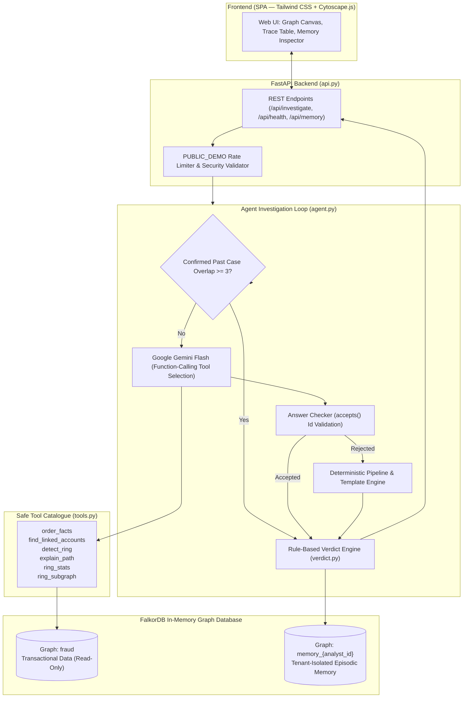
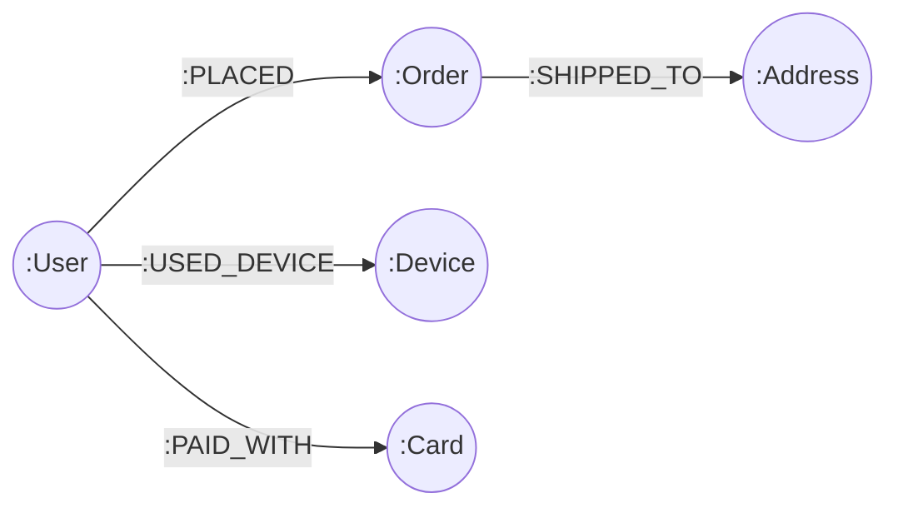
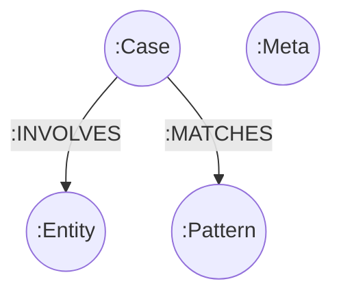

# RingWatch

> **An autonomous, graph-native fraud-ring investigation agent on FalkorDB that uncovers multi-hop syndicates, explains verdicts with verifiable graph paths, and learns from analyst feedback through isolated episodic memory.**

---

### Hackathon Submissions
- **Tracks Entered:**
  - **Track 01: Agents That Act on Connected Data**
  - **Track 02: Agent Memory and Coordination**
- **Project Links:**
  - **Live Application:** [<LIVE_URL>](<LIVE_URL>)
  - **Demo Video:** [<DEMO_VIDEO_URL>](<DEMO_VIDEO_URL>)
  - **Blog Post:** [<BLOG_URL>](<BLOG_URL>)

---

## 1. Problem & Core Idea

In e-commerce and fintech, sophisticated fraud rings operate across synthetic identities, mule accounts, shared physical devices, compromised credit cards, and drop shipping addresses.

When inspected **record-by-record** in conventional relational tables, each transaction appears normal:
- An order comes from an account with a reasonable order amount.
- The user uses a valid card and ships to an address.
- Traditional rules or single-row anomaly detectors miss the connection entirely.

**The RingWatch Idea:**
Fraud rings are relational by nature. RingWatch models every interaction as a graph in **FalkorDB**. When an order is flagged or reviewed, the agent explores multi-hop connections along shared devices (`:USED_DEVICE`), payment cards (`:PAID_WITH`), and shipping addresses (`:SHIPPED_TO`). It reconstructs the full syndicate topology, computes a deterministic risk score, evaluates analyst episodic memory, and visually renders the exact path of evidence.

---

## 2. Architecture



### Architectural Principles
1. **The LLM Never Writes Cypher:** Gemini only selects high-level tools from a fixed catalogue using typed function calling.
2. **The LLM Never Decides the Verdict:** Fraud verdict and risk scores are computed 100% deterministically by `verdict.py`.
3. **The LLM Writes Exactly One Sentence:** Gemini summarizes the evidence in plain language. If the sentence hallucinate IDs or makes unsupported claims, the rule checker rejects it and substitutes an auditable template.

---

## 3. Graph Data Model

### Fraud Knowledge Graph (`fraud`)


- **`:User`**: `id` (e.g. `u184`), `name`
- **`:Order`**: `id` (e.g. `o546`), `amount` (float), `flagged` (boolean)
- **`:Device`**: `id` (e.g. `dA1`, `d12`)
- **`:Card`**: `id` (e.g. `cB`, `c45`)
- **`:Address`**: `id` (e.g. `aB`, `a57`)

### Analyst Episodic Memory Graph (`memory_{analyst_id}`)
Each analyst has a strictly isolated FalkorDB graph. Cases, entities, and pattern statistics never mix across analysts.



- **`:Case`**: `id` (short uuid), `at` (ISO timestamp), `order_id`, `verdict`, `confidence`, `status` (`pending` | `confirmed` | `rejected`), `shape`
- **`:Entity`**: `id`, `kind` (`User`, `Device`, `Card`, `Address`, `Order`)
- **`:Pattern`**: `name` (`shared_device_chain`, `shared_card_ring`, `mixed`), `confirmed_count`, `rejected_count`
- **`:Meta`**: `created_at` (used for automated 24-hour cleanup of temporary visitor graphs)

---

## 4. Key Cypher Queries & Graph Algorithms

RingWatch leverages native graph operations in FalkorDB:

### 1. Variable-Length Traversal (`detect_ring` in `tools.py`)
```cypher
MATCH (start:User {id:$user_id})-[:USED_DEVICE|PAID_WITH*1..{max_hops}]-(other:User)
WHERE other.id <> $user_id
RETURN DISTINCT other.id AS member_id
```
> *Why a graph model naturally fits:* SQL can express multi-hop relationships with recursive Common Table Expressions (CTEs), but a graph traversal naturally handles variable-depth alternating hops (`:USED_DEVICE`, `:PAID_WITH`) and circular paths in a single Cypher expression without recursive join boilerplate.

### 2. Shortest Path Evidence Route (`explain_path` in `tools.py`)
```cypher
MATCH (a:User {id:$a}),(b:User {id:$b})
WITH shortestPath((a)-[:USED_DEVICE|PAID_WITH*..15]-(b)) AS p
RETURN p
```
> *Why a graph model naturally fits:* Native `shortestPath()` finds and returns the complete, ordered sequence of nodes and edges connecting two entities in a single query, directly supplying visual path evidence to the UI without client-side path stitching.

### 3. Weakly Connected Components (`find_rings` in `tools.py`)
```cypher
CALL algo.WCC({relationshipTypes:['USED_DEVICE','PAID_WITH']})
YIELD node, component
```
> *Why a graph model naturally fits:* WCC discovers all disjoint clusters platform-wide in linear time directly inside the database engine, avoiding the need to extract large adjacency lists into application memory.

### 4. Direct Shared Infrastructure (`find_linked_accounts` in `tools.py`)
```cypher
MATCH (u:User {id:$uid})-[:USED_DEVICE]->(d:Device)<-[:USED_DEVICE]-(o:User)
RETURN DISTINCT o.id AS user, d.id AS shared_entity, 'Device' AS kind
UNION
MATCH (u:User {id:$uid})-[:PAID_WITH]->(c:Card)<-[:PAID_WITH]-(o:User)
RETURN DISTINCT o.id AS user, c.id AS shared_entity, 'Card' AS kind
```
> *Why a graph model naturally fits:* Extracts direct 2-hop hardware and payment card intersections connecting suspect accounts in a single index-backed traversal.

### 5. Episodic Memory Recall (`recall_similar` in `memory.py`)
```cypher
MATCH (c:Case)-[:INVOLVES]->(e:Entity)
WHERE e.id IN $entity_ids
WITH c, count(DISTINCT e.id) AS overlap, collect(e.id) AS shared_entities
ORDER BY overlap DESC, c.at DESC
LIMIT 5
OPTIONAL MATCH (c)-[:MATCHES]->(p:Pattern)
RETURN c.id, c.at, c.order_id, c.verdict, c.confidence, c.status, c.shape,
       overlap, shared_entities, p.name, p.confirmed_count, p.rejected_count
```
> *Why a graph model naturally fits:* Calculates entity intersection counts across historical cases directly on the graph structure to rank prior human decisions by topological overlap.

---

## 5. What Breaks Without FalkorDB

While relational databases can model connected networks using joins and recursive CTEs, what FalkorDB makes concrete and natural is:
1. **Direct Path Evidence:** Native `shortestPath()` returns the complete, ordered sequence of nodes and edges in a single query; in SQL, reconstructing and ordering the full multi-table path for visual graph rendering requires custom procedural aggregation.
2. **Built-in Graph Algorithms:** Graph partitioning like Weakly Connected Components (`algo.WCC`) runs directly in-engine across the entire dataset in linear time, without exporting table dumps to external graph processing frameworks.
3. **Per-Tenant Memory in One Model:** Dynamic episodic memory graphs (`memory_{analyst_id}`) are created and queried on demand as first-class graphs alongside the fraud data, enabling topological overlap recall (`recall_similar`) without multi-tenant table partitioning or complex row-level joins.

---

## 6. The 4 Investigation Outcomes

Every order investigated returns one of four explicit, plain-language outcomes:

| Outcome | Plain Meaning | Agent Behavior |
|---------|---------------|----------------|
| **`path_found`** | **Network Discovered** | Discovered connected fraud ring across multiple graph hops. Displays Cytoscape graph with evidence path highlighted. |
| **`answered_from_memory`** | **Answered from Memory** | Matched confirmed case in analyst's private episodic memory. Boosts confidence and short-circuits LLM tool loop. |
| **`not_linked`** | **No Links Found** | No shared devices or cards detected. **Critical Note: "No links found does not mean the account is safe."** It only means no shared hardware or cards were discovered. |
| **`unknown_entity`** | **Unknown Entity** | Order ID does not exist in the database graph. Immediately returns 0 tool calls and saves no case. |

---

## 7. Deterministic Verdict Scoring Engine

Scoring is fully auditable and rule-based. Constants from [`verdict.py`](file:///c:/Users/manas/OneDrive/Documents/Projects/Ringwatch/verdict.py):

| Rule / Condition | Increment | Constant in `verdict.py` | Description |
|------------------|:---------:|--------------------------|-------------|
| **Base Ring Size** | **+35** | `SCORE_RING_SIZE_3` | Ring size (including order user) $\ge 3$ users |
| **Large Ring Size** | **+10** | `SCORE_RING_SIZE_6_MORE` | Additional boost if ring size $\ge 6$ users |
| **Shared Device** | **+10** | `SCORE_DEVICE_SHARED` | Device hardware fingerprint shared between users |
| **Shared Card** | **+10** | `SCORE_CARD_SHARED` | Payment card shared between multiple users |
| **Shared Address** | **+5** | `SCORE_ADDRESS_SHARED` | Shipping address shared by $\ge 3$ ring members |
| **Flagged Order Ratio** | **+20** | `SCORE_FLAGGED_SHARE` | Proportion of flagged orders in ring $\ge 30\%$ |
| **High Order Amount** | **+10** | `SCORE_AVG_AMOUNT` | Average order amount in ring $\ge \$3,000$ |
| **Confirmed Past Case** | **+15** | `SCORE_CONFIRMED_CASE_BOOST` | Overlapping confirmed case in analyst memory |
| **Rejected Past Case** | **-25** | `SCORE_REJECTED_CASE_PENALTY` | Overlapping rejected case in analyst memory |

### Verdict Rules & Clamping
- **`FRAUD_RING`**: Total Score $\ge 70$ (`THRESHOLD_FRAUD_RING`)
- **`SUSPICIOUS`**: Total Score $< 70$ (with at least one shared link)
- **`NO_LINKS_FOUND`**: Ring size $\le 1$ and no shared entities (Score: 0)
- **Score Range**: Clamped between `0` and `100`. When raw points exceed 100, the UI reports e.g. `100 (raw 105, capped)`.

---

## 8. Memory Architecture

RingWatch combines **episodic** and **semantic** memory:
1. **Episodic Memory (`:Case`)**: Captures complete historical investigation snapshots, timestamps, verdicts, confidence levels, and involved entities.
2. **Semantic Memory (`:Pattern`)**: Aggregates analyst confirmations and rejections to maintain counters for ring archetypes (`shared_device_chain`, `shared_card_ring`, `mixed`).
3. **Analyst Tenant Isolation**: Each analyst operates inside their own FalkorDB graph (`memory_a1`, `memory_visitor-xxxx`). One analyst's feedback never alters another analyst's scoring.
4. **Memory Short-Circuit Optimization**: When recall finds a **confirmed** past case sharing $\ge 3$ entities with the current order, the expensive LLM tool calling loop is completely bypassed in favor of two cheap verification checks. As directly measured in `demo_scenario.py`:
   - **Template mode (`python demo_scenario.py --no-llm`):**
     - Cold investigation (Step 2): **5 tool calls**, **164.86 ms** elapsed
     - Memory short-circuit (Step 3): **2 tool calls**, **88.47 ms** elapsed
     - Efficiency impact: **60% reduction in tool calls** (5 $\rightarrow$ 2) and a **46.3% latency reduction** (164.86 ms $\rightarrow$ 88.47 ms). The full 7-step demo scenario completes in **0.66 seconds**.
   - **Gemini mode (`python demo_scenario.py` with `gemini-flash-lite-latest`):**
     - Cold investigation (Step 2): **5 tool calls**, **14,037.63 ms** elapsed (multi-turn function-calling network round-trips)
     - Memory short-circuit (Step 3): **2 tool calls**, **106.61 ms** elapsed (bypasses LLM network calls entirely, querying local FalkorDB directly)
     - Efficiency impact: **99.2% latency reduction** (14,037.63 ms $\rightarrow$ 106.61 ms) and **60% fewer tool calls**. The full 7-step scenario completes in **22.77 seconds**.

---

## 9. Safety & Safeguard Design

- **Zero LLM-Generated Cypher:** LLM prompt injection cannot compromise or query the database. All Cypher queries are hardcoded and parameterized in `tools.py`.
- **Parameterization:** All queries use `$param` mappings; zero string concatenation or f-strings in queries.
- **Entity Resolution Safeguard:** `resolve(kind, id)` checks node existence before any tool executes.
- **Answer Checker (`accepts()`):**
  - Extracts all entity-like tokens (`u\d+`, `d\w+`, `c\w+`, `a\w+`, `o\d+`).
  - Verifies that every token appears in known tool results.
  - Rejects false linkage claims on unlinked accounts.
  - Automatically falls back to a deterministic template if rejected, logging the exact rejection reason.
- **Analyst ID Injection Protection:** Validates analyst IDs against `^[a-z0-9_-]{1,20}$` before creating or selecting any memory graph.
- **Public Demo Rate Limiting (`PUBLIC_DEMO`):** Enforces 20 LLM investigations/hour globally and 3/minute per IP, falling back cleanly to template mode with an explicit note.
- **Memory Graph Cap (`MAX_MEMORY_GRAPHS = 200`):** Protects FalkorDB from unbounded memory consumption. New analysts receive `"demo memory is full, try again later"` instead of errors.
- **Automated Memory Cleanup (`cleanup_memory.py`):** Automatically purges visitor graphs (`memory_visitor-*`) older than 24 hours using the stored `(:Meta {created_at})` timestamp.

---

## 10. Local Setup & Running

### Prerequisites
- Python 3.11+
- Docker (for local FalkorDB container)

### Step 1: Start FalkorDB
```bash
docker run -p 6379:6379 -it --rm falkordb/falkordb:latest
```

### Step 2: Install Dependencies
```bash
pip install -r requirements.txt
```

### Step 3: Seed Synthetic Knowledge Graph
```bash
python build_graph.py
```
*Expected output:* `[[1292]] [[1613]]` (1,292 nodes and 1,613 edges).

### Step 4: Run FastAPI Backend & UI
```bash
uvicorn api:app --reload
```
Open **[http://localhost:8000](http://localhost:8000)** in your browser.

### Environment Variables
Configure via `.env` file or environment:

| Variable | Default | Description |
|----------|---------|-------------|
| `FALKORDB_HOST` | `localhost` | FalkorDB server host |
| `FALKORDB_PORT` | `6379` | FalkorDB server port |
| `FALKORDB_USERNAME` | *None* | FalkorDB username (optional) |
| `FALKORDB_PASSWORD` | *None* | FalkorDB password (optional) |
| `FALKORDB_SSL` | `false` | Enable SSL/TLS (`true` for FalkorDB Cloud) |
| `GEMINI_API_KEY` | *None* | Google Gemini API Key (runs in template mode if omitted) |
| `GEMINI_MODEL` | `gemini-flash-lite-latest` | Gemini model name |
| `PUBLIC_DEMO` | `false` | Enable demo rate limits & visitor mode |
| `MAX_MEMORY_GRAPHS`| `200` | Maximum allowed memory graphs |

### FalkorDB Cloud Option
To connect to **FalkorDB Cloud**:
```env
FALKORDB_HOST=your-instance.falkordb.cloud
FALKORDB_PORT=your-port
FALKORDB_PASSWORD=your-password
FALKORDB_SSL=true
```

---

## 11. Test Suites & Demo

### Install Development & Testing Dependencies
To run browser UI verification tests with Playwright:
```bash
pip install -r requirements-dev.txt
python -m playwright install chromium
```

### Run Backend & Agent Test Suites
```bash
python test_api.py             # FastAPI endpoints, memory cap, cleanup, safeguards
python test_tools.py           # Cypher tools, variable hops, WCC components
python test_memory_verdict.py  # Episodic memory, feedback, scoring thresholds
python test_agent.py           # Agent loop, accepts() validation, memory recall
```

### Run End-to-End Browser UI Verification
Drives the application in a headless Chromium browser, testing 1-click examples, memory short-circuit, multi-tenant isolation, Cytoscape graph rendering, WCC rings, Join vs Graph traversal, and mobile responsiveness:
```bash
python ui_check.py
```

### Run Automated Demo Scenario
Runs an end-to-end interactive demo script in under 60 seconds:
```bash
python demo_scenario.py --no-llm
# Or with live Gemini agent:
python demo_scenario.py
```

---

## 12. Synthetic Data Structure

The dataset generated by `build_graph.py` contains **1,292 nodes** and **1,613 edges**:
- **200 Users** (`u0` to `u199`): `u0`–`u181` are normal users; `u182`–`u199` belong to planted rings.
- **600 Orders** (`o0` to `o599`): 546 normal orders (~2% false-positive flag rate) + 54 ring orders (~50% flagged).
- **101 Addresses** (`a0`–`a99` plus shared drop address `aB`).

### The Three Planted Fraud Rings
1. **Ring A (`u182`–`u187`) — Device Bridge Syndicate:**
   - 6 users sharing two devices: `dA1` (shared by `u182`, `u183`, `u184`) and `dA2` (shared by `u184`, `u185`, `u186`, `u187`).
   - `u184` acts as the bridge connecting both halves of the ring.
2. **Ring B (`u188`–`u192`) — Shared Card & Drop Address:**
   - 5 users sharing a single payment card `cB` and shipping drop address `aB`.
3. **Ring C (`u193`–`u199`) — Multi-Hop Daisy Chain:**
   - 7 users arranged in an alternating chain: `u193`-`dC0`-`u194`-`dC1`-`u195`-`dC2`-`u196`-`dC3`-`u197`-`dC4`-`u198`-`dC5`-`u199`.
   - Requires 12 graph hops to traverse from end to end. Demonstrates the difference between fixed 2-hop relational joins (which see 1 member) and variable-length graph traversals (which discover all 6 members).

---

## 13. Limitations & Honest Notes

- **Synthetic Data Calibration:** Scoring weights and thresholds were tuned on our synthetic topology. Real-world fraud operations require calibration against production fraud labels and class imbalances.
- **Address Normalization:** RingWatch matches addresses by exact node identifier (`id`). A production system would incorporate address geocoding, fuzzy string parsing, and postal validation.
- **Deterministic Supremacy:** The LLM does not make decisions; it summarizes findings. If Gemini service is unavailable or rate-limited, the system falls back seamlessly to deterministic rule templates.

---

## 14. Screenshots & Visual Assets

Visual artifacts are located in the [`docs/`](file:///c:/Users/manas/OneDrive/Documents/Projects/Ringwatch/docs) directory:
- `docs/ring-a.png`: Cytoscape visualization of Ring A showing `u184` bridging devices `dA1` and `dA2`.
- `docs/ring-c.png`: Interactive graph view of the 12-hop Ring C daisy-chain topology.
- `docs/memory.png`: Analyst memory tab displaying episodic cases, pattern stats, and confirmation history.
- `docs/mobile.png`: Full-page responsive layout at 390px mobile viewport width.

---

## 15. AI Disclosure & Credits

- **Claude (Anthropic):** Assisted with architectural planning, scenario design, and prompt design.
- **Antigravity (Google DeepMind):** Interactive agentic coding assistant for code generation, test authoring, and deployment hardening.
- **Gemini (Google):** Runtime function-calling agent for tool selection and single-sentence natural language synthesis.
- **Design Inspiration:** Architectural patterns inspired by FalkorDB's guide *"How to Build an Agent That Reasons Over a Graph"*.
