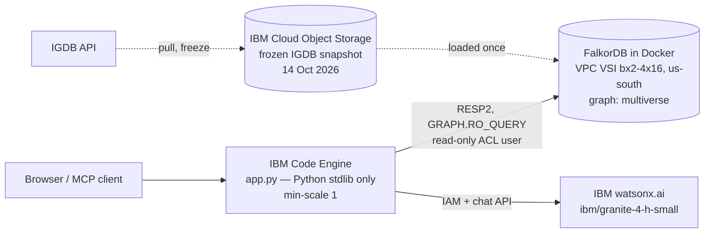

# Gaming Multiverse Reasoner


**Every game is connected.** Enter any two to four games and see the hidden paths, bridge nodes, and communities that join them — computed live in FalkorDB and narrated by IBM watsonx, with every claim verifiable by clicking it.

**Live demo:** https://multiverse.2fy1rnikhcll.us-south.codeengine.appdomain.cloud
**Agent surfaces:** [MCP server](https://multiverse.2fy1rnikhcll.us-south.codeengine.appdomain.cloud/mcp) · [llms.txt](https://multiverse.2fy1rnikhcll.us-south.codeengine.appdomain.cloud/llms.txt) · [OpenAPI](https://multiverse.2fy1rnikhcll.us-south.codeengine.appdomain.cloud/openapi.json) · [Licenses & full stack](https://multiverse.2fy1rnikhcll.us-south.codeengine.appdomain.cloud/licenses)

Built for **Graph Hacks** (WeMakeDevs × FalkorDB), Track 1 — Agents That Act on Connected Data.

## What it does

Pick games — say Elden Ring, Hades, Stardew Valley, and Baldur's Gate III — and the Reasoner finds how they connect: **24 paths in under 2 seconds**. Path types:

- **Direct lineage** — remakes, remasters, DLC, expansions, versions, shared collection/franchise parents
- **Company bridges** — a studio or publisher whose *other* games join the pair (degree-capped so giant publishers don't swallow the graph)
- **Similar-game chains** — shortest paths over IGDB's similarity graph
- **Common neighbours** — games IGDB lists as similar to both
- **Shared threads** — a genre, theme, or engine both games genuinely share

Click any path card, any narration claim, or any node, and that exact path lights up in the graph. A **Surprise me** slot machine picks four random games to prove it works for any set. Each game also shows its **community** — a cluster of kindred games discovered from the graph itself.

## Why a graph — and why FalkorDB

The core question — *how are these games connected?* — is a variable-depth path problem across many relationship types. In SQL it becomes a recursive CTE nobody wants to write or run interactively; in a search index it doesn't exist at all, because a bridge node is not a property of any game — it is a property of the **paths between a set of games**, and it only exists as a traversal result.

FalkorDB does the work here, live, on every query: `shortestPath` over the similarity graph, anchored single-hop expansions for company bridges (intersected in code — measured faster than one big pattern on this dataset), degree-aware hub suppression, all through `GRAPH.RO_QUERY` as a read-only user with a 5,000 ms graph timeout. There is no other data path: remove FalkorDB and the product has no answers. Every path card in the UI shows the actual Cypher that produced it.

**Hub suppression is the design decision that makes the answers mean something.** Without it, every pair of games "connects" through the platform *PC* or the genre *Adventure* — technically true, completely worthless. So platforms and game modes never appear in paths, and any genre, theme, or engine shared by more than 12,000 games is suppressed. The rule is stated in the app header, not hidden.

## Architecture



Four IBM services, one job each: Code Engine serves, the VSI hosts the graph, watsonx narrates, COS freezes the data. Region: us-south throughout.

## The graph

Data: IGDB, frozen 14 Oct 2026 — every game with a rating count (IGDB's entire rated population, 25,165) plus critic-only, hyped, newest, and similarity-frontier tiers, and the full QueerCade catalogue merged in. **50,217 games · 84,296 nodes · 1,023,292 relationships.**

| Nodes | Edges (selected) |
|---|---|
| Game (50,217) | SIMILAR_TO 465,364 · ON_PLATFORM 118,649 |
| Company (18k+) | HAS_GENRE 112,936 · HAS_THEME 67,322 · HAS_MODE 68,193 |
| Genre / Theme / GameMode | DEVELOPED_BY 41,385 · PUBLISHED_BY 50,905 |
| Engine (1,512) | HAS_ENGINE 19,023 · IN_COLLECTION 19,153 · IN_FRANCHISE 11,980 |
| Platform / Perspective / Collection / Franchise | Lineage: PART_OF 3,403 · REMAKE_OF 319 · REMASTER_OF 418 · DLC_OF 432 · EXPANSION_OF 454 · VERSION_OF 452 |

One node per company whether it developed or published — splitting those roles would split its paths too. Keywords were deliberately never pulled: they are hub poison.

## Key Cypher

Every answer is one of these traversals, run live via `GRAPH.RO_QUERY` as the read-only `app_reader` user, with a 5,000 ms graph timeout. Hot paths use anchored single-hop expansions intersected in code — measured much faster on this FalkorDB build than one large multi-type pattern. The same queries appear in `app.py` and under every path card in the UI.

**Similar-game chain** — shortest path over the similarity graph:

```cypher
MATCH (a:Game {igdb_id:$a}), (b:Game {igdb_id:$b})
WITH shortestPath((a)-[:SIMILAR_TO*..4]-(b)) AS p
UNWIND nodes(p) AS n RETURN n.igdb_id, n.name
```

**Direct lineage** — remake / remaster / DLC / expansion / version / part-of:

```cypher
MATCH (a:Game {igdb_id:$a})-[r:PART_OF|VERSION_OF|DLC_OF|EXPANSION_OF|REMAKE_OF|REMASTER_OF]-(b:Game {igdb_id:$b})
RETURN type(r), startNode(r).igdb_id
```

**Shared lineage parent** — both games connect to one parent game:

```cypher
MATCH (a:Game {igdb_id:$a})-[r1:PART_OF|VERSION_OF|DLC_OF|EXPANSION_OF|REMAKE_OF|REMASTER_OF]-(p:Game)-[r2:PART_OF|VERSION_OF|DLC_OF|EXPANSION_OF|REMAKE_OF|REMASTER_OF]-(b:Game {igdb_id:$b})
WHERE p.igdb_id <> $a AND p.igdb_id <> $b
RETURN p.igdb_id, p.name, type(r1), startNode(r1).igdb_id, type(r2), startNode(r2).igdb_id LIMIT 3
```

**Company bridge** — two degree-capped expansions (company degree cap 800), intersected in code; the games under a shared company are the bridge:

```cypher
MATCH (g:Game {igdb_id:$g})-[r]->(c:Company)
WHERE c.degree <= $cap
RETURN c.igdb_id, c.name, c.degree, type(r)
```

```cypher
MATCH (c:Company {igdb_id:$c})<-[r]-(m:Game)
WHERE m.igdb_id <> $a AND m.igdb_id <> $b
RETURN m.igdb_id, m.name, coalesce(m.rating_count, 0), type(r) LIMIT 999
```

**Shared threads & common neighbours** — the anchored neighbourhood expansion below runs for both games and the results are intersected in code. Genre, theme, and engine nodes above degree 12,000 are suppressed as hubs; platforms and game modes never appear in paths:

```cypher
MATCH (g:Game {igdb_id:$g})-[r]-(x)
RETURN labels(x)[0], x.igdb_id, x.name, x.degree, coalesce(x.rating_count, 0), type(r) LIMIT 9999
```

Communities come from weighted label propagation over SIMILAR_TO (mutual links ×2, one-way ×1, community size capped at 1,500), computed offline by `communities.py` and labeled as precomputed in the UI.

## How the AI works (and how it can't lie to you)

watsonx does one narrow job: **narrate**. It receives the paths FalkorDB returned and replies with claims as structured JSON, each claim citing the `path_id`s it describes. The app then validates every citation in code — a claim whose IDs are not in the returned path set is dropped, and you never see it. Clicking a surviving claim highlights its path. If watsonx is unavailable, the app falls back to template explanations generated from the same paths and labels them `template` — the badge always says which source you're reading.

Name resolution is deterministic (a ranked title index in code) — the model never picks which game you meant. Game text enters prompts only as data; the citation check would drop any claim built on smuggled instructions anyway, because it couldn't cite a real path.

## Honesty notes

- **Live:** all traversals, path ranking, and narration. Timings shown in the UI are the server's own measured milliseconds.
- **Precomputed (labeled):** communities — weighted label propagation over the similarity graph (mutual links weigh ×2, 1,500-member cap), 6,234 communities, computed at load time and labeled "precomputed" in the UI.
- **Cached:** nothing, for results. Every search hits the graph. The only frozen artifact is the IGDB snapshot itself (14 Oct 2026), stated in the header.
- **Inferred:** nothing. `SIMILAR_TO` is IGDB's own `similar_games` data; lineage edges are IGDB's factual relations. No invented influence edges.
- **Cut, on purpose:** a SQL benchmark panel, a density slider, and an influence template were in the plan and were cut in the pre-agreed order to protect the core flow. The why-not-SQL answer above is structural; the Cypher is on screen for every path.

## Agent surfaces & audits

- **MCP server** at `POST /mcp` (streamable HTTP, JSON-RPC 2.0): `resolve_game`, `find_paths`, `random_games`, `game_community`, `narrate` — other agents can reason over the same graph.
- **Silicon Friendly audit: 18/30** — full marks on discoverability; honest fails for server-rendered content, real 429 rate limiting, and Level-5 autonomy features a read-only query tool doesn't have.
- **Lighthouse accessibility: 100/100**, zero failing audits (WCAG 2.2 pass: combobox ARIA, live regions, keyboard-operable graph, reduced-motion support).

## Screenshots


## Run it yourself

You need a FalkorDB instance and IGDB (Twitch) credentials for the pull.

```bash
# 1. Pull and freeze the data (writes JSONL + manifest)
IGDB_CLIENT_ID=... IGDB_CLIENT_SECRET=... python3 igdb_pull.py
python3 igdb_topup.py && python3 igdb_topup_frontier.py && python3 igdb_queercade_merge.py

# 2. Load the graph and compute communities
FALKOR_HOST=... FALKOR_MASTER_PASSWORD=... python3 graph_load.py
python3 communities.py

# 3. Serve (stdlib only — no pip installs)
FALKOR_HOST=... FALKOR_MASTER_PASSWORD=... FALKOR_READER_PASSWORD=... \
IBM_API_KEY=... python3 app.py   # port 8080
```

The app self-heals its read-only FalkorDB user (`app_reader`) on boot. watsonx narration needs `WATSONX_SPACE_ID` (a deployment space associated with a Watson Machine Learning instance); without it, narration degrades to the labeled template fallback.

## Future work & business value

Roadmap, in the order the cuts were made: density tiers (watch paths multiply as the graph grows), an influence template over properly sourced edges only, and a fairly-benchmarked SQL comparison panel. The bridge node is the commercial insight in three markets: storefront discovery beyond "more of the same," publisher portfolio and gap analysis, and creator research into how games secretly relate — plus the MCP server makes the same reasoning available to other agents today.

## License & credits

Project code: MIT (see `LICENSE`). Data: IGDB (Twitch) — this is a fan/hackathon project, not affiliated with IGDB or the publishers named. Full third-party license inventory: [/licenses](https://multiverse.2fy1rnikhcll.us-south.codeengine.appdomain.cloud/licenses).

Built by Mike "Demo" Demopoulos for Graph Hacks 2026.
