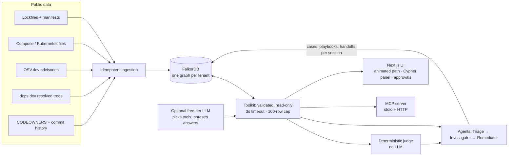

# Blastradius

**A supply-chain vulnerability triage agent whose brain is a FalkorDB graph.**
A new CVE drops. Blastradius answers: *are we affected, through which dependency path, who owns it, what did we decide last time, and what should we do?* Every answer is a graph traversal you can see, and the product stops working if you turn FalkorDB off.

Built for **Graph Hacks: Context for AI Agents** (WeMakeDevs × FalkorDB), entering **all three tracks**.

**Live demo: https://13-203-50-195.sslip.io** (small shared server; see [Hosted demo vs running it yourself](#hosted-demo-vs-running-it-yourself)). MCP endpoint: `https://13-203-50-195.sslip.io/mcp` (read-only).


<sub>A critical advisory traced hop by hop from the internet-exposed frontend to the vulnerable package. The right column is the case file: verdict, blast radius, owners, precedent, gated actions and every Cypher query. Light and dark themes follow your OS.</sub>

| Track | What Blastradius does |
|---|---|
| 1 · Agents That Act on Connected Data | Multi-hop traversals (`service → package → … → vulnerable package`), blast radius over a service call graph **discovered from the project's own Kubernetes/Compose files**, PageRank, a deterministic judge, human-gated action proposals, an **MCP server** and an LLM tool loop. |
| 2 · Agent Memory & Coordination | Episodic cases, procedural playbooks with derived success counts, three agents handing off through graph state, **one graph per tenant** and **per-session memory isolation**, plus a [concurrency benchmark](BENCH.md). |
| 3 · Company Brain | Ownership from CODEOWNERS, human expertise from commit history, dependency decisions **traced to the source commit**, `SUPERSEDES` edges marking stale knowledge. |

## Why a graph (and not a vector DB)
*"Does this CVE reach production?"* is a path query: advisory → package → dependency chain → service → caller chain → internet-exposed entry point. A similarity search can't prove a path exists, and it can't prove one doesn't. In a graph **"no path found" is evidence**, which is how Blastradius proves Log4Shell does not affect a Node/Go/Python stack, and how it finds it in a Java one through a dependency the manifest never names.

## What you can do
- **Guided demo.** One button plays the whole story with captions: critical CVE → animated traversal → approval → memory → the next advisory cites the precedent → proof by absence → company brain → tenant isolation.
- **Analyse any public GitHub repo.** Paste `owner/name`. Blastradius finds the manifests (`package-lock.json`, `go.mod`, `requirements.txt`, `pom.xml`, `build.gradle`, `Cargo.lock`), **resolves transitive dependencies through [deps.dev](https://deps.dev)** when the manifest only lists direct ones, queries [OSV](https://osv.dev) and builds a tenant graph. Try `christophetd/log4shell-vulnerable-app`: it finds Log4Shell through `app → spring-boot-starter-log4j2 → log4j-core@2.14.1`, a path no manifest parser can see.
- **Ask from your own AI client (MCP).** Point any MCP client at the hosted `https://<host>/mcp` (read-only), or run it locally over stdio. For Claude Desktop / Claude Code add:
  ```json
  { "mcpServers": { "blastradius": { "command": "<repo>/backend/.venv/Scripts/python.exe",
                                     "args": ["-m", "blastradius.mcp_server"], "cwd": "<repo>/backend" } } }
  ```
  Tools: `list_tenants`, `risk_board`, `triage_advisory`, `blast_radius`, `who_owns`, `service_brain`, and `record_decision` (local only; it is not registered on a public server).
- **Chat.** A tool-calling loop on a free Gemini key (`GEMINI_API_KEY`); with no key a deterministic router answers the same tools, so everything works at $0.
- **Know if the vulnerable function is actually called (Go).** For Go services, Blastradius brings in the official [`govulncheck`](https://go.dev/doc/security/vuln/) call-graph analysis: a vulnerable package is not a vulnerable *call*. The case file shows the real call stack (`shippingservice.main (main.go:99) → grpc.Server.Serve → … → http2.Framer.WriteContinuation`) or states that no call path exists, and a P0/P1 whose function is provably never called is demoted to P2 with the reason shown. Stored as `(Service)-[:REACHES {level, symbol, stack}]->(Advisory)`; the raw results are committed in the snapshot (`python -m blastradius.reach collect <tenant>` regenerates them in a Go container).
- **Let it notice on its own.** **Rescan OSV** (or `python -m blastradius.watch --all` from cron) re-queries every package, finds advisories published since the graph was built, writes them into the graph marked *new*, and triages them with the same judge.
- **Take the decision with you.** Approved decisions export as an **[OpenVEX](https://openvex.dev)** document (fixed / not affected with your rationale / risk accepted) from the Memory tab.
- **Stress it.** The Memory tab runs 10/50/100 concurrent agents against shared graph memory.

## Run it locally ($0, no accounts, works offline)
Requirements: Docker, Python 3.12+, Node 20+.

```bash
docker compose up -d falkordb                      # FalkorDB (browser UI on :3000)

cd backend
python -m venv .venv && .venv/Scripts/activate     # or: source .venv/bin/activate
pip install -r requirements.txt
python -m blastradius.build                        # builds both tenant graphs from the committed snapshot (offline, under a minute)
uvicorn blastradius.api:app --port 8000

cd ../web && npm install
echo NEXT_PUBLIC_API=http://localhost:8000 > .env.local
npm run dev -- -p 3001                             # http://localhost:3001
```
Everything in containers: `docker compose --profile seed run --rm seed && docker compose up -d --build`.

The data (lockfiles, deployment manifests, OSV results, commit metadata) is committed in [`backend/snapshot`](backend/snapshot) so graphs rebuild identically with no network; `python -m blastradius.build --snapshot` refreshes it after a networked build.

## Architecture

The LLM never sees a database credential and never writes Cypher. It can pick a tool and phrase the result; it **cannot change a verdict**. The verdict (`AFFECTED / NOT_AFFECTED / NEEDS_HUMAN`) comes from plain rules in [`triage.py`](backend/blastradius/triage.py).

## Graph data model
```
(Meta)  tenant title, repo, exposure_known, built_at
(Repo)-[:CONTAINS]->(Service)-[:CALLS]->(Service)               // CALLS and exposure are DISCOVERED from deployment files
(Service)-[:DEPENDS_ON {direct, dev}]->(Package)-[:DEPENDS_ON {dev}]->(Package)
(Advisory)-[:AFFECTS {fixed}]->(Package)        (Alias)-[:ALIAS_OF]->(Advisory)   // CVE-… ⇄ GHSA-…
(Owner {kind: team|person|bot})-[:OWNS]->(Service) ; (Owner)-[:COMMITTED {count,last}]->(Service)
(Commit)-[:TOUCHED]->(Service)
(Decision)-[:DOCUMENTED_IN]->(Commit) ; (Decision)-[:CONCERNS]->(Service|Package) ; (Decision)-[:SUPERSEDES]->(Decision)
-- memory, written by the agents, scoped by session --
(Case {sid, decision, rationale, actor, ts, reused})-[:ABOUT]->(Advisory) ; (Case)-[:IN]->(Service) ; (Case)-[:USED]->(Playbook)
(Run {sid})-[:HAS_STEP]->(Step {agent, tool, summary, ms}) ; (Step)-[:HANDS_OFF_TO]->(Step)
```

## The Cypher the product depends on
All in [`queries.py`](backend/blastradius/queries.py) and [`memory.py`](backend/blastradius/memory.py); the UI shows the exact query and latency for every step.

| Purpose | Technique |
|---|---|
| Path from every service to a vulnerable package | `shortestPath((s)-[:DEPENDS_ON*1..15]->(p))` per `(Advisory)-[:AFFECTS]->(Package)` |
| Blast radius / who calls this | variable-length `(c:Service)-[:CALLS*0..6]->(s)` |
| Is it reachable from the internet? | `shortestPath` from `Service {exposed:true}` over `CALLS` |
| Which services matter most | `CALL algo.pageRank('Service','CALLS')` |
| Precedent from memory | 3-hop `(Case)-[:ABOUT]->(Advisory)-[:AFFECTS]->(Package)` matched by package name, scoped to the session |
| Proof by absence / version outside range | empty traversal, plus `Package` presence by name to explain *why* |
| Ownership, expertise, decisions | `OWNS`, `COMMITTED`, `Decision-[:DOCUMENTED_IN]->Commit` with `SUPERSEDES` for staleness |

## Does it work? [EVALS.md](EVALS.md) · [BENCH.md](BENCH.md)
- `python -m evals.run` recomputes ground truth **without the graph** and compares it with the product: affected-service sets and verdicts for every advisory, that every returned path is a real chain of lockfile edges, exposure distances over the discovered topology, ownership, transitive callers, memory reuse, tenant **and session** isolation, and guardrails. Currently **54/54**, including that every govulncheck finding is stored in the graph with the identical call-graph level.
- **Discovery is cross-checked** against the hand-written call lists from the projects' docs: 100% recall on OpenTelemetry (plus 7 calls only the deployment files reveal), 100% on Bank of Anthos (Kubernetes env resolved through ConfigMaps, including `jdbc:` URLs) and 94% on Online Boutique. The one edge it misses (`shoppingassistantservice → productcatalogservice`) is in no deployment file; EVALS.md reports it rather than hiding it.
- `pytest backend/tests`: **38 tests**: parsers, discovery, MCP over stdio, the LLM loop against a mock model, repo analysis (network mocked, including a Log4Shell found only through a transitive dependency), validation, rate limiting, session isolation and backpressure.
- [BENCH.md](BENCH.md): 10/50/100 concurrent agents on shared memory. Reads stay fast; writes queue (FalkorDB serialises them); the client retries on backpressure and counts every retry.

## Security model (public deployment)
| Risk | Control |
|---|---|
| LLM or caller runs arbitrary Cypher | No Cypher is exposed. The agent and MCP only call validated toolkit functions; the read path rejects write keywords **and** uses `GRAPH.RO_QUERY` (the database refuses writes); 3 s timeout, 100-row cap |
| Prompt injection via advisory text | Tool results are treated as data in the system prompt; every tool is read-only and argument-validated; tenant is fixed server-side; no write tool exists on a public server |
| One visitor wipes or reads another's memory | Memory carries a session id (`X-Session`); precedents, counts and reset are all scoped to it |
| SSRF / path tricks | Advisory ids must match a strict pattern before they reach any URL; repos must match `owner/name`; only `api.github.com`, `raw.githubusercontent.com`, `api.osv.dev`, `api.deps.dev` are ever contacted |
| Abuse / cost | Per-client rate limits (general, heavy, benchmark, repo analysis 3/hour), one analysis at a time with a 150 s deadline, ≤15 manifests and ≤20k packages per repo, ≤8 analysed tenants kept (oldest evicted), memory retention caps, 20 KB request bodies |
| Database exposure | FalkorDB has no published port, requires a password, and sits on an internal network behind Caddy (automatic HTTPS, HSTS) |
| Information leakage | Generic 500s, OpenAPI/docs disabled in public mode, no stack traces, no CORS grants |
| Secrets | None in the repo; the Gemini key and DB password are server-side env vars |
| Supply chain of this app | Version-pinned database image and bounded dependency ranges; non-root app containers; SSH restricted to the deployer's IP; IMDSv2 required on EC2 |

## Hosted demo vs running it yourself
The hosted instance is a small shared server: public repos only, limits as above, and analysed repos have **no deployment topology, so exposure is unknown and every service is assumed internet-reachable** (the conservative choice). **The better way to use Blastradius on your own code is to clone this repository and run it locally** (above): no limits, your data stays on your machine, and you can point `compose`/Kubernetes discovery at your own deployment files.

## Deploy to AWS
```powershell
aws login                                  # once
./deploy/aws/provision.ps1                 # EC2 t3.small, Ubuntu 24.04, Docker, Caddy HTTPS on <ip>.sslip.io (~10 min)
node tools/probe.mjs https://<host>        # 14 outsider checks against the live site
./deploy/aws/update.ps1                    # ship a new push
./deploy/aws/teardown.ps1                  # remove everything, stop all charges
```
`deploy/docker-compose.prod.yml` is the same stack for any Docker host.

## Data & rules compliance
Only public data: OSV.dev and deps.dev, plus the public lockfiles, deployment files, `CODEOWNERS` and commit metadata and pull-request discussions of three open-source projects ([open-telemetry/opentelemetry-demo](https://github.com/open-telemetry/opentelemetry-demo), [GoogleCloudPlatform/microservices-demo](https://github.com/GoogleCloudPlatform/microservices-demo), [GoogleCloudPlatform/bank-of-anthos](https://github.com/GoogleCloudPlatform/bank-of-anthos)) treated as three "companies" (tenants). Contributor info is limited to public GitHub handles in commit metadata; bots are labelled as bots. No private, paywalled or personal data. The advisory set is a snapshot as of ingestion time. FalkorDB is the primary and only store.

## AI assistance disclosure
This project was built with **Claude Code** as a coding assistant (Anthropic), directed and reviewed by the author. The graph model, queries, judge rules, guardrails and evals are designed to be explainable end to end; the eval and test suites exist specifically to check the assistant-written code against an independent computation.

## Repo layout
```
backend/blastradius/   ingest · discover · depsdev · parsers · osv · queries · triage (agents+judge) · memory · brain
                       toolkit · agent (LLM loop) · mcp_server · bench · jobs · security · api
backend/snapshot       committed public inputs (reproducible, offline builds)
backend/tests, backend/evals
web/                   Next.js UI (graph canvas, panels, guided demo, repo analyser, benchmark)
deploy/                production compose, Caddyfile, AWS scripts
tools/                 Playwright helpers, outsider probe
```

## The reasoning behind decisions (PR discussions)

Commits say *what* changed; the pull request says *why*. At build time `discussions.py` reads the PR (title, description, comments) behind each dependency-manifest commit from the public GitHub API and asks Gemini for a structured decision: what was decided, the stated reason, the packages concerned. Output is committed in `backend/snapshot/discussions/`, so a deploy needs no key. The model only extracts: a package it names is linked only if it literally appears in the PR or commit text, an empty rationale stays empty, and every decision links to its PR. Two evals check that the graph holds exactly the extracted text and that no invented subject was linked. Ask "why did we upgrade golang.org/x/net?" and the agent calls `why_decision` and cites the PR.

## CI gate and scheduled watcher

- **GitHub Action / CLI.** `python -m blastradius.ci --path . --baseline ../base --fail-on P0 --sarif out.sarif` builds the graph for the checkout, ranks advisories with the same deterministic judge, writes SARIF for the Security tab and a job summary, and exits 1 when the change *introduces* a finding at or above the threshold. `action.yml` wraps it (it starts a FalkorDB container on the runner); `docs/ci/blastradius.yml` is a ready workflow. Exposure is unknown from a checkout alone, so serious production advisories are ranked as exposed.
- **Watcher.** With `BR_WATCH_HOURS` set (the hosted deploy uses 6) the API re-queries OSV for every curated tenant on a schedule and marks advisories published since the graph was built; the risk board shows them as NEW.

## Limitations (honest)
- Reachability is **function-level only for Go** (govulncheck). For npm, PyPI and Maven it is package-level: a vulnerable function that is never called still counts as a path, and the case file says "not analysed".
- Online Boutique's and OpenTelemetry's `go.mod` and pinned `requirements.txt` are flat lists, so those services have direct dependency edges only (Bank of Anthos uses `uv.lock` and resolved Maven trees, so it has real transitive paths); analysed repos get resolved transitive trees from deps.dev (up to 60 direct dependencies per manifest).
- The Maven/Gradle parsers read literal versions; versions that come from a parent BOM are recovered through deps.dev resolution, not by evaluating the build.
- Discovery reads Compose and Kubernetes env vars; calls made through other means (service meshes, hard-coded hosts) are not seen.
- Analysed repos have no company-brain data (no commit history is ingested for them) and unknown exposure.
- The Gemini tool loop is covered by mock-server tests and has been exercised against the live API (it falls back through several Flash models if one is overloaded or retired). Without a key, the deterministic router answers instead.
- A hosted demo can be rate-limited by GitHub's anonymous API quota; the repo analyser says so and suggests running locally.
