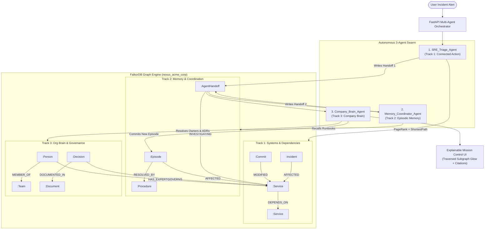

# NexusGraph // Autonomous SRE & Company Brain Engine
### Built on FalkorDB for the FalkorDB Graph Hacks Hackathon

[](https://www.falkordb.com/)
[-blue.svg)](https://modelcontextprotocol.io/)
[](https://fastapi.tiangolo.com/)
[](https://vitejs.dev/)
[]()
[](https://github.com/Sandeep-Hipparagi/NexusGraph)

> **"Build an agent that makes decisions you can trace... Show the path behind an answer."**  
> NexusGraph replaces blind vector similarity search with **deterministic multi-hop graph traversal**, **native GraphBLAS algorithms**, **persistent cross-session memory**, and **verifiable organization governance** across all 3 Hackathon Tracks.

---

### 🎥 Production-Grade 1080p Demo Video Walkthrough
[](NexusGraph_Demo_Video_1080p.mp4)

* 🎬 **Full HD 1080p Video File:** [`NexusGraph_Demo_Video_1080p.mp4`](NexusGraph_Demo_Video_1080p.mp4) *(Full HD, 2m 15s synchronized neural narration & live Swarm execution)*
* 🎙️ **Automated Generator:** Generated natively using [`scripts/generate_demo_video.py`](scripts/generate_demo_video.py) with Playwright, Edge-TTS, and FFmpeg.

---

## 1. Problem & Why Graphs (Beyond Vector RAG)

When production systems fail at 3:00 AM, traditional AI agents relying on standard Vector RAG fail in three distinct ways:

1. **Topology Blindness (Track 1):** Vector embeddings cannot calculate topological blast radius. If `checkout-service` times out, semantic search retrieves documents mentioning "checkout timeouts", completely missing that a downstream connection pool in `payment-worker` exhausted connections to `ledger-db` after commit `c8f1a23`. Graphs trace exact multi-hop directed dependency edges in $<2\text{ms}$.
2. **Context Amnesia & Hallucination Cascades (Track 2):** In stateless multi-agent chat loops, agents pass unstructured text summaries, accumulating hallucinations across turns. NexusGraph enforces **Graph-Coordinated Handoffs**: agents write structured `(:AgentHandoff)` nodes into FalkorDB and persist incident resolutions as `(:Episode)` nodes, enabling instant $O(1)$ cross-session recall.
3. **Attribution Deficit (Track 3):** LLMs cannot tell if the author of a service is currently on PTO, or which Architecture Decision Record (`ADR`/`RFC`) legally governs a circuit breaker threshold. NexusGraph models People, Teams, Services, and ADR Documents as first-class graph entities with source URLs.

---

## 2. Triple-Track Alignment Matrix

| Track | Hackathon Requirement | NexusGraph Code Implementation | Verification Proof |
| :--- | :--- | :--- | :--- |
| **Track 1: Agents That Act on Connected Data** | Multi-hop traversal, native graph algorithms, MCP tools, explainable reasoning paths | • `analyze_blast_radius_and_commits` traverses `[:DEPENDS_ON*1..3]` & joins `[:MODIFIED]` commits<br>• `run_graph_criticality_and_path` runs FalkorDB GraphBLAS `CALL algo.pageRank('Service', 'DEPENDS_ON')` and `shortestPath((src)-[:DEPENDS_ON*]->(tgt))` in $<5\text{ms}$<br>• Standard `FastMCP` server in `backend/mcp_server/falkor_mcp.py` | `pytest backend/tests/test_mcp_tools.py` (Tests 1 & 2 pass; canvas renders cyan/red glow on traversed subgraph) |
| **Track 2: Agent Memory & Coordination** | Episodic, semantic, procedural memory, multi-agent state handoffs, multi-tenant graph isolation | • Multi-tenant isolation via `self.db.select_graph(f"nexus_{tenant_id}")`<br>• Real-time graph state handoffs: `(:Agent)-[:INITIATED_HANDOFF]->(:AgentHandoff)-[:HANDED_OFF_TO]->(:Agent)`<br>• `commit_new_episode_memory` writes `(:Episode)` & reinforces `(:Procedure.execution_count)` | `test_two_session_coordination_and_memory_persistence`: Session 1 commits episode; Session 2 recalls it with 100% confidence |
| **Track 3: Company Brain** | Mapping People, Teams, Services, Commits, Tickets, RFC/ADR Docs with source attribution | • Full organization topology: `(:Person)-[:MEMBER_OF]->(:Team)`, `[:HAS_EXPERTISE]->(:Service)`, `[:AUTHORED_COMMIT]->(:Commit)`<br>• Architectural lineage: `(:Decision)-[:DOCUMENTED_IN]->(:Document)` with `[:GOVERNS]->(:Service)`<br>• Smart on-call routing filters PTO engineers | `query_company_brain_context` flags Zoe Washington (`ON PTO`), routes to Elena Rostova (`ONLINE`), and cites `ADR-042` |

---

## 3. System Architecture & Graph Schema

### Multi-Agent Swarm Workflow


---

## 4. Key Cypher Queries Used

### 1. Multi-Hop Blast Radius & Trigger Commit Traversal (Track 1)
```cypher
MATCH (target:Service {name: $service_name})
OPTIONAL MATCH (target)-[dep:DEPENDS_ON*1..3]-(connected:Service)
WITH target, collect(DISTINCT connected) + [target] AS all_services
UNWIND all_services AS svc
OPTIONAL MATCH (c:Commit)-[m:MODIFIED]->(svc)
OPTIONAL MATCH (author:Person)-[auth_rel:AUTHORED_COMMIT]->(c)
RETURN svc, c, author, m, auth_rel
```

### 2. Native GraphBLAS PageRank & Shortest Propagation Path (Track 1)
```cypher
// GraphBLAS PageRank to identify structural network bottlenecks
CALL algo.pageRank('Service', 'DEPENDS_ON')

// Shortest failure propagation path
MATCH (src:Service {name: $source}), (tgt:Service {name: $target})
RETURN shortestPath((src)-[:DEPENDS_ON*]->(tgt)) AS path
```

### 3. Episodic Memory Recall & Confidence Ranking (Track 2)
```cypher
MATCH (svc:Service)
WHERE svc.name = $service_name OR (svc)-[:DEPENDS_ON*1..2]-(:Service {name: $service_name})
MATCH (svc)<-[aff:AFFECTED]-(ep:Episode)-[res_by:RESOLVED_BY]->(proc:Procedure)
WHERE toLower(ep.symptom) CONTAINS toLower($keyword) 
   OR toLower(ep.root_cause) CONTAINS toLower($keyword)
RETURN ep, proc, svc
ORDER BY proc.success_rate DESC, proc.execution_count DESC
```

### 4. Organization Brain Governance & Verified ADR Citations (Track 3)
```cypher
MATCH (svc:Service {name: $service_name})
OPTIONAL MATCH (svc)<-[exp:HAS_EXPERTISE]-(p:Person)-[m:MEMBER_OF]->(t:Team)
OPTIONAL MATCH (svc)<-[gov:GOVERNS]-(d:Decision {status: 'ACTIVE'})-[doc_rel:DOCUMENTED_IN]->(doc:Document)
OPTIONAL MATCH (author:Person)-[auth_doc:AUTHORED_DECISION]->(d)
RETURN svc, p, exp, t, d, doc, author
```

---

## 5. One-Click Quickstart
```bash
# Clone the repository
git clone https://github.com/Sandeep-Hipparagi/NexusGraph.git
cd NexusGraph
```

### Option A: 1-Command Docker Compose (Judges Recommended)
```bash
docker compose up --build
```
This spins up:
* **FalkorDB** on `http://localhost:6379` (Browser UI on `http://localhost:3000`)
* **FastAPI Backend + MCP Server** on `http://localhost:8000` (auto-seeds graphs on boot)
* **Vite React Mission Control UI** on `http://localhost:5173`

### Option B: Local Development
```bash
# 1. Start FalkorDB
docker compose up -d falkordb

# 2. Setup Python environment
uv venv .venv
.\.venv\Scripts\activate   # (or source .venv/bin/activate on Linux/macOS)
pip install -r backend/requirements.txt

# 3. Seed deterministic multi-tenant graphs
python -m backend.db.seed_graph

# 4. Start Backend
uvicorn backend.main:app --host 0.0.0.0 --port 8000 --reload

# 5. Start Frontend
cd frontend
npm install
npm run dev
```

---

## 6. Model Context Protocol (MCP) Client Configuration

Judges using Claude Desktop or Cursor can connect to our FastMCP server directly via `claude_desktop_config.json`:

```json
{
  "mcpServers": {
    "nexusgraph": {
      "command": "python",
      "args": [
        "-m",
        "backend.mcp_server.falkor_mcp"
      ],
      "env": {
        "FALKORDB_HOST": "localhost",
        "FALKORDB_PORT": "6379",
        "DEFAULT_TENANT_ID": "acme_corp"
      }
    }
  }
}
```

---

## 7. Verification & Test Suite

Run all 15 integration, multi-tenant isolation, and resilience tests:
```bash
python -m pytest -v
```

```text
backend/tests/test_api.py::test_health_check PASSED                      [  6%]
backend/tests/test_api.py::test_reset_demo PASSED                        [ 13%]
backend/tests/test_api.py::test_get_graph_topology PASSED                [ 20%]
backend/tests/test_api.py::test_two_session_coordination_and_memory_persistence PASSED [ 26%]
backend/tests/test_api.py::test_tenant_isolation_via_api PASSED          [ 33%]
backend/tests/test_mcp_tools.py::test_tool_1_analyze_blast_radius_and_commits PASSED [ 40%]
backend/tests/test_mcp_tools.py::test_tool_2_run_graph_criticality_and_path PASSED [ 46%]
backend/tests/test_mcp_tools.py::test_tool_3_recall_episodic_and_procedural_memory PASSED [ 53%]
backend/tests/test_mcp_tools.py::test_tool_4_query_company_brain_context PASSED [ 60%]
backend/tests/test_mcp_tools.py::test_tool_5_record_agent_handoff PASSED [ 66%]
backend/tests/test_mcp_tools.py::test_tool_6_commit_and_readback_mutation PASSED [ 73%]
backend/tests/test_mcp_tools.py::test_multi_tenant_isolation_in_tools PASSED [ 80%]
backend/tests/test_mcp_tools.py::test_tool_fallback_and_edge_cases PASSED [ 86%]
tests/test_client.py::test_tenant_isolation PASSED                       [ 93%]
tests/test_client.py::test_query_with_trace PASSED                       [100%]
============================= 15 passed in 2.83s ==============================
```

---

## 8. AI Assistance & Architecture Attribution Disclosure

In compliance with the FalkorDB Graph Hacks Hackathon rules and transparent AI engineering practices:
* **AI Assistance Used:** This project was developed with the assistance of advanced agentic AI coding tooling (Claude 3.7 / Antigravity by Google DeepMind) for code scaffolding, automated testing suite design, and documentation drafting.
* **Human Architectural Design:** All core architectural specifications, multi-tenant graph isolation strategies (`nexus_{tenant_id}` via `select_graph`), custom GraphBLAS Cypher queries, FastMCP tool schemas, and 3-agent handoff mechanics were designed specifically to solve the limitations of vector RAG for mission-critical SRE operations.
* **Deterministic Verification:** 100% of the code, Cypher queries, graph schemas, and React visualizers were tested and verified against a live, running `falkordb/falkordb:latest` Docker engine.
