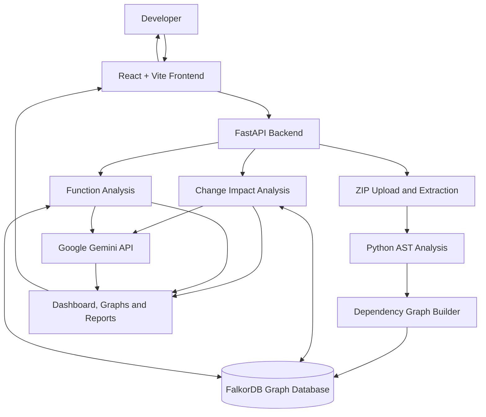
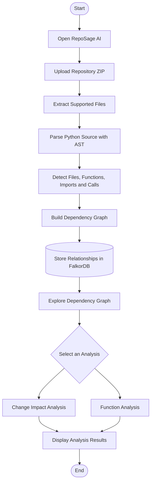
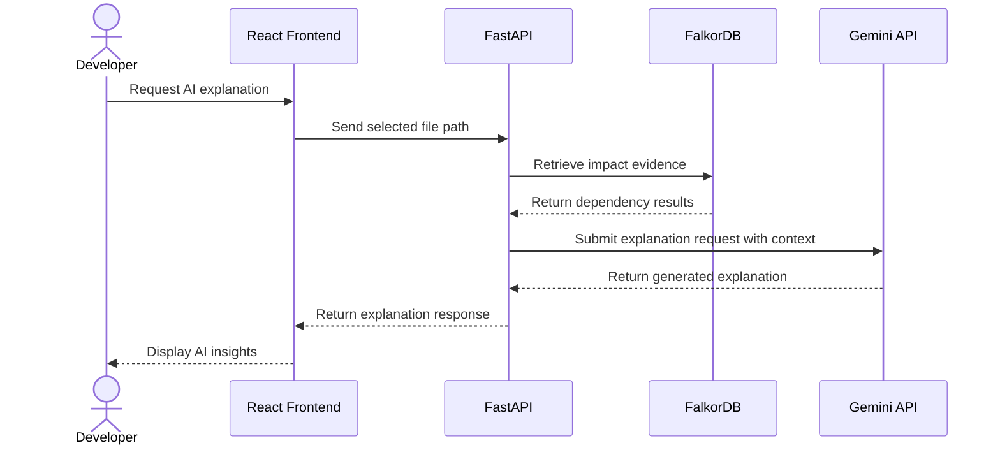
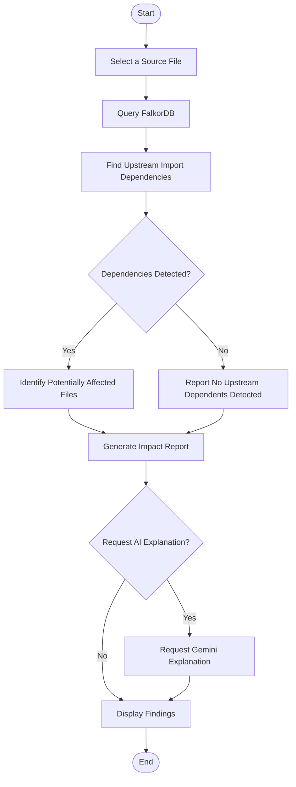

# RepoSage AI — Intelligent Code Change Impact Analyzer

**Understand your codebase. Trace dependencies. Analyze change impact.**

RepoSage AI is an AI-assisted code analysis platform that helps developers understand relationships between source files and functions, investigate potential change impact, and generate natural-language explanations using graph-based analysis and Google Gemini.

By combining Python static analysis, FalkorDB graph storage, an interactive React interface, and generative AI, RepoSage AI makes code relationships easier to explore and understand.

> **Project:** RepoSage AI  
> **Category:** Developer Tools · Static Analysis · Graph Databases · Generative AI  
> **Status:** Working prototype  
> **Primary language analyzed:** Python

---

## Table of Contents

- [Overview](#overview)
- [Problem Statement](#problem-statement)
- [Our Solution](#our-solution)
- [Features](#features)
- [System Architecture](#system-architecture)
- [Repository Analysis Flowchart](#repository-analysis-flowchart)
- [AI Explanation Sequence Diagram](#ai-explanation-sequence-diagram)
- [Change Impact Flowchart](#change-impact-flowchart)
- [Technology Stack](#technology-stack)
- [How It Works](#how-it-works)
- [Project Structure](#project-structure)
- [Prerequisites](#prerequisites)
- [Installation](#installation)
- [Running the Application](#running-the-application)
- [API Reference](#api-reference)
- [Example Use Case](#example-use-case)
- [Security](#security)
- [Current Limitations](#current-limitations)
- [Future Enhancements](#future-enhancements)
- [Contributing](#contributing)
- [License](#license)

---

## Overview

Understanding an unfamiliar codebase can be difficult, especially when source files depend on one another and functions call other functions across multiple modules.

RepoSage AI analyzes supported Python source code and builds a graph of detected relationships. Developers can explore dependencies, inspect functions, generate change-impact reports, and request AI-assisted explanations of the findings.

### Why RepoSage AI?

- **Understand:** Explore file and function relationships.
- **Analyze:** Investigate potential impact before changing code.
- **Visualize:** Navigate a graph representation of the codebase.
- **Explain:** Use Gemini to interpret available analysis evidence.
- **Improve workflow:** Reduce the manual effort of tracing dependencies.

## Problem Statement

Software projects frequently contain interconnected modules, imports, and function calls. A seemingly small change can affect other parts of an application.

Developers may need to manually inspect several files to determine:

- Which modules depend on a particular file.
- Which functions call another function.
- Which parts of a codebase deserve additional review after a change.
- How an unfamiliar project is organized.
- Why a change may have broader consequences.

Traditional code browsing provides access to source code but does not always present these relationships in one unified view.

**The challenge:** How can developers investigate code relationships and potential change impact more efficiently?

## Our Solution

RepoSage AI combines static analysis, graph-based relationship storage, and AI-assisted explanations in a single interface.

The application:

1. Accepts a repository ZIP archive.
2. Extracts supported source files.
3. Analyzes Python source code using the Abstract Syntax Tree (AST).
4. Detects file, function, import, and call relationships.
5. Stores the resulting relationships in FalkorDB.
6. Provides dependency visualization and impact-analysis features.
7. Uses Google Gemini to generate natural-language explanations when available.

**Core workflow:**

`Source Code → Static Analysis → Dependency Graph → Impact Analysis → AI Explanation`

RepoSage AI supports developer decision-making; it does not guarantee complete dependency detection or replace testing and code review.

---

## Features

### 1. Repository Upload and Analysis

- Upload a project through a ZIP archive.
- Extract and inspect supported Python source files.
- Identify source files and function definitions.
- Detect imports and function-call relationships.
- Build a graph representation of the analyzed repository.

### 2. Interactive Dependency Graph

- Visualize relationships between source files.
- Explore the structure of an analyzed project.
- Identify detected dependencies between modules.
- Navigate the graph to better understand code organization.

### 3. Change Impact Analysis

- Select a file for impact analysis.
- Query upstream import dependencies.
- Identify potentially affected files based on detected relationships.
- Generate a structured impact report.

### 4. Function Analysis

- Inspect detected function definitions.
- Explore relationships between functions.
- Investigate detected callers and function calls.
- Understand how functions are connected across modules.

### 5. Gemini AI Explanations

- Generate natural-language explanations of analysis results.
- Interpret available dependency and impact evidence.
- Make technical findings easier to understand.
- Provide AI-assisted context for code review and investigation.

AI explanations depend on API availability, quota, and the analysis context supplied by the backend.

### 6. Graph-Based Data Model

The application uses FalkorDB to represent source-code relationships as nodes and edges.

The graph includes concepts such as:

- `File`
- `Function`
- `DEFINES`
- `IMPORTS`
- `CALLS`

This enables graph queries over relationships identified during static analysis.

---

## System Architecture

The architecture separates the frontend, backend API, source-code analysis, graph storage, and AI explanation service.



### Architecture Components

| Component | Responsibility |
|---|---|
| React | User interface and application navigation |
| Vite | Frontend development and build tooling |
| FastAPI | HTTP API and backend request handling |
| Python AST | Static analysis of supported Python source files |
| FalkorDB | Graph storage and dependency queries |
| Impact analysis | Analysis of detected file dependencies |
| Function analysis | Inspection of detected function relationships |
| Google Gemini | AI-assisted explanations of available analysis context |

*The diagram illustrates the logical architecture. Actual data flow depends on the implementation of each endpoint.*

---

## Repository Analysis Flowchart

The following diagram shows the main process from repository upload to analysis results.



---

## AI Explanation Sequence Diagram

This diagram illustrates how a request for an AI explanation can move through the frontend, backend, graph database, and Gemini API.



Gemini requests can fail if the model is overloaded, the API quota is exhausted, or the service is unavailable.

---

## Change Impact Flowchart

The change-impact workflow uses detected graph relationships to investigate potential effects of modifying a file.



**Important:** The current file-level impact analysis uses detected upstream import dependencies. A result showing no upstream dependents does not prove that a file has no possible runtime impact.

---

## Technology Stack

| Technology | Purpose |
|---|---|
| React | Frontend application |
| Vite | Frontend tooling |
| Tailwind CSS | Interface styling |
| FastAPI | Backend API |
| Python | Analysis logic |
| Python AST | Static source-code analysis |
| FalkorDB | Graph database |
| Docker | Local database environment |
| Google Gemini API | Generative AI explanations |
| Git and GitHub | Version control and collaboration |

---

## How It Works

### Step 1: Upload a repository

The user uploads a ZIP archive containing a source-code project.

### Step 2: Extract and parse source code

The backend extracts the archive and analyzes supported Python files using AST parsing.

### Step 3: Identify code entities

The analyzer identifies supported entities and relationships, including file imports, function definitions, and function calls.

### Step 4: Construct the graph

The detected information is stored in FalkorDB as graph nodes and relationships.

Example relationship types:

- `File → DEFINES → Function`
- `File → IMPORTS → File`
- `Function → CALLS → Function`

### Step 5: Query dependencies

The backend queries the graph to retrieve relationships relevant to the selected file or function.

### Step 6: Analyze potential impact

RepoSage AI uses the detected relationships to identify areas that may deserve additional investigation after a code change.

### Step 7: Generate AI explanations

When requested, the backend sends relevant analysis context to Gemini and returns the generated explanation to the frontend.

### Step 8: Display the results

The frontend presents dependency information, function relationships, impact reports, and AI insights.

---

## Project Structure

The following is a simplified representation of the main project files. Update it if your final repository structure differs.

```text
RepoSageAI/
├── backend/
│   └── api.py
├── frontend/
│   ├── src/
│   │   ├── App.jsx
│   │   └── api.js
│   ├── package.json
│   └── vite.config.js
├── main.py
├── impact_advisor.py
├── requirements.txt
├── .gitignore
└── README.md
```

### Important Files

| File | Description |
|---|---|
| `backend/api.py` | FastAPI endpoints and backend integration |
| `main.py` | Python source analysis and graph construction |
| `impact_advisor.py` | Impact reports and Gemini explanations |
| `frontend/src/App.jsx` | Main frontend application |
| `frontend/src/api.js` | Frontend API integration |
| `requirements.txt` | Python dependency list, if used |

---

## Prerequisites

Before running RepoSage AI, install:

- Python and a compatible version for the project's dependencies.
- Node.js and npm.
- Docker Desktop with WSL2 if required on Windows.
- Git.
- A Google Gemini API key for AI explanation functionality.

The following instructions use Windows PowerShell and the existing local project directory.

---

## Installation

### 1. Open the project

If you already have the project locally:

```powershell
cd E:\Programx64\RepoSageAI
```

For a fresh installation, clone your published repository instead:

```powershell
git clone https://github.com/Suchit-2004/RepoSageAI.git
cd RepoSageAI
```

Replace the placeholder with your actual repository URL.

### 2. Create the Python environment

```powershell
python -m venv .venv
.\.venv\Scripts\Activate.ps1
```

Install dependencies using the repository's dependency file:

```powershell
pip install -r requirements.txt
```

If the project uses another dependency-management method, follow its configuration.

### 3. Start FalkorDB

For an existing Docker container:

```powershell
docker start reposage-db
```

Check the running container:

```powershell
docker ps --filter "name=reposage-db"
```

Test the database:

```powershell
docker exec reposage-db redis-cli PING
```

Expected response:

```text
PONG
```

If the container does not exist, create a new FalkorDB container using the official FalkorDB Docker documentation and configure the port and persistence settings required by the backend.

### 4. Configure Gemini

Obtain an API key through Google AI Studio.

Set the key in the backend terminal:

```powershell
$env:GEMINI_API_KEY = "YOUR_GEMINI_API_KEY"
```

Replace the placeholder with your actual key.

This environment variable applies to the current PowerShell session. Configure it again when opening a new terminal, or use a properly ignored local environment file if supported by the project.

**Never publish your API key or commit it to Git.**

### 5. Install frontend dependencies

Open a second terminal:

```powershell
cd E:\Programx64\RepoSageAI\frontend
npm install
```

---

## Running the Application

### Start the backend

From the project root:

```powershell
cd E:\Programx64\RepoSageAI
.\.venv\Scripts\Activate.ps1
```

Set `GEMINI_API_KEY` if it is not already configured in this terminal.

Start FastAPI:

```powershell
python -m uvicorn backend.api:app --reload --port 8000
```

The backend runs at:

- **API:** `http://127.0.0.1:8000`
- **Health check:** `http://127.0.0.1:8000/api/health`
- **Interactive API documentation:** `http://127.0.0.1:8000/docs`

Keep this terminal open.

### Start the frontend

Open another terminal:

```powershell
cd E:\Programx64\RepoSageAI\frontend
npm run dev
```

Open the local URL shown in the terminal, normally:

**http://localhost:5173**

Ensure Docker/FalkorDB, the backend, and the frontend are running while using the application.

---

## API Reference

The backend currently exposes these endpoints.

| Method | Endpoint | Purpose |
|---|---|---|
| `GET` | `/api/health` | Check backend and database health |
| `POST` | `/api/projects/analyze` | Upload and analyze a repository ZIP |
| `GET` | `/api/dependencies` | Retrieve dependency information |
| `GET` | `/api/impact?path=...` | Analyze file-level impact |
| `GET` | `/api/functions` | Retrieve function information |
| `GET` | `/api/function-impact?name=...&file=...` | Analyze function relationships |
| `POST` | `/api/ai/explanation?path=...` | Generate an AI-assisted explanation |

For request parameters and response details, open:

`http://127.0.0.1:8000/docs`

---

## Example Use Case

Consider a Python project containing two files:

```text
sample_project/
├── app.py
└── database.py
```

Suppose `app.py` imports `database.py` and calls a function defined in that module.

RepoSage AI can:

1. Identify both source files.
2. Detect the import relationship.
3. Identify supported function definitions and calls.
4. Store the relationships in FalkorDB.
5. Display the dependency graph.
6. Analyze upstream dependents when `database.py` is selected.
7. Generate an AI-assisted explanation of the available findings.

This can help a developer identify code that deserves review when modifying a database function.

The results depend on the relationships detected by the current analyzer and should be verified against the actual source code and tests.

---

## Screenshots

Add screenshots of the actual running application to showcase its capabilities.

Suggested repository layout:

```text
docs/
└── screenshots/
    ├── dashboard.png
    ├── dependency-graph.png
    ├── change-impact.png
    ├── function-analysis.png
    └── ai-insights.png
```

After adding the images, include them in this section:

### Dashboard


### Dependency Graph


### Change Impact Analysis


### Function Analysis


### AI Insights


*Replace these paths with the actual screenshot files you commit to the repository. Until the images are added, the links will not display screenshots.*

---

## Security

RepoSage AI should be treated as a development prototype until appropriate production controls are implemented.

- Never commit API keys, tokens, passwords, or private credentials.
- Add local environment files and secret-containing files to `.gitignore`.
- Validate uploaded ZIP paths to prevent path traversal.
- Limit upload sizes and archive extraction resources.
- Avoid uploading confidential code without authorization.
- Restrict API access when deploying beyond local development.
- Review dependencies and update vulnerable packages.
- Configure graph isolation if multiple users or projects are supported.

---

## Current Limitations

- **Python-focused analysis:** The current analyzer primarily supports Python source code.
- **Static analysis:** Dynamic imports, reflection, runtime behavior, and some indirect calls may not be detected.
- **Impact accuracy:** Dependency relationships indicate potential impact, not guaranteed execution paths.
- **AI availability:** Gemini explanations depend on model availability and API quota.
- **Graph lifecycle:** The current analysis flow clears and rebuilds the graph; concurrent multi-project isolation needs additional work.
- **Production readiness:** Authentication, deployment hardening, monitoring, and multi-user isolation may require further implementation.

These limitations define areas for future development rather than implying capabilities that have not yet been verified.

---

## Future Enhancements

Potential improvements include:

- GitHub repository integration.
- Git diff-based impact analysis.
- JavaScript, TypeScript, and Java support.
- Automated test recommendations for affected modules.
- Risk scoring for code changes.
- Historical dependency graphs across commits.
- More resilient Gemini error handling and fallback behavior.
- Multi-project graph isolation and persistence.
- Exportable reports for code reviews.
- Automated tests and continuous integration.
- Authentication and production deployment support.

---

## Contributing

Contributions and suggestions are welcome.

1. Fork the repository.
2. Create a feature branch.
3. Implement your changes.
4. Run relevant tests.
5. Submit a pull request with a clear description.

For larger changes, discuss the proposed implementation before starting development.

---

## License

Add an appropriate open-source license before publishing the project for public reuse. Until a license is added, do not assume that others have permission to reuse or redistribute the code.

---

## Acknowledgements

RepoSage AI combines static source-code analysis, graph databases, web development, and generative AI to address a practical software engineering challenge: understanding code relationships and investigating potential change impact.

**RepoSage AI — See the connections. Understand the impact. Change code with confidence.**
