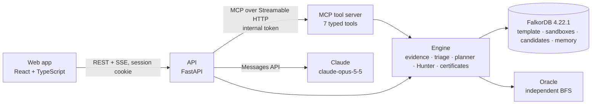

# Interdict

**Graph-grounded security triage on FalkorDB.** Interdict takes a storm of vulnerability alerts and uses a graph to find the few that sit on a real path from the Internet to a crown-jewel database. It computes the cheapest safe fix: at most three Kubernetes egress allowlist policies, ranked by how many declared dependencies they break. A deterministic Path Hunter then tries that fix on an isolated copy of the graph and checks, with three independent methods, that no path survives. Only then does it issue a **model-verified containment certificate (simulation)**.

> Built for **WeMakeDevs × FalkorDB Graph Hacks 2026, Track 01: Agents That Act on Connected Data** (Oct 15–18, 2026). All data is synthetic, and nothing ever changes real infrastructure.

## What happens in 60 seconds
| Step | What you see | What the graph does |
| :--- | :--- | :--- |
| 1. Alert storm | 1,000 alerts become **69 on a real attack path**, in 4 clusters; 382 are vulnerable but on no path, and 549 are not actionable. | FalkorDB builds `ATTACK_STEP` edges from evidence (exposure, exploitable vulnerability, observed reachability, IAM grants), then forward and backward reachability classify every alert. |
| 2. Investigate | The agent (Claude over MCP, or the deterministic pipeline) walks the evidence, the paths and memory. | Multi-hop tier queries and bounded path enumeration (≤ 3 lateral hops) over raw `CAN_REACH`. |
| 3. Cheapest safe fix | The exact best plan of ≤ 3 allowlist policies, its impact on declared dependencies, alternatives, and hard isolation for comparison. | Exact search over every subset of the action catalogue (the worst case is 4,526 subsets over 10,000 chains, in about 50 ms). |
| 4. Path Hunter | Rounds of verification. It also finds a **4-hop path to `customer-pii-db` beyond the planner's bound** and re-plans to close it. | `GRAPH.COPY` makes a candidate graph, FalkorDB applies the policies itself, and `algo.maxFlow` per crown jewel, bounded chains and an oracle BFS must agree. |
| 5. Certificate | "Model-verified containment (simulation)", with snapshot hashes, an expiry, and the exclusions written out. | SHA-256 hashes of the sandbox and the candidate. Any later sandbox change supersedes the certificate. |
| 6. Try to break it | Expose a workload and add a lateral reach in the sandbox panel: a new attack path appears, the certificate is superseded, and the next run re-plans. | Each change is one Cypher query with a revision compare-and-set. |

Honest outcomes are part of the product. Asking for both crown jewels at once returns **"No safe plan within 3 changes"** (4 independent paths need 4 actions), along with the best partial plan. Expiring a piece of evidence makes the triage **inconclusive**, never "0 paths".

## Why the graph is essential
Every verdict comes from a connected-data operation in FalkorDB, never from the LLM:

| Graph operation | Used for |
| :--- | :--- |
| Multi-hop pattern queries over 11 relationship types | Evidence tiers per workload, with provenance and freshness |
| Derived `ATTACK_STEP` graph, built in Cypher from evidence | One edge per possible attacker move (MITRE ATT&CK labels: T1190, T1210, T1078.004) |
| Variable-length paths over `CAN_REACH` | Bounded attack-chain enumeration (method E), cross-checked against `ATTACK_STEP` |
| `algo.BFS` and `algo.maxFlow` | Reachability for triage; unit-capacity max-flow from the Internet to each crown jewel (method F) |
| `GRAPH.COPY` | A private sandbox per visitor, and a candidate graph per Hunter round |
| Kubernetes policy semantics applied in Cypher | FalkorDB prunes every flow the candidate policies no longer allow, and the result must equal the planner's prediction |
| Revision compare-and-set in the same query as each mutation | Certificates are superseded the moment the graph changes |
| A per-session memory graph | Dated plans and certificates, recalled first for the same assets |

## Architecture

- **Agent:** Claude chooses among seven MCP tools (`triage_alert_storm`, `find_evidence_by_workload`, `find_attack_paths_to_asset`, `plan_remediation`, `hunt_residual_paths`, `submit_remediation_execution`, `recall_incident_memory`). The schemas are strict, there is no query tool, and the agent gets no sandbox access.
- **Guards in code:** at most 12 tool calls; the final status, plan, certificate and receipt are copied from tool results. Without an API key, or after a refusal, the **deterministic pipeline** runs the same tools and says so.
- **Action Gateway:** the only path to a receipt. It requires the allowlisted action type, SIMULATION mode, a VALID certificate at the current revision, and an idempotency key.

## Run it
Prerequisites: Docker. For development, also [uv](https://docs.astral.sh/uv/) and Node 22.

```bash
cp .env.example .env
# In .env, set FALKORDB_PASSWORD, plus INTERDICT_SESSION_SECRET and INTERDICT_INTERNAL_TOKEN.
# Generate each secret with: python3 -c "import secrets; print(secrets.token_urlsafe(48))"
# Optional: ANTHROPIC_API_KEY enables agent mode.
docker compose up -d --build        # FalkorDB + the app on http://localhost:8000
```

**Development:**
```bash
docker compose up -d falkordb
cd backend && uv sync
uv run python -m interdict.seed     # load the synthetic environment (graph `template`)
uv run python -m interdict.mcp_server &
uv run uvicorn interdict.api:app --port 8000
uv run pytest                       # ~490 tests against the local FalkorDB
cd ../frontend && npm ci && npm run dev   # http://localhost:5173 (mock data by default; see frontend/README.md)
```

**Use the tools from Claude Code.** The MCP server only listens on localhost and requires the internal token:
```bash
claude mcp add --transport http interdict http://127.0.0.1:8765/mcp \
  --header "Authorization: Bearer $INTERDICT_INTERNAL_TOKEN" \
  --header "X-Interdict-Session: my-local-session-0001"
```

## Measured on the default environment
| Measure | Result |
| :--- | :--- |
| Full storm triage, 1,000 alerts (gate G4) | median 58 ms |
| Exact planner, worst case (30 actions, 10,000 chains) | about 50 ms |
| Path Hunter for one cluster, two rounds, ending in a certificate | about 0.7 s |
| Whole deterministic investigation through the MCP server | about 1.0 s |
| `algo.maxFlow` agreement with the oracle on 50 random graphs (gate G1) | 50 / 50, p95 5 ms |
| Graph copy, about 800 nodes and 3,000 edges (gate G2) | p95 108 ms |
| Container start to ready, API + MCP + web app (gate G5) | 2.7 s |

Gate details are in [`solution.md`](solution.md) §17.1.

## What a certificate does and does not claim
- **It claims:** under threat model ITM-1, on the hashed synthetic snapshot, after the listed policies, no modelled chain reaches the target, and three methods agreed.
- **It does not claim:** real-world containment, CNI enforcement, or coverage of unmodelled vectors (credential theft, application-layer attacks, egress exfiltration, IAM conditions, supply chain, zero-days).
- **Optimality:** the plan is exact only among plans of at most three actions from its catalogue.
- **Oracle limitation:** in this event build, the oracle re-checks reachability over the same derived `ATTACK_STEP` edges as max-flow, so it does not independently re-derive the threat model (RSK-16). The certificate says so.

## Data and credits
- The environment is generated by our own code (seed 20261018). The application layout is shaped on Google's [Online Boutique](https://github.com/GoogleCloudPlatform/microservices-demo) demo (Apache-2.0).
- Vulnerability ids are synthetic (`DEMO-CVE-…`), addresses come from RFC 5737, hosts end in `.example`, and the IAM account is `000000000000`.
- Attack steps carry [MITRE ATT&CK®](https://attack.mitre.org/) technique labels. ATT&CK® is a registered trademark of The MITRE Corporation.
- No real company, personal or cloud-account data is used.

## Repository
| Path | Contents |
| :--- | :--- |
| `backend/src/interdict/engine/` | Evidence, attack graph, triage, planner, Path Hunter, snapshots, certificates |
| `backend/src/interdict/` | Tools, MCP server, agent, API, gateway, sandbox operations, memory, audit |
| `backend/src/interdict_oracle/` | Independent oracle (imports nothing from the engine) |
| `frontend/` | React + TypeScript web app |
| `deploy/`, `Dockerfile`, `docker-compose.yml` | One image (API + MCP + web app), FalkorDB, and Caddy for TLS |
| `solution.md` | Canonical specification; decisions D-01 to D-21 |
| `docs/` | Pre-event planning notes |

## Contributing and security
See [CONTRIBUTING.md](CONTRIBUTING.md) and [SECURITY.md](SECURITY.md). `main` is protected: every change goes through a pull request with passing CI.

## AI usage disclosure
This project is built with an AI coding assistant (Claude Code). The planning documents in `docs/` and `solution.md` were prepared before the event as notes. All application code was written during the event and is reviewed and tested by the team. Commits that include AI-written changes carry a `Co-Authored-By` trailer.

## License
[MIT](LICENSE)
