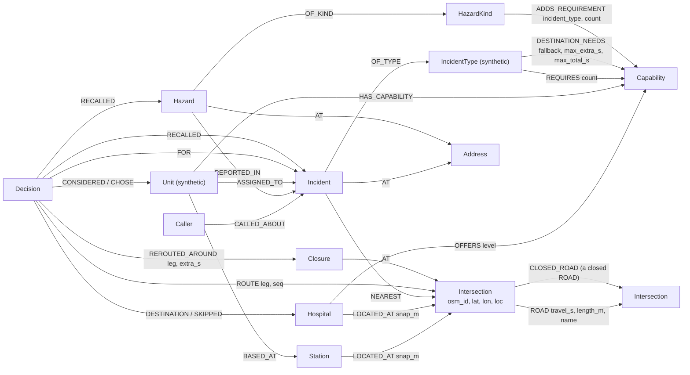
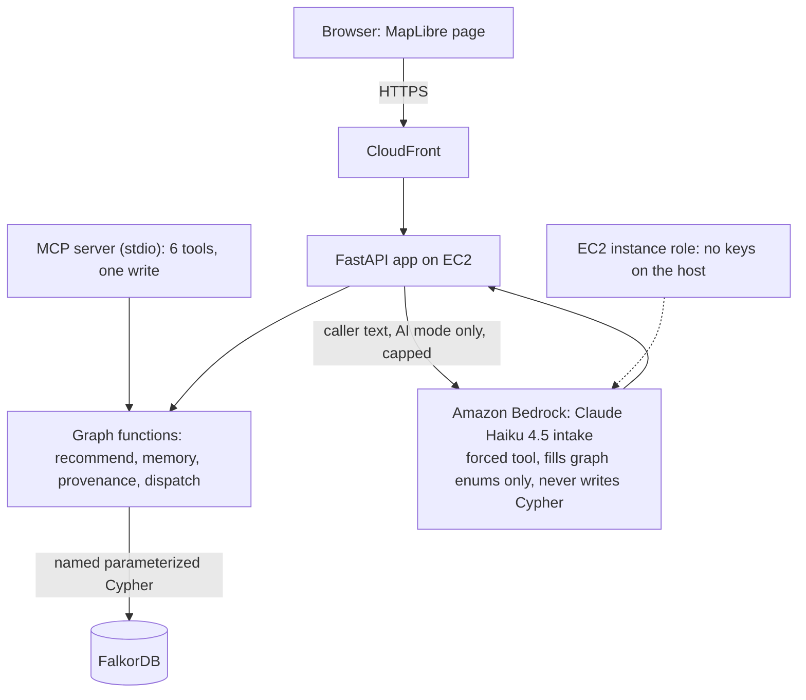

# GraphDispatch

Dispatch decision support for emergency calls: every recommendation is a walk through a FalkorDB graph of San Jose roads, stations, hospitals and what the system remembers about an address. Built for Graph Hacks (WeMakeDevs x FalkorDB).

**This is a hackathon prototype on synthetic data, not a real dispatch system.**

Demo video: [VIDEO LINK]

## What the graph decides

- **Which units to send, and how fast they get there.** Road travel time is computed inside FalkorDB with `algo.SPpaths` over a directed road graph. The units required for an incident, including units added because of a remembered hazard at the address, come from one query, `effective_requirements`. When a road is closed, routing skips it.
- **Which hospital to take the patient to.** The nearest hospital is often the wrong one, because the needed capability (trauma, burn, clot removal for a stroke) differs by hospital. For strokes, the AHA bypass limits are stored on a graph edge and applied to the real road times; the nearest hospital that was skipped is shown with its reason.
- **What to remember.** Hazards and earlier incidents at an address change later decisions, and every decision is stored as nodes and edges (units considered, chosen, hospitals skipped, route, memory recalled), so "why?" is answered by one Cypher query.

## Live demo

**https://d445nmo1mzx5s.cloudfront.net** (synthetic data, so do not type anything real). Use **Graph only** to run with no AI, or the AI mode for caller text; the AI mode is capped per day and per visitor.


*Stroke, west side. O'Connor is nearest but cannot remove clots; Regional is 8:22 farther, inside the AHA 30:00 limit, so the patient goes to Regional. Every line in the decision panel opens the Cypher query that produced it.*


*A second call at the same address. The oxygen hazard and the earlier fire are recalled from the graph.*

## Why a graph

The hackathon asks whether the product still works once FalkorDB is taken out. We tested that with a pre-registered protocol ([eval/PROTOCOL.md](eval/PROTOCOL.md)) and an independent oracle (`eval/oracle.py`, which recomputes every answer from the seed CSVs with its own Dijkstra and imports nothing from the app). 24 scenarios, three configurations, scored against the oracle; full results in [eval/RESULTS.md](eval/RESULTS.md).

- **A**: GraphDispatch (the graph does the routing, rules and memory).
- **B**: no graph, no LLM: nearest by straight-line distance, same assignment rules.
- **C**: Claude Haiku 4.5 given every fact as text (stations, units, hospitals, rules, hazards, earlier incidents) but no road network.

| | A GraphDispatch | B straight-line | C LLM with facts as text |
|---|---|---|---|
| Exact unit set (of 24) | 24 | 19 | 10 |
| Every required capability covered (of 24) | 24 | 23 | 24 |
| Hazard-added unit included (O1) | 1 of 1 | 0 of 1 | 1 of 1 |
| Correct hospital (of 16) | 16 | 16 | 14 |
| Stroke rule applied correctly (of 4) | 4 | 4 | 4 |
| Memory recall (O2) | 1 of 1 | 0 of 1 | 1 of 1 |
| Latency, median / p95 (ms) | 38.1 / 48.3 | 0.0 / 0.1 | 1274.3 / 1585.0 |
| Seconds lost vs the oracle, total (post hoc) | 0 | 195 | 2190 |
| Seconds lost, median / max in one scenario (post hoc) | 0.0 / 0 | 0.0 / 103 | 20.9 / 325 |

What this shows, and what it does not:

- Road travel time is what separates A from B on unit choice: the nearest station in a straight line is not always the fastest by road.
- Hospital choice did **not** differ: B picked the same hospital as the oracle in all 16 cases, because the three hospitals are ordered the same way by straight line and by road. This set does not show a hospital-choice benefit from the graph, and the four stroke scenarios did not discriminate either.
- The LLM baseline was **handed the memory** (the active hazard and the earlier incident, as text) and used it correctly. The graph's advantage on memory is that it stores, queries and applies it deterministically, not that a model cannot use the facts when it is given them. B has no memory by definition, so its zeros there are by construction.
- C had no road network by design; its failures measure what coordinates in text can support, not what a model with a routing tool could do.
- 24 synthetic scenarios in one small area, one run at temperature 0, 24 Bedrock calls: a demonstration, not a statistical study. The oracle is independent in code and method but shares its rules with the app, so it does not test whether the rules are medically right. The seconds-lost columns were added after the results and are labeled that way in [eval/RESULTS.md](eval/RESULTS.md). Cost of the AI baseline was not verified (tokens only are reported there).

## Road closures (demonstration)

Closing a road retypes its `ROAD` edges to `CLOSED_ROAD`, and routing follows `ROAD` only, so a closed road is skipped with no new algorithm. A decision that was affected records "rerouted around <road>, +m:ss" and whether the chosen unit or hospital changed; the same legs are also computed ignoring the closure, so the cost is measured, not guessed.

The demo preset "Road closed on the stroke route" closes two synthetic segments on the stroke route and takes the same call. The trip to Regional gets 1:24 longer (9:11 becomes 10:34). Station 7 becomes 158 s from the incident and station 10 is 157 s (1.7 s apart before rounding), so E10 and M10 are sent instead of E7 and M7. That unit change is a difference of about one second of travel time, not a large effect. On the live site at most 3 closures are active, and each reopens by itself after 30 minutes.

Closures were not part of the pre-registered evaluation above: this is a demonstration of the mechanism, not evidence of benefit. The numbers come from [docs/phases/phase9/REPORT.md](docs/phases/phase9/REPORT.md) and [docs/phases/phase10/REPORT.md](docs/phases/phase10/REPORT.md).

## Graph model

Seed data (loaded by `scripts/load.py` from `seed/`): 4,268 nodes and 10,538 relationships (counts in [docs/seed_counts.json](docs/seed_counts.json)). Runtime data (incidents, decisions, closures and so on) is created as calls come in.



| Seed node label | Count | Seed relationship | Count |
|---|---|---|---|
| Intersection | 4,213 | ROAD | 10,430 |
| Unit | 22 | HAS_CAPABILITY | 43 |
| Capability | 11 | BASED_AT | 22 |
| Station | 10 | REQUIRES | 14 |
| Hospital | 3 | LOCATED_AT | 13 |
| IncidentType | 7 | OFFERS | 10 |
| HazardKind | 2 | DESTINATION_NEEDS | 5 |
| | | ADDS_REQUIREMENT | 1 |

## Cypher queries

The product depends on 85 named, parameterized queries in [graphdispatch/queries.cypher](graphdispatch/queries.cypher), all documented with their Cypher, callers, read or write, and timings in **[QUERIES.md](QUERIES.md)** (including `GRAPH.EXPLAIN` and `GRAPH.PROFILE`). The ones to read first:

- `unit_candidates`: available units with the needed capabilities, their station and the station's road intersection (a multi-hop traversal).
- `eta` and `route`: travel time and the ordered path between two intersections with `algo.SPpaths` on `travel_s`.
- `effective_requirements`: the incident type's requirements plus requirements added by active hazards at the address, counted once per hazard kind, in one query.
- `dest_capability` and `hospitals`: which capability the hospital must offer, the stroke bypass limits, and what each hospital offers.
- `recall_hazards` and `recall_incidents`: address memory.
- `why`: everything recorded for one decision, read back in a single query.
- `dispatch`: assigns the chosen units only if every one is still available, all or nothing, in one query.
- `close_road`, `reopen_road` and `route_all`: closing a road retypes its `ROAD` edges to `CLOSED_ROAD` (routing follows `ROAD` only), and `route_all` computes the same path ignoring closures, so a decision can say what a closure cost.

## Architecture



The model never writes Cypher. It only fills values from lists that come from the graph (incident types, hazard kinds), and the output is validated in code before anything is written. Dispatch is never done by the model: it is a button a human presses.

## Use the graph tools from Claude Desktop

The same graph operations are available to an MCP client over stdio (`python -m graphdispatch.mcp_server`). They need FalkorDB on `localhost:6379` with the seed loaded, and the package installed once so the module is found:

```bash
docker run -d -p 6379:6379 falkordb/falkordb
pip install -r requirements.txt && pip install -e .
python scripts/load.py          # loads the seed into graph sjfd (idempotent)
```

Claude Desktop config (`claude_desktop_config.json`, under `mcpServers`), then restart Claude Desktop:

```json
{
  "mcpServers": {
    "graphdispatch": {
      "command": "<path-to>/graphdispatch/.venv/bin/python",
      "args": ["-m", "graphdispatch.mcp_server"],
      "env": { "GRAPH_NAME": "sjfd" }
    }
  }
}
```

On Windows use `<path-to>\graphdispatch\.venv\Scripts\python.exe`. There are six tools; only one writes, none accepts Cypher and none can dispatch:

- `recommend_units`: ranks the available units and picks a destination hospital for an incident at a location (read-only; creates nothing and dispatches nothing).
- `recall_address`: active hazards (with crew notes) and incidents in the last 30 days at an address (read-only).
- `explain_decision`: explains a recorded decision: units, skipped hospitals and the memory it used (read-only).
- `list_open_incidents`: incidents that are open or dispatched (read-only).
- `unit_status`: every unit with its status and station (read-only).
- `report_hazard`: records a hazard at an address for 30 days; the only tool that writes, and it cannot dispatch.

Demo clip: [DEMO CLIP LINK]

## Setup

Local, with Docker (graph-only mode needs no AWS account):

```bash
git clone <this repository> graphdispatch && cd graphdispatch
cp .env.server.example .env.server        # keep LLM_DAILY_CAP=0 for graph-only; the file is gitignored
docker compose -f docker-compose.yml -f docker-compose.local.yml up -d --build
# open http://localhost:8080
docker compose -f docker-compose.yml -f docker-compose.local.yml down -v
```

The app loads the seed into FalkorDB by itself on start. For the AI mode locally, raise `LLM_DAILY_CAP` and add your own AWS credentials to `.env.server` (never commit them); on the deployed host the instance role is used instead.

Tests (Python 3.12, FalkorDB on port 6379; they use a separate graph `sjfd_test` and make no Bedrock calls):

```bash
docker run -d -p 6379:6379 falkordb/falkordb
python -m venv .venv && . .venv/bin/activate      # on Windows: .venv\Scripts\activate
pip install -r requirements.txt
pytest -q
```

Run the app without Docker: `python -m uvicorn graphdispatch.api:app --port 8000`.

## Deployment

One EC2 t3.micro running docker compose behind CloudFront (the browser connection is HTTPS), Bedrock reached through an instance role with a least-privilege policy. The operator checklist is in **[deploy/RUNBOOK.md](deploy/RUNBOOK.md)** and the policy in `deploy/iam-bedrock-policy.json`.

## Data sources and licenses

- Roads: © OpenStreetMap contributors, ODbL (https://www.openstreetmap.org/copyright); snapshot dated in [seed/DATA.md](seed/DATA.md).
- Map tiles: OpenFreeMap (https://openfreemap.org); map rendering: MapLibre GL JS, BSD-3-Clause (https://maplibre.org).
- Trauma designations: California EMSA "Designated Trauma Centers" list, updated 2025-08-25.
- Stroke destination rule: AHA Mission: Lifeline Stroke EMS triage algorithm (meded.stroke.org). Stroke center designations: strokeinfo.org. Hospital capabilities: scvmc.scvh.org trauma and burn pages and an EMS1 article of 2025-05-03 (see the per-row sources in `seed/hospitals.csv`).
- **Synthetic:** units, incident types, callers, addresses, hazards and incidents. No real calls, people or phone numbers are used. Hazard rules are invented for the demo. Details in [seed/DATA.md](seed/DATA.md).

## Limitations

- Not a real dispatch system and not for real emergencies. Units and incidents are synthetic.
- The AHA stroke numbers (30:00 extra, 45:00 total) are suburban figures applied to an urban area; the urban guidance gives none.
- The rule numbers shown in the panel are parsed from the sentence the rule code writes, not stored as numbers.
- The per-visitor rate limiter is in memory in one worker and resets on restart; the daily AI cap is persisted and is the real cost guard.
- Road closures are a demonstration; they were not part of the pre-registered evaluation.
- The evaluation is 24 synthetic scenarios (see above).

## AI assistance

Claude Code (Anthropic) wrote the code, tests and docs from phase briefs that were drafted with Claude (chat) acting as an advisor. The author set the goal and scope, approved every phase before it ran, ran the field checks on the real product, did all AWS setup and deployment, and decided what was published. In the product, Amazon Bedrock (Claude Haiku 4.5) only classifies caller text into values the graph allows. See [AI_DISCLOSURE.md](AI_DISCLOSURE.md) for who did what.

## Friction log

What went wrong and what we did about it, written as it happened: [FRICTION_LOG.md](FRICTION_LOG.md).

## Hackathon tracks entered

- **Track 01, Agents That Act on Connected Data:** An LLM intake step turns the caller's words into one forced tool call whose values must come from the graph's own lists. The same graph operations are exposed as six typed MCP tools (five read-only, one that records a hazard); an MCP client such as Claude Desktop chooses among them. Dispatch stays a human action, and no tool accepts Cypher.
- **Track 02, Agent Memory and Coordination:** the graph remembers hazards and earlier incidents per address, and that memory changes which units are sent; every decision and the memory it used are stored and explainable; unit assignment is all or nothing.

## Next

- Mutual aid between agencies.

## License

MIT, see [LICENSE](LICENSE).
