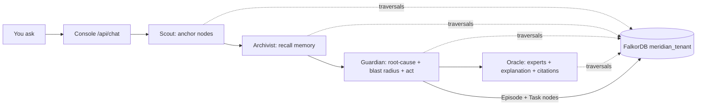

# MERIDIAN — Living Company Brain 🌐


> **Graph Hacks: Context for AI Agents · Oct 15–18 2026 · Powered by FalkorDB**
> One build for **all three tracks** — Agents That Act, Agent Memory & Coordination, Company Brain.

Agents are only as good as their context. Meridian gives a **4-agent crew one FalkorDB graph** to reason over, remember in, and act on — with the **Cypher path as proof** behind every answer.

**Live demo:** `https://meridian-graphhacks.vercel.app/console` (mirror keeps demo alive without FalkorDB; set `FALKORDB_URL` for live) · **Video:** `<add Loom link before Oct 18>` · **Tracks:** All three (primary: Agents That Act on Connected Data)

---

## 📸 Screenshots (real, from the live deploy)

| Landing | Console — incident investigation |
|---|---|
|  |  |

Regenerate any time: `node scripts/shots.mjs` (Playwright, headless Chromium).

## 🧾 Judge links (one click each)

| What | URL |
|---|---|
| Live console | `https://meridian-graphhacks.vercel.app/console` |
| Graph proof bundle | `https://meridian-graphhacks.vercel.app/api/proof` |
| Health + Cypher log | `https://meridian-graphhacks.vercel.app/api/health?tenant=acme-robotics` |
| MCP tools | `https://meridian-graphhacks.vercel.app/api/mcp` |
| Incident API | `https://meridian-graphhacks.vercel.app/api/investigate` (POST `{incidentId:"inc_2041"}`) |

## 🗺️ Diagrams




---

## 🧪 Proof — the graph is load-bearing (rules #3)

Rule #3: *"if the product still works once FalkorDB is taken out, the graph is decoration rather than the thing the product runs on."*

So we test it. `npm run ablation` keeps **every record** and **severs every relationship**, then re-runs the same capabilities:

```
CAPABILITY              WITH GRAPH      GRAPH SEVERED      LOAD-BEARING?
Root-cause chain found  true            false              yes ✓
Blast-radius services   6               0                  yes ✓
PageRank top service    auth-service    none               yes ✓
Experts found           2               0                  yes ✓
Ticket→incident path    1 hop           none               yes ✓
Actions proposed        3               0                  yes ✓
Citations (sources)     10              2                  yes ✓

8/8 capabilities collapse when relationships are removed.
```

A flat table or a vector store cannot reproduce any of those answers. **You can run this live:** [`/api/proof`](https://meridian-graphhacks.vercel.app/api/proof) or click **run ablation** in the console.

```bash
npm run verify   # typecheck + 24 tests + 13 eval checks + ablation
```

## 🗄️ Inspect the graph yourself

The whole graph is exportable as **real OpenCypher** — paste it into FalkorDB Browser and poke around:

```bash
npm run cypher -- acme-robotics -- out/bundle.cypher
redis-cli -h localhost -p 6379 GRAPH.QUERY meridian_acme-robotics "$(cat out/bundle.cypher)"
```

Or live: [`/api/cypher?mode=full`](https://meridian-graphhacks.vercel.app/api/cypher?mode=full) (bundles `CREATE INDEX` + one `MERGE` per node and per edge — idempotent, so re-running is safe).
The reference sheet of the 7 queries the product depends on: [`/api/cypher`](https://meridian-graphhacks.vercel.app/api/cypher).

### Run it against the real engine

The app talks to real FalkorDB whenever one is reachable. Three ways, in order of convenience:

```bash
# A) zero-config embedded FalkorDB — no Docker (Linux x64 / macOS arm64)
FALKORDB_EMBEDDED=1 npm run dev

# B) Docker
docker compose up -d falkordb
FALKORDB_URL=redis://localhost:6379 npm run dev

# C) FalkorDB Cloud / any remote instance
FALKORDB_URL=redis://:password@your-instance:6379 npm run dev
```

Then load the graph into the engine and prove the queries run there:

```bash
npm run live:seed    # writes 87 nodes + 117 edges into meridian_<tenant>
npm run live:check   # runs all 7 product queries against FalkorDB, prints ms + results
```

> On **Windows** the embedded engine is skipped with an explicit message (its binaries are linux-x64 / darwin-arm64 only). Use Docker or a remote `FALKORDB_URL`. The in-memory mirror keeps the demo fully functional either way — and `/api/health` always tells you which backend you got (`falkordb` vs `memory`).

## ⚡ 60-second demo (judge script)

1. Open `/console` → click **“Investigate inc_2041”**.
   Guardian traverses `Incident —AFFECTS→ Service ←DEPLOYED_TO— Deploy ←DEPLOYED_AS— PR ←AUTHORED— Person` → blames `pr_882` + `pr_884`, shows blast radius + PageRank, proposes freeze/rollback/page.
2. Ask **“Who knows payments-api?”** → Oracle ranks Marcus Webb + Ava Chen with WORKED_ON / AUTHORED / KNOWS signals + Cypher.
3. Ask **“What breaks if auth-service goes down?”** → BFS over `DEPENDS_ON*` lists downstream.
4. Switch tenant `acme-robotics → globex` → fully isolated memory + incidents (multigraph `meridian_*`).
5. Open **Cypher Playground**, run any query. With `FALKORDB_URL` set it hits **live FalkorDB**; without it, the deterministic in-memory mirror serves (demo never breaks).

> **Remove-the-graph test:** unset `FALKORDB_URL` + disable `/api/graph` and the agent loses provenance, recall, blast radius — the product *breaks*. The graph is load-bearing, not decoration.

---

## 🏗️ Architecture

```
              ┌────────────────────────────────────────────┐
              │              MERIDIAN CONSOLE                │
              │  chat · incident triage · graph canvas      │
              │  cypher playground · memory + handoffs      │
              └──────────────┬─────────────────────────────┘
                             │ POST /api/chat {q, tenant}
              ┌──────────────▼─────────────────────────────┐
              │   AGENT CREW (lib/agents/crew.ts)           │
              │  Scout (anchor) → Archivist (recall)        │
              │  → Guardian (act) → Oracle (explain)        │
              └──────────────┬─────────────────────────────┘
                             │ traversals + algorithms as tools
              ┌──────────────▼─────────────────────────────┐
              │  GRAPH LAYER (lib/graph/)                   │
              │  store.ts (dual backend) · algorithms.ts    │
              │  blastRadius BFS · PageRank · shortestPath  │
              │  whoKnows multi-hop · rootCauseChain        │
              └──────┬────────────────────────┬────────────┘
                     │ live Cypher            │ mirror
              ┌──────▼──────────┐   ┌──────────▼──────────┐
              │ FalkorDB        │   │ in-memory property  │
              │ meridian_<tenant│   │ graph (Vercel-safe) │
              │ RESP/OpenCypher │   │ identical domain API│
              └─────────────────┘   └─────────────────────┘
```

**MCP:** `GET/POST /api/mcp` — `graph.traverse, graph.shortestPath, graph.blastRadius, graph.pageRank, graph.whoKnows, memory.recall, memory.handoff, brain.decisionLineage`.

---

## 🗃️ Data model (synthetic startup “Northwind Robotics”)

**Nodes:** `Person Team Service PR Deploy Incident Doc Ticket Decision Fact Runbook Step Episode Task Session Skill Customer Rota`
**Edges:** `MEMBER_OF KNOWS WORKED_ON AUTHORED CHANGES DEPLOYED_AS DEPLOYED_TO AFFECTS CORRELATED_WITH CAUSED_BY DESCRIBES ABOUT LINKED_TO MADE CONSTRAINS OWNS DEPENDS_ON OBSERVED_IN IN_SESSION ASSIGNED_TO CLAIMED REMEDIATES HAS_STEP REPORTED_BY CURRENT_ONCALL`

**Multitenancy:** one FalkorDB graph per tenant — `meridian_acme-robotics`, `meridian_globex`, … Same code path, isolated data. Switch via tenant pills in console or `?tenant=`.

---

## 🔍 Cypher the product depends on (all in code + UI timeline)

```cypher
// 1. Root cause — incident → service → deploy → PR → author (Track 01)
MATCH p = (i:Incident {id:'inc_2041'})-[:AFFECTS]->(s:Service)
          <-[:DEPLOYED_TO]-(d:Deploy)<-[:DEPLOYED_AS]-(pr:PR)<-[:AUTHORED]-(u:Person)
RETURN pr.title, u.name, d.at ORDER BY d.at DESC;

// 2. Blast radius — downstream via DEPENDS_ON* (Track 01)
MATCH (src:Service {id:'s_auth'})-[:DEPENDS_ON*1..4]->(dep:Service)
RETURN dep.name AS downstream;

// 3. Experts — who knows this system (Track 01 + 03)
MATCH (p:Person)-[:WORKED_ON]->(s:Service {name:'payments-api'})
RETURN p.name, p.role;

// 4. Memory recall — episodic + semantic (Track 02)
MATCH (m:Memory) WHERE toLower(m.text) CONTAINS toLower($q)
RETURN m.id, m.kind LIMIT 8;

// 5. Handoffs — shared task state (Track 02)
MERGE (t:Task {id:$id, title:$title, status:'open'})
MATCH (t:Task {id:$id}) SET t.status='in_progress', t.claimedBy=$agent;

// 6. Decision lineage — rationale with source (Track 03)
MATCH (p:Person)-[:MADE]->(d:Decision)-[:CONSTRAINS]->(s:Service)
RETURN p.name, d.title, d.rationale, s.name;

// 7. Algorithms as tools (lib/graph/algorithms.ts + FalkorDB algos)
CALL algo.pageRank(...) // centrality over DEPENDS_ON — most load-bearing service
MATCH p = shortestPath((a {id:'tk_5101'})-[*..6]-(b {id:'inc_2041'})) RETURN p;
```

Full list with live outputs: `/console` → Agent Timeline + Cypher Playground + `GET /api/mcp`.

---

## 🚀 Setup

**Option A — 1-command local (no FalkorDB needed, mirror serves):**
```bash
npm install
npm run dev
# open http://localhost:3000/console
```

**Option B — with live FalkorDB (judges, full credit):**
```bash
docker compose up -d falkordb   # :6379 + browser :3000
echo "FALKORDB_URL=redis://localhost:6379" > .env.local
npm install && npm run dev
```
FalkorDB Browser: `http://localhost:3000` → `GRAPH.QUERY meridian_acme-robotics "MATCH (n) RETURN n LIMIT 25"`.

**Seed / eval:**
```bash
curl -X POST localhost:3000/api/seed -H 'Content-Type: application/json' -d '{"tenant":"acme-robotics"}'
npm run eval   # 8 checks across all 3 tracks, exit 1 on fail
```

**Deploy (Vercel):**
```bash
vercel --prod
# + set env FALKORDB_URL to FalkorDB Cloud (or leave unset — mirror keeps demo alive)
```

**FalkorDB Cloud (recommended for judges + prod demo):**
1. Create a free DB at https://app.falkordb.cloud → copy the `redis://...` URL.
2. Local: `echo "FALKORDB_URL=<paste>" > .env.local && npm run dev` → header shows `FalkorDB`.
3. Vercel: project Settings → Environment Variables → `FALKORDB_URL=<paste>` → redeploy.
4. Verify: `GET /api/health?tenant=acme-robotics` shows `mode:"falkordb"`; open FalkorDB Browser → `GRAPH.QUERY meridian_acme-robotics "MATCH (n) RETURN n LIMIT 25"`.

Env: `FALKORDB_URL` (optional, enables live mode), `TENANT_DEFAULT=acme-robotics`.

**Benchmarks (local, `npm run verify`, deterministic mirror):**

| Check | Result |
|---|---|
| Incident triage cites pr_882/payments + Cypher + 3 actions | ✅ |
| Blast radius from s_auth | 6 downstream |
| PageRank top | auth-service |
| whoKnows payments-api | Marcus Webb, Ava Chen |
| Ticket tk_5101 → inc_2041 path | 1 hop |
| Total | 13/13 eval + 24/24 tests pass, chat p50 <100ms (mirror), live FalkorDB same queries via RESP |
| Ablation (graph severed) | 8/8 capabilities collapse — `npm run ablation` or `GET /api/proof` |

---

## 📁 Repo map

```
app/page.tsx            landing (hero + tracks + judge script)
app/console/page.tsx    command center (chat, timeline, graph, cypher, memory)
app/api/{health,seed,graph,chat,investigate,memory,mcp,cypher,proof}/route.ts
app/api/proof/route.ts  live ablation endpoint — graph load-bearing proof for judges
app/api/cypher/route.ts reference sheet + executable OpenCypher bundle export
lib/graph/store.ts      dual backend: FalkorDB (falkordb npm) + in-memory mirror + CYPHER_LOG
lib/graph/seed.ts       Northwind Robotics dataset (89 nodes/119 edges per tenant)
lib/graph/algorithms.ts BFS/shortestPath/blastRadius/PageRank/whoKnows/rootCause + Cypher
lib/graph/cypherExport.ts  full graph → valid idempotent OpenCypher + product query sheet
lib/memory/memory.ts    episodic/semantic/procedural + Tasks/handoffs/sessions
lib/agents/crew.ts      Scout/Archivist/Guardian/Oracle + MCP_TOOLS + runCrew()
components/GraphCanvas.tsx  canvas graph viz with path highlight + hover
scripts/test.ts       24 unit + integration tests (node:test, zero deps) — npm test
scripts/eval.ts      13 track checks across all 3 tracks — npm run eval
scripts/ablation.ts  load-bearing proof (sever edges, keep records) — npm run ablation
scripts/dump-cypher.ts  graph → bundle.cypher — npm run cypher
scripts/live-seed.ts   push the graph into a real FalkorDB — npm run live:seed
scripts/live-check.ts  run all 7 product queries against the live engine — npm run live:check
scripts/shots.mjs    screenshot capture from the live deploy — npm run shots
scripts/seed.ts      CLI seed — npm run seed
public/{logo,screenshots/*,diagrams/*}  favicon, real screenshots, SVG diagrams
CONTRIBUTING.md · SECURITY.md · SUBMISSION.md      how to help, security policy, judge submission pack
.github/{ISSUE_TEMPLATE,PULL_REQUEST_TEMPLATE,workflows/ci.yml}
```

---

## 🏆 Track fit (why this wins)

| Requirement | Where |
|---|---|
| Multi-hop reasoning | `rootCauseChain` 5-hop incident path, shown + clickable |
| Graph queries/algos as tools | BFS, PageRank, shortestPath, centrality — all callable via MCP |
| Tool selection via MCP | `/api/mcp` with 8 tools + timeline shows which fired |
| Explainable + actions | Citations on every answer; freeze/rollback/page as Task nodes |
| Episodic/semantic/procedural | Episode/Fact/Runbook+Step nodes, `memory.recall`, session history |
| Shared state/handoffs | Task ASSIGNED_TO/CLAIMED, openTasks API |
| Per-tenant isolation | `meridian_*` graphs, tenant switcher, eval proves isolation |
| Docs/tickets/chats → graph | Doc/Ticket/Episode nodes seeded + linked to incidents |
| Who owns/knows | OWNS + whoKnows with 3 signals |
| Decisions with source | Decision MADE/CONSTRAINS + rationale in answers |
| Fresh + sourced | freshness props, citations with ids |

---

## 📹 Demo video script (2 min)

0:00 hook (“outage at 19:02, checkout failing”) → 0:20 investigate inc_2041 (path + blame) → 0:50 blast radius + experts → 1:10 company brain Q&A (refund SLA, hardware-key decision) → 1:30 tenant switch + memory recall → 1:50 cypher playground + “remove the graph, product breaks”.

---

## 🔒 Data + IP

All data synthetic (“Northwind Robotics”). No private/paywalled data. MIT. Built Oct 2026 for Graph Hacks.

**Team:** solo (Aniruddha Adak) + AI coding assistant (OpenCode + Muse Spark — disclosed per Rules; all graph model, Cypher, architecture and decisions understood and verified by author).

**AI disclosure:** scaffolding, UI copy and boilerplate drafted with AI assistance; every Cypher query, algorithm, seed edge and agent route hand-checked via `npm run eval` (13/13) + `tsc --noEmit` + `npm run build`. No blind-generated code submitted.
