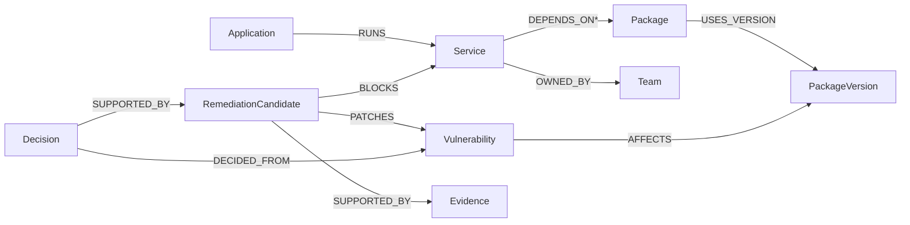
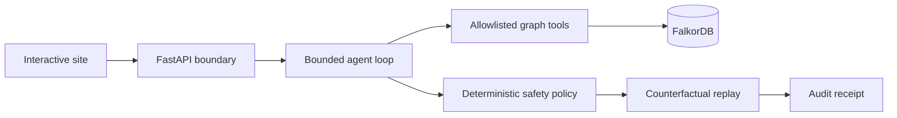

# PATCHPATH

## Patch before you break.

**Autonomous Dependency-Risk Remediation Agent powered by FalkorDB.**

PatchPath follows vulnerabilities through transitive dependencies, explains every affected service, rejects unsafe upgrades, and replays the safest remediation before production is touched.


## Real demo


[Watch the bounded 1280×720 investigation (WebM)](artifacts/media/patchpath_graph_investigation.webm) · [Watch the unsafe-upgrade comparison (WebM)](artifacts/media/patchpath_unsafe_upgrade_rejection.webm)

> Real FalkorDB queries · explainable graph-tool calls · reproducible audit receipts · synthetic demo data

The main narrated demo and live deployment will be linked after they are recorded and verified.

## What PatchPath does

A scanner can identify a vulnerable package. PatchPath answers the harder connected question: **what will break, which plan is safe, and what evidence supports that decision?**

In the showcase fixture, one vulnerable version reaches **6 services through 6 multi-hop paths**. A cheap major upgrade is rejected with `COMPATIBILITY_BLOCK`; a compatible parent upgrade is selected; counterfactual replay projects **6 → 0 exposed services** while preserving the baseline graph.


[Animated unsafe-upgrade proof](artifacts/media/patchpath_unsafe_upgrade_rejection.gif)

These are real runs against synthetic fixtures, not static mock states.

## Why FalkorDB matters

The answer spans applications, services, transitive packages, versions, vulnerabilities, owners, remediation candidates, compatibility constraints, and evidence. FalkorDB is the operating context, not a visualization layer:

- variable-length traversal calculates blast radius;
- connected constraints reject incomplete or incompatible plans;
- graph paths explain every affected service;
- decision nodes and hashes make replay auditable.

Remove FalkorDB and the core decision stops working.

## Agent investigation

`OBSERVE → QUERY_GRAPH → FORM_HYPOTHESES → GENERATE_OPTIONS → QUERY_IMPACT → EVALUATE_CONSTRAINTS → CHOOSE_PLAN → SIMULATE → VERIFY → EXPLAIN → PERSIST_DECISION`

The bounded agent produces an explicit trace of 8–10 graph-tool calls per scenario. It abstains for unknown vulnerabilities or when no safe remediation satisfies the connected constraints.

The default demo uses deterministic orchestration. A separate hybrid technical proof records local `qwen3:8b` selecting three allowlisted read tools while deterministic graph policy retains safety authority. Model prose never authorizes a remediation.

## Multi-hop dependency graph



Traversal is bounded to six dependency hops and remains cycle-safe. The included fourth fixture contains converging branches and a dependency cycle.

## Remediation planning

Each candidate is checked for coverage, compatibility blocks, residual vulnerable services, ownership evidence, breaking-risk, and effort proxies. The policy selects the lowest-ranked safe candidate. It does not execute package upgrades or repository writes.

The showcase rejects:

- a direct major upgrade because it blocks Checkout (`COMPATIBILITY_BLOCK`);
- an isolation-only plan because services remain exposed (`RESIDUAL_VULNERABLE_SERVICES`).

It selects a compatible parent-adapter upgrade that covers every affected path.

## Counterfactual replay

PatchPath calculates a deterministic projection, verifies expected residual exposure, and confirms that the source graph was not mutated. A semantic `analysis_hash` excludes random run identifiers, so identical evidence and policy replay to the same hash.

**Showcase result: 6 exposed services → 0 projected exposures.**

**Simulated remediation. No production changes.**

## Evaluation

| Evidence | Result |
|---|---:|
| Synthetic gold scenarios | 4 |
| Blast-radius precision | 1.00 |
| Blast-radius recall | 1.00 |
| Direct-only baseline recall | 0.25 |
| Correct remediation plans | 4/4 |
| Selected-plan constraint violations | 0 |
| Counterfactual consistency | 1.00 |
| Integration tests | 7/7 |

The cycle-safe fixture finds 2 affected services through 3 paths and rejects a partial remediation. These four synthetic fixtures are a correctness suite, **not a production or industrial security benchmark**.

## Reproducible setup

Requirements: Python 3.11, Docker Desktop or Docker Engine, and PowerShell for the included bootstrap scripts.

```powershell
git clone https://github.com/chapaevv123/patchpath-falkordb-agent.git
cd patchpath-falkordb-agent
./scripts/bootstrap.ps1
./scripts/start.ps1
```

Open <http://127.0.0.1:8890>. FalkorDB binds to `127.0.0.1:6380`; FalkorDB Browser uses `127.0.0.1:3001`.

```powershell
./.venv/Scripts/python.exe -m pytest -q
./.venv/Scripts/python.exe ./scripts/verify_real_falkordb.py
./.venv/Scripts/python.exe ./scripts/evaluate.py
./.venv/Scripts/python.exe ./scripts/v3_browser_qa.py
```

The Docker application image runs as UID/GID `65532:65532` and includes a FalkorDB-aware healthcheck. See [deployment guidance](docs/DEPLOYMENT.md) before hosting publicly.

### Render Free single-container option

`Dockerfile.render` packages the pinned FalkorDB 4.22.1 server and PatchPath API in one web-service image. FalkorDB binds only to container localhost; Uvicorn is the only public listener and binds to Render's `$PORT`. On every cold start the service performs a real Cypher round-trip and deterministically reloads the synthetic Compatibility Trap fixture before readiness returns HTTP 200.

```powershell
docker build -f Dockerfile.render -t patchpath:render-free .
docker run --rm --memory 512m --cpus 0.10 -e PORT=10000 -p 127.0.0.1:8892:10000 patchpath:render-free
```

The Render Free filesystem is ephemeral. Demo fixtures are reproducible, but runtime decisions and audit receipts disappear on restart. This project does not claim persistent hosted history and does not use artificial keep-alive traffic.

## Architecture



The browser never submits arbitrary Cypher. FastAPI exposes bounded scenario operations; graph tools query isolated FalkorDB graphs; deterministic policy evaluates safety; replay emits a reproducible receipt. See [the detailed architecture](docs/ARCHITECTURE.md).

## Cypher evidence

```cypher
MATCH p=(s:Service)-[:DEPENDS_ON*1..6]->(pkg:Package)
  -[:USES_VERSION]->(pv:PackageVersion)<-[:AFFECTS]-
  (v:Vulnerability {id: $vulnerability_id})
OPTIONAL MATCH (app:Application)-[:RUNS]->(s)
OPTIONAL MATCH (s)-[:OWNED_BY]->(team:Team)
RETURN s.id, app.id, team.id, length(p), [n IN nodes(p) | n.id]
ORDER BY s.id, length(p)
```

Runtime values are parameters. Fixture labels and relationship types are allowlisted. Public visitors cannot submit Cypher. Real round-trip receipts are included under `artifacts/receipts/`.

## Security and limitations

- Recommendation and simulation only; no production patch execution.
- No arbitrary Cypher, source code, scripts, or uploads from visitors.
- Parameterized values and allowlisted schema tokens.
- Request-size limit, rate limit, security headers, and non-root container.
- Optional FalkorDB ACL credentials and TLS.
- No Pulse database, private owner data, or secrets.
- Separate process liveness and FalkorDB-aware readiness endpoints.
- All included vulnerabilities, organizations, and dependency graphs are synthetic.
- Version applicability is fixture-declared; production use needs audited ecosystem-specific range parsing and advisory ingestion.
- Cost is a unitless effort proxy, not a financial estimate.
- Counterfactuals are projections, not executed production changes.

## AI disclosure

AI coding assistance was used during implementation and documentation. The participant remains responsible for the graph model, Cypher, architecture, policy, security, tests, and demonstration. The main demo uses deterministic orchestration. The optional hybrid proof uses a local model only for allowlisted graph-tool selection and narrative; deterministic policy owns factual and safety decisions. No private chain-of-thought is stored.

## Graph Hacks 2026

Built for **Graph Hacks: Context for AI Agents — WeMakeDevs × FalkorDB**.

Primary track: **Agents That Act on Connected Data**.

## License and credits

MIT License. Built with FalkorDB, the official FalkorDB Python client, FastAPI, Uvicorn, Playwright, and Docker. Dependencies and third-party projects retain their own licenses. See [credits](CREDITS.md).
