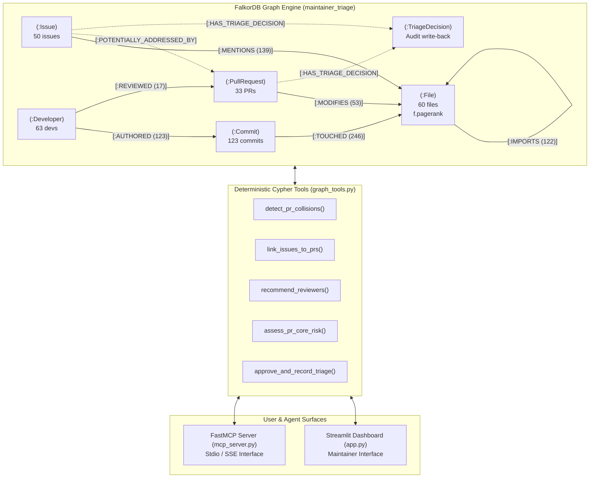

# Open-Source Maintainer Triage Agent

> A graph-native triage and merge conflict hazard detector for open-source repositories, powered by **FalkorDB** and **FastMCP**.

[](https://www.python.org/downloads/)
[](https://www.falkordb.com/)
[](https://github.com/jlowin/fastmcp)
[](https://streamlit.io/)
[](https://opensource.org/licenses/MIT)

---

## The Problem

High-traffic open-source repositories often face a triage bottleneck:
- **Dozens of open PRs** compete for maintainer attention and can introduce breaking changes across coupled modules.
- **Dozens of issues** describe symptoms of identical underlying bugs without referencing the affected files or candidate PRs.
- **Hidden merge hazards**: Two PRs modify different files and pass CI independently, but because one file imports the other, merging both introduces breaking runtime errors.

Standard LLM triage bots fail here because they treat code repositories as flat text strings or chunked vectors. Semantic similarity cannot detect architectural import chains or evaluate commit history recency.

The **Open-Source Maintainer Triage Agent** models repository structure, git churn, and community activity as an interconnected knowledge graph in **FalkorDB**. All triage recommendations are computed via deterministic multi-hop Cypher queries with auditable graph path evidence.

---

## Architecture & Graph Model

The engine represents repository state as a typed property graph:



### Why Graph Topology Beats Vector Search for Code Triage

1. **1-Hop Import-Coupled PR Collisions**:
   Standard git conflict detection only alerts when PRs edit the exact same lines of code. FalkorDB flags architectural collisions across dependencies:
   - PR #3741 (`@p3ck`) modifies `httpx/_client.py`.
   - PR #3778 (`@akx`) modifies `httpx/_transports/default.py`.
   - Neither PR modifies the other's file, but `httpx/_client.py` imports `httpx/_transports/default.py`.
   - FalkorDB catches this 1-hop hazard:
     ```
     PullRequest #3741 -> File `httpx/_client.py` -[:IMPORTS]-> File `httpx/_transports/default.py` <- PullRequest #3778
     ```

2. **Issue-to-PR Structural Resolution**:
   - Issue #3728 reports a cancellation scope error mentioning `httpx/_client.py`.
   - PR #3769 modifies `httpx/_client.py` to ensure mounted transports close properly.
   - Traversing `(:Issue)-[:MENTIONS]->(:File)<-[:MODIFIES]-(:PullRequest)` links them with 0.95 confidence, creating a `[:POTENTIALLY_ADDRESSED_BY]` edge in the graph.

3. **GraphBLAS In-Memory PageRank for Core Architecture**:
   FalkorDB computes `CALL algo.pageRank('File', 'IMPORTS')` directly in memory. Highly-imported core files (`httpx/_models.py` at `0.0773`, `httpx/_types.py` at `0.0598`) are classified as `HIGH_RISK_CORE`, automatically enforcing a two-maintainer review policy.

4. **Recency-Decayed Reviewer Scoring**:
   Instead of static keyword matching, reviewer recommendations traverse recent commits touching the modified files with continuous time decay:
   $$\text{Score} = \sum \frac{\text{changes}}{1.0 + 0.05 \times \text{days\_ago}} + 15.0 \times \text{prior\_reviews}$$
   Bots (`[bot]`, `dependabot`) and the PR author are filtered out automatically.

---

## Benchmark Repository Data (`encode/httpx`)

The benchmark dataset represents a sampled triage snapshot of `encode/httpx` (configured via `--limit-prs 30 --limit-issues 50 --depth 150`) to stay within standard GitHub API rate limits (60 req/hr) while capturing the active triage queue:

| Metric | FalkorDB Value | Details |
| :--- | :---: | :--- |
| **Tracked Python Files** | **60** | Core source modules (excluding tests and docs) |
| **AST Import Edges** | **122** | Extracted via Python's `ast` parser |
| **Open Pull Requests** | **33** | Full metadata and modified file manifests |
| **Open Issues Ingested** | **50** | Issues paginated via GitHub REST API |
| **Issues Linked to Code** | **39 / 50 (78.0%)** | Matched via regex traces and AST symbol tables |
| **Active PR File Collisions** | **7 Files** | Core `.py` files modified by multiple PRs |
| **Unique Developers** | **63** | Normalized GitHub handles (bots excluded) |
| **Git Commits Mined** | **123** | Git history with line churn and timestamps |
| **Cypher Query Latency** | **< 15 ms** | In-memory graph traversal response times |

---

## Core Cypher Queries (FastMCP Tools)

All graph tools in [`graph_tools.py`](./graph_tools.py) execute parameterized Cypher queries against FalkorDB:

### 1. `detect_pr_collisions(pr_number)`
```cypher
MATCH (pr1:PullRequest {state: 'open'})
MATCH (pr2:PullRequest {state: 'open'})
WHERE pr1.number < pr2.number 
  AND pr1.base_branch = pr2.base_branch
  AND ($pr_number IS NULL OR pr1.number = $pr_number OR pr2.number = $pr_number)

// 0-Hop: Direct File Overlap
OPTIONAL MATCH (pr1)-[m1:MODIFIES]->(f_direct:File)<-[m2:MODIFIES]-(pr2)
WHERE NOT f_direct.path STARTS WITH 'tests/' 
  AND NOT f_direct.path ENDS WITH '__init__.py'

// 1-Hop: Import-Coupled Collision
OPTIONAL MATCH (pr1)-[m1c:MODIFIES]->(f1:File)-[:IMPORTS]->(f2:File)<-[m2c:MODIFIES]-(pr2)
WHERE f1 <> f2 
  AND NOT f1.path STARTS WITH 'tests/' 
  AND NOT f2.path STARTS WITH 'tests/'
  AND NOT f1.path ENDS WITH '__init__.py' 
  AND NOT f2.path ENDS WITH '__init__.py'

RETURN pr1, pr2, f_direct, m1.changes, m2.changes, f1, f2, m1c.changes, m2c.changes
```

### 2. `link_issues_to_prs(issue_number)`
```cypher
MATCH (i:Issue)
WHERE ($issue_number IS NULL OR i.number = $issue_number)
MATCH (i)-[m:MENTIONS]->(f1:File)

MATCH (f1)-[imp:IMPORTS*0..1]->(f2:File)<-[mod:MODIFIES]-(pr:PullRequest {state: 'open'})
WHERE NOT f2.path STARTS WITH 'tests/'
  AND (length(imp) = 0 OR NOT f1.path ENDS WITH '__init__.py')

WITH i, pr, f1, f2, m, mod, length(imp) AS hop_distance,
     CASE WHEN length(imp) = 0 THEN m.confidence ELSE m.confidence * 0.8 END AS calc_confidence
ORDER BY calc_confidence DESC, mod.changes DESC

MERGE (i)-[rel:POTENTIALLY_ADDRESSED_BY]->(pr)
ON CREATE SET rel.confidence = calc_confidence,
              rel.hop_distance = hop_distance,
              rel.shared_file = f1.path,
              rel.verified_by_human = false
RETURN i.number, pr.number, calc_confidence, hop_distance, f1.path, f2.path
```

### 3. `recommend_reviewers(pr_number)`
```cypher
MATCH (pr:PullRequest {number: $pr_number})-[mod:MODIFIES]->(f:File)
WHERE NOT f.path STARTS WITH 'tests/'
MATCH (d:Developer)-[:AUTHORED]->(c:Commit)-[t:TOUCHED]->(f)
WHERE d.login <> pr.author
  AND NOT d.login CONTAINS '[bot]'
  AND NOT d.login CONTAINS 'bot'

OPTIONAL MATCH (d)-[:REVIEWED]->(past_pr:PullRequest)-[:MODIFIES]->(f)

WITH d,
     collect(DISTINCT f.path) AS files_touched,
     sum(toFloat(t.changes) / (1.0 + 0.05 * toFloat(c.days_ago))) AS commit_score,
     count(DISTINCT past_pr) * 15.0 AS review_bonus
RETURN d.login AS reviewer,
       commit_score + review_bonus AS composite_score,
       commit_score,
       review_bonus,
       files_touched
ORDER BY composite_score DESC
LIMIT 3
```

### 4. `assess_pr_core_risk(pr_number)`
```cypher
MATCH (pr:PullRequest {number: $pr_number})-[mod:MODIFIES]->(f:File)
WHERE NOT f.path STARTS WITH 'tests/'
  AND NOT f.path ENDS WITH '__init__.py'

OPTIONAL MATCH (other:File)-[:IMPORTS]->(f)

WITH pr, f, mod,
     coalesce(f.pagerank, 0.0) AS pr_score,
     count(DISTINCT other) AS in_degree
RETURN f.path AS file_path,
       pr_score,
       in_degree,
       mod.changes AS changes,
       CASE WHEN pr_score >= 0.035 OR in_degree >= 5 THEN true ELSE false END AS is_core
```

### 5. `approve_and_record_triage(...)`
Creates a `(:TriageDecision)` audit node, updates edge verification flags, and formats executable `gh` CLI commands (`gh pr edit`, `gh pr comment`).

---

## Quickstart

### Prerequisites
- Python 3.10+
- Docker (for running FalkorDB)

### 1. Setup Environment
```bash
git clone https://github.com/darshans2006/open-source-maintainer-triage-agent.git
cd open-source-maintainer-triage-agent

python -m venv .venv
# On Windows:
.venv\Scripts\activate
# On Linux / macOS:
source .venv/bin/activate

pip install -r requirements.txt
```

### 2. Start FalkorDB
```bash
docker run -p 6379:6379 -d --name falkordb falkordb/falkordb:latest
```

### 3. Ingest Repository Graph
The project includes pre-cached GitHub REST API payloads in `cache/encode_httpx/`, allowing immediate offline ingestion for the default target without API rate limits or authentication tokens:
```bash
python ingest.py --repo encode/httpx
```

#### Ingesting Any Other Python Repository
The ingestion engine works dynamically with any public Python repository on GitHub. Simply pass the `--repo <owner>/<repo>` flag:
```bash
# Example 1: Ingest Starlette
python ingest.py --repo encode/starlette

# Example 2: Ingest Requests
python ingest.py --repo psf/requests

# Example 3: Ingest FastAPI
python ingest.py --repo tiangolo/fastapi
```

> **Tip for Custom Repositories**: When ingesting repositories that are not pre-cached, add your `GITHUB_TOKEN` to `.env` to take advantage of GitHub's authenticated rate limit of 5,000 requests/hour (unauthenticated calls are capped at 60/hour). You can also customize sampling bounds with `--limit-prs` (default: 30), `--limit-issues` (default: 50), and commit history `--depth` (default: 150).

### 4. Run Unit Tests
```bash
pytest
```

### 5. Launch the Dashboard
```bash
streamlit run app.py
```
Open **`http://localhost:8501`** in your browser.

---

## Model Context Protocol (FastMCP) Integration

The triage tools can be mounted into any MCP-compatible client (Claude Desktop, Cursor, etc.).

Start the server directly:
```bash
python mcp_server.py
```

Or run the built-in self-test:
```bash
python mcp_server.py --test
```

### Client Configuration (`claude_desktop_config.json`)
```json
{
  "mcpServers": {
    "maintainer-triage": {
      "command": "python",
      "args": ["/path/to/open-source-maintainer-triage-agent/mcp_server.py"]
    }
  }
}
```

---

## Project Structure

```
├── app.py              # Streamlit dashboard for interactive triage & audit log
├── graph_tools.py      # Parameterized Cypher traversal engine & scoring logic
├── ingest.py           # AST import parsing, git log miner, GitHub API client
├── mcp_server.py       # FastMCP server exposing graph tools
├── requirements.txt    # Project dependencies
├── tests/              # Pytest suite for AST analyzer & graph logic
├── cache/              # Cached GitHub REST responses for offline development
└── BLOG_POST.md        # Technical case study & architecture breakdown
```

---

## Engineering Trade-offs & Limitations

1. **AST Parsing vs. Tree-sitter**:
   - Python's native `ast` module was chosen for zero extra runtime dependencies and fast parsing.
   - *Limitation*: Currently scoped to Python repositories. Expanding to TypeScript and Go using Tree-sitter is on the roadmap.
2. **Issue Linking Heuristics**:
   - Issue text is matched using deterministic filename substrings, Python tracebacks, and unique AST symbols.
   - *Limitation*: Issues that describe bugs purely conceptually without mentioning classes, files, or error traces remain unlinked unless manually mapped by a maintainer.
3. **GraphBLAS In-Memory Dependency**:
   - PageRank execution relies on FalkorDB's linear algebra engine. Large repositories (>10,000 files) require sufficient container RAM allocation during the PageRank call.

---

## License

MIT License. Developed as part of the **Graph Hacks** challenge (Track 1: Agents That Act on Connected Data).
