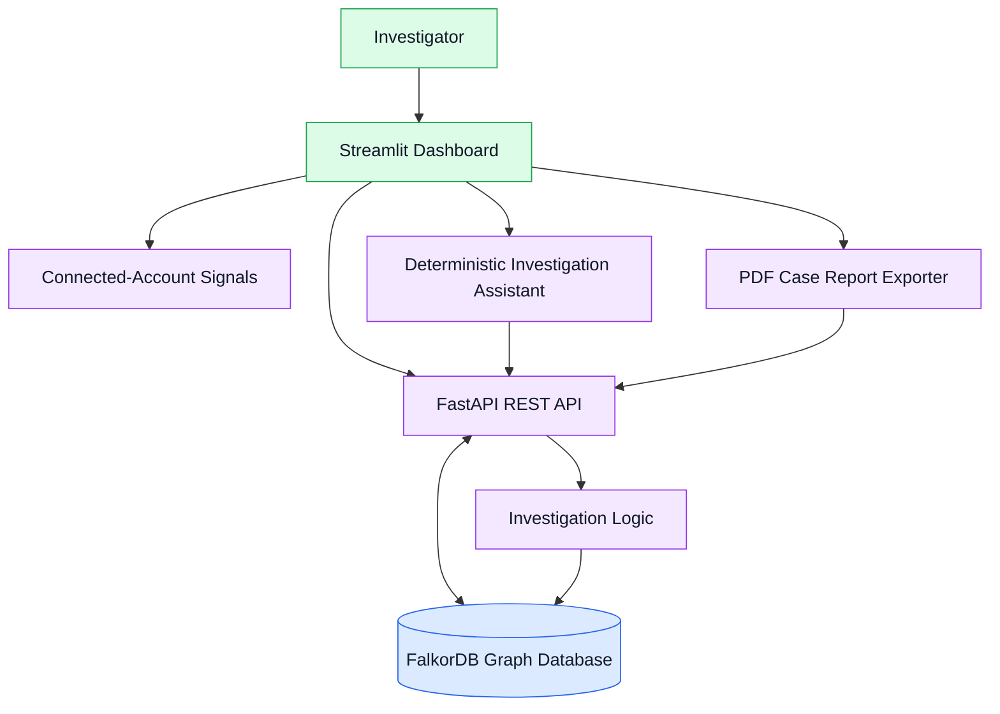
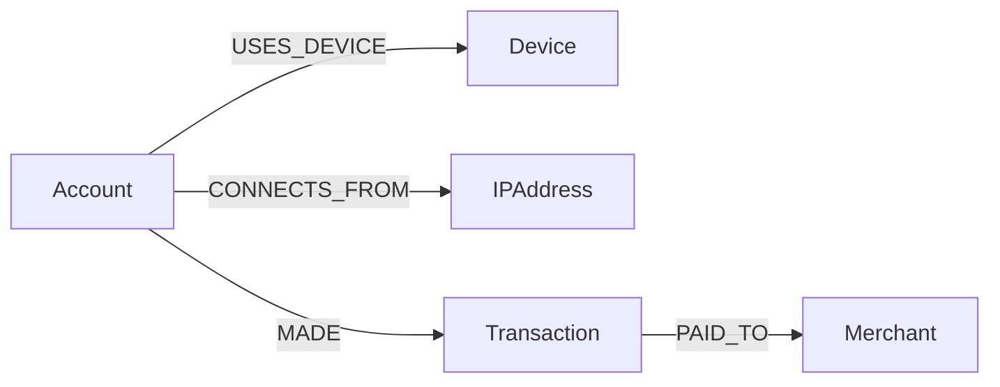

# FraudTrace AI
### Graph-Powered Fraud Investigation with FalkorDB

**Connect the evidence. Investigate the pattern. Keep the decision human.**

FraudTrace AI is a graph-powered investigation platform designed to help analysts explore suspicious transaction activity, identify relationships between accounts, inspect connected infrastructure, and generate structured case reports.

Instead of examining transactions in isolation, FraudTrace AI uses **FalkorDB** to represent and traverse relationships between accounts, devices, IP addresses, transactions, and merchants.

Investigators can explore graph neighborhoods at different depths, review supporting evidence, receive deterministic investigation summaries, and export PDF reports.

> **Important:** This project uses synthetic demonstration data. Investigation findings are leads for human review, not proof of fraud. The assistant retrieves graph evidence and uses deterministic question routing, with optional Groq/OpenAI-compatible language-model answering when configured. Model-generated responses may be incorrect; verify claims against the supporting evidence.

---

## Table of Contents

- [Problem Statement](#problem-statement)
- [Solution](#solution)
- [Key Features](#key-features)
- [Multi-Dataset Architecture](#multi-dataset-architecture)
- [System Architecture](#system-architecture)
- [Technology Stack](#technology-stack)
- [Graph Data Model](#graph-data-model)
- [Example Cypher Queries](#example-cypher-queries)
- [Project Structure](#project-structure)
- [Installation and Setup](#installation-and-setup)
- [Port Configuration & Conflict Troubleshooting](#port-configuration--conflict-troubleshooting)
- [Running the Application](#running-the-application)
- [API Reference](#api-reference)
- [Testing](#testing)
- [Example Investigation](#example-investigation)
- [Responsible Use and Limitations](#responsible-use-and-limitations)
- [Demo Walkthrough](#demo-walkthrough)
- [Hackathon Submission Checklist](#hackathon-submission-checklist)
- [Future Improvements](#future-improvements)
- [Acknowledgements](#acknowledgements)

---

## Problem Statement

Fraud investigations can become difficult when evidence is distributed across multiple accounts, transactions, devices, IP addresses, and merchants.

Reviewing individual transactions may not immediately reveal relationships that deserve further investigation.

For example:

- Multiple accounts may use the same device.
- Different accounts may connect through the same IP address.
- Several transactions may be associated with a common merchant.
- A relationship discovered through one account may lead investigators to other connected entities.

These connections do not necessarily indicate fraudulent activity. However, they can help investigators identify patterns that warrant closer examination.

## Solution

FraudTrace AI represents investigation data as a graph and uses FalkorDB to explore connections between entities.

The application provides an investigation workflow in which a user can:

1. Select an account for investigation.
2. Retrieve connected-account and transaction evidence.
3. Explore related entities through bounded graph traversal.
4. Inspect shared-device, shared-IP, and merchant signals.
5. Ask the deterministic investigation assistant for an evidence-based summary.
6. Generate a PDF case report for review.

The goal is to make connected evidence easier to explore and explain while keeping final decisions with human investigators.

---

## Key Features

### 1. Graph-Powered Investigation with FalkorDB
Uses FalkorDB to store entities and relationships and retrieve connected graph neighborhoods.

### 2. Interactive 3D Molecular Network Visualization
Renders genuine 3D molecular networks where nodes are spherical 'atoms' and edges are chemical 'bonds' with relationship-coded colors, smooth 3D orbit rotation, zoom, pan, and responsive layout modes (3D Molecular, 2D Force-Directed, 3D Spherical Orbit).

### 3. Real Multi-Hop Path Finder
Discovers and traces genuine multi-hop paths between any two entities in FalkorDB (e.g. Account → Device → Account, Account → IPAddress → Account, Account → Transaction → Merchant) with ordered step visualization and supporting evidence references.

### 4. Suspicious Cluster & Ring Detection
Discovers multi-account clusters sharing infrastructure (devices, IP addresses, merchants) with explainable heuristic risk scoring and flagged transaction breakdowns.

### 5. Connected-Account Signals
Identifies relationships involving shared devices, IP addresses, and merchants with transparent review priorities (HIGH, MEDIUM, REVIEW).

### 6. Transaction Evidence
Retrieves transaction details, merchant associations, amounts, and transaction status with UTF-8 safe currency formatting.

### 7. Evidence-Grounded Investigation Assistant
Produces structured investigation summaries using available graph evidence, with deterministic question routing, stable evidence references (`EV-LINK-...`, `EV-TXN-...`), and persistent case memory.

### 8. Persistent Case Memory (Track 02)
Stores investigation observations in FalkorDB linked to accounts (`:HAS_INVESTIGATION_MEMORY`), enabling cross-session recall and search across sessions.

### 9. PDF Case Report Generation
Exports comprehensive investigation findings, related accounts, transaction evidence, graph details, assistant output, and audit notes into court-ready PDFs.

### 10. Multi-Dataset Support & Dataset Isolation
Allows seamless switching between synthetic demonstration data (`demo_synthetic` graph: `FraudTrace`) and real-world-style transaction networks (`ibm_amlsim` graph: `ibm_amlsim`). Strict server-side allowlisting guarantees complete graph isolation and prevents cross-contamination.

### 11. Automated Test Suite
Includes unit, graph-isolation, AMLSim import, PDF report, and API smoke checks.

---

## Multi-Dataset Architecture

FraudTrace AI supports two distinct graph datasets simultaneously:

| Dataset ID | Graph Name | Focus & Characteristics | Key Entities & Labels | Recommended Starting Account |
|---|---|---|---|---|
| `demo_synthetic` | `FraudTrace` | Synthetic fraud ring with shared infrastructure signals | `Account`, `Device`, `IPAddress`, `Merchant`, `Transaction` | `ACC002` (Shares device with `ACC001`) |
| `ibm_amlsim` | `ibm_amlsim` | Synthetic AMLSim network with transfers, cash activity, branches, and alerts | `AMLAccount`, `AMLTransaction`, `AMLAlert`, `AMLBranch` | `AML_ACC_25` (Has alert `AML_ALERT_0`) |

### Key Guarantees:
1. **Server-Side Allowlist**: Controlled via `DATASET_ALLOWLIST = frozenset({"demo_synthetic", "ibm_amlsim"})` in [dataset_registry.py](file:///d:/PROJECTS/FraudTrace%20AI/dataset_registry.py). Arbitrary graph names are strictly rejected with HTTP 400.
2. **Schema Preservation**: The AMLSim dataset does not invent fake device/IP entities. Account transfers use `AML_SENT` and `AML_RECEIVED`; cash transactions link the account to an `AMLTransaction`, which records its branch and links to an `AMLBranch` using `AML_AT_BRANCH`. Alerts link to their source account using `HAS_ALERT`.
3. **Investigation Assistant Awareness**: The assistant explicitly informs the investigator of the active dataset and adapts its traversal logic accordingly.

---

## System Architecture

The following diagram represents the high-level application architecture.



### Component Responsibilities

| Component | Responsibility |
|---|---|
| Streamlit dashboard | Investigation interface, graph exploration, evidence presentation, and report download |
| FastAPI | REST endpoints, request validation, and investigation responses |
| FalkorDB | Graph storage and relationship traversal |
| Investigation logic | Collects connected-account and transaction evidence |
| Connected-account signals | Evaluates shared-device, shared-IP, and merchant relationships |
| Investigation assistant | Produces deterministic, evidence-based summaries |
| PDF exporter | Generates a structured investigation report |

FalkorDB is central to the solution because the investigation depends on relationships between entities, rather than only on isolated transaction records.

---

## Technology Stack

| Component | Technology |
|---|---|
| Language | Python |
| Graph database | FalkorDB |
| Backend API | FastAPI |
| Request validation | Pydantic |
| Dashboard | Streamlit |
| Graph visualization | Plotly and NetworkX |
| Data presentation | Pandas |
| PDF generation | ReportLab |
| HTTP client | Requests |
| Automated testing | Python `unittest` and smoke-test script |
| Local database runtime | Docker |

---

## Graph Data Model

FraudTrace AI uses five principal node types.

### Node Types

| Node label | Description | Example |
|---|---|---|
| `Account` | Represents an account under investigation | `ACC002` |
| `Device` | Represents a device associated with an account | `DEV002` |
| `IPAddress` | Represents an IP address associated with an account | `IP002` |
| `Transaction` | Represents a transaction | `TXN002` |
| `Merchant` | Represents a merchant receiving a transaction | `MER001` |

### Relationships

| Relationship | Direction | Description |
|---|---|---|
| `USES_DEVICE` | Account → Device | An account is associated with a device |
| `CONNECTS_FROM` | Account → IPAddress | An account is associated with an IP address |
| `MADE` | Account → Transaction | An account made a transaction |
| `PAID_TO` | Transaction → Merchant | A transaction is associated with a merchant |

### Graph Structure



The graph model makes it possible to traverse from an investigated account to related infrastructure, transactions, and merchants.

### Example Investigation Pattern

An investigation may reveal that two accounts share a device. A further traversal may reveal that one of those accounts shares an IP address with another account.

Such paths can provide useful investigation leads, but they do not establish shared ownership, intent, or criminal activity.

---

## Example Cypher Queries

The following queries illustrate how FalkorDB can support the investigation workflow. They are examples of the graph model, not a guarantee that every query is executed verbatim by the application's endpoints.

### 1. Find accounts sharing a device

```cypher
MATCH (a:Account)-[:USES_DEVICE]->(d:Device)<-[:USES_DEVICE]-(other:Account)
WHERE a.id = $account_id
  AND other.id <> a.id
RETURN
    a.id AS investigated_account,
    d.id AS shared_device,
    other.id AS connected_account
```

### 2. Find accounts sharing an IP address

```cypher
MATCH (a:Account)-[:CONNECTS_FROM]->(ip:IPAddress)<-[:CONNECTS_FROM]-(other:Account)
WHERE a.id = $account_id
  AND other.id <> a.id
RETURN
    a.id AS investigated_account,
    ip.id AS shared_ip,
    other.id AS connected_account
```

### 3. Retrieve transaction and merchant evidence

```cypher
MATCH (a:Account)-[:MADE]->(t:Transaction)-[:PAID_TO]->(m:Merchant)
WHERE a.id = $account_id
RETURN
    a.id AS account_id,
    t.id AS transaction_id,
    t.amount AS amount,
    t.status AS status,
    m.id AS merchant_id
```

### 4. Explore a bounded graph neighborhood

```cypher
MATCH (root:Account {id: $account_id})
MATCH path = (root)-[*1..3]-(neighbor)
WHERE length(path) <= $hops
RETURN path
```

The application API restricts the requested traversal depth to values between 1 and 3. Its graph endpoint returns structured node and relationship data for use by the dashboard.

---

## Project Structure

```text
FraudTrace AI/
├── app.py                      # FastAPI REST application
├── dashboard.py                # Streamlit 3D molecular investigation dashboard
├── dataset_registry.py         # Multi-dataset allowlist and registry
├── amlsim_importer.py          # IBM AMLSim CSV graph importer
├── amlsim_data/                # AMLSim CSV source data (accounts, tx, cash_tx, alerts)
├── seed_graph.py               # Synthetic demo graph initialization
├── inspect_graph.py            # Graph exploration and Cypher inspector
├── investigate.py              # Account investigation and risk scoring
├── ring_detection.py           # Multi-hop paths & cluster detection
├── case_memory.py              # Persistent case memory module (Track 02)
├── ai_assistant.py             # Grounded AI investigation assistant
├── export_case_report.py       # PDF case dossier report generator
├── smoke_test.py               # Automated 28-point API smoke test
├── test_case_memory.py         # Unit tests: Case memory persistence
├── test_case_report.py         # Unit tests: PDF report formatting
├── test_enhanced_features.py   # Unit tests: Multi-hop paths & clusters
├── test_amlsim_importer.py     # Unit tests: AMLSim dataset importer
├── test_dataset_isolation.py   # Unit tests: Strict graph isolation
├── test_falkordb.py            # FalkorDB connectivity test
├── requirements.txt            # Python dependencies
├── README.md                   # Full system documentation
└── reports/                    # Generated forensic case dossiers (PDFs)
```

The `reports/` directory contains generated demonstration output. Keep the sample report in the public repository only if you intend to publish it as a synthetic example.

---

## Installation and Setup

### Prerequisites

Install the following before running the project:

- Python
- Docker Desktop
- Git
- A terminal such as Windows PowerShell

### 1. Clone the repository

```powershell
git clone https://github.com/gagan-gag/FraudTrace-AI.git
cd FraudTrace-AI
```

### 2. Create and activate a virtual environment

```powershell
python -m venv .venv
.\.venv\Scripts\Activate.ps1
python -m pip install --upgrade pip
```

If PowerShell prevents activation, consult the Python documentation for virtual-environment activation on Windows.

### 3. Install dependencies

```powershell
python -m pip install -r requirements.txt
```

### 4. Start FalkorDB

FraudTrace AI expects FalkorDB running locally on port `6379`.

If you do not already have a container named `falkordb`, create one:

```powershell
docker run -d --name falkordb -p 6379:6379 -p 3001:3000 falkordb/falkordb:latest
```

If the container already exists (or after a reboot), simply start it:

```powershell
docker start falkordb
```

Verify that the container is running:

```powershell
docker ps --filter "name=falkordb"
```

### 5. Seed Demonstration Datasets

FraudTrace AI includes two graphs:

1. **Synthetic Demo Graph (`FraudTrace`)**:
   ```powershell
   python seed_graph.py
   ```
   > **Note:** Run this script only once on initial setup. Do not re-run repeatedly to avoid wiping custom case memories or resetting state.

2. **IBM AMLSim Graph (`ibm_amlsim`)**:
   ```powershell
   python amlsim_importer.py --dry-run
   python amlsim_importer.py
   ```
   The importer validates all four CSV files before connecting and uses the dataset registry's configured database connection. The sample data includes 30 accounts, 45 account transfers, 88 cash transactions, and 2 alerts. Cash transactions are stored as `AMLTransaction` nodes linked to the source account and branch.

Database settings are loaded from the project `.env` for local development; environment variables supplied by a hosting provider take precedence. Keep `.env` out of version control.

---

## Port Configuration & Conflict Troubleshooting

FraudTrace AI uses three local network ports:

| Service | Default Port | Environment Variable / Flag | Purpose |
|---|---|---|---|
| **FalkorDB** | `6379` | `FALKORDB_PORT=6379` | Graph database engine |
| **FastAPI Backend** | `8010` | `--port 8010` | REST API & Investigation engine |
| **Streamlit Dashboard** | `8501` | `--server.port 8501` | User interface & 3D visualization |

### Preventing and Resolving Port Conflicts

If you see an error like `[Errno 10048] error while attempting to bind on address ('127.0.0.1', 8010)` or Docker container name conflicts, use the following quick fixes:

#### 1. Port 8010 already in use (FastAPI backend)
A previous backend instance or terminal session may still be running in the background.

* **Find and kill process on port 8010 (PowerShell)**:
  ```powershell
  Get-NetTCPConnection -LocalPort 8010 -ErrorAction SilentlyContinue | ForEach-Object { Stop-Process -Id $_.OwningProcess -Force }
  ```
* **Or run on an alternate port**:
  ```powershell
  python -m uvicorn app:app --host 127.0.0.1 --port 8020
  ```

#### 2. Port 8501 already in use (Streamlit dashboard)
* **Kill existing Streamlit process (PowerShell)**:
  ```powershell
  Get-NetTCPConnection -LocalPort 8501 -ErrorAction SilentlyContinue | ForEach-Object { Stop-Process -Id $_.OwningProcess -Force }
  ```
* **Or let Streamlit pick another port**:
  ```powershell
  streamlit run dashboard.py --server.port 8502
  ```

#### 3. Docker Conflict: container name "/falkordb" is already in use
This occurs if you run `docker run` when the container was previously created.
* **Fix**: Run `docker start falkordb` instead of `docker run`.
* If you need to recreate it from scratch:
  ```powershell
  docker rm -f falkordb
  docker run -d --name falkordb -p 6379:6379 -p 3001:3000 falkordb/falkordb:latest
  ```

---

## Running the Application

Follow these steps to launch the entire stack:

### Step 1: Start the FastAPI Backend (Terminal 1)

```powershell
cd "D:\PROJECTS\FraudTrace AI"
.\.venv\Scripts\Activate.ps1
python -m uvicorn app:app --host 127.0.0.1 --port 8010
```

Verify backend health by visiting:
- Health check: [http://127.0.0.1:8010/health](http://127.0.0.1:8010/health) (returns `{"status":"healthy","database":"FalkorDB","graphs":["FraudTrace","ibm_amlsim"]}`)
- Interactive Swagger docs: [http://127.0.0.1:8010/docs](http://127.0.0.1:8010/docs)

Keep this terminal running.

### Step 2: Start the Dashboard (Terminal 2)

```powershell
cd "D:\PROJECTS\FraudTrace AI"
.\.venv\Scripts\Activate.ps1
streamlit run dashboard.py
```

The Streamlit UI opens automatically in your browser at:
- Dashboard: [http://localhost:8501](http://localhost:8501)

The dashboard reads `API_BASE_URL` to locate FastAPI and defaults to `http://127.0.0.1:8010` for local development. For a hosted Streamlit dashboard, set `API_BASE_URL` in the frontend provider's environment settings to `https://fraudtrace-ai-backend.onrender.com` (without a trailing slash). Set this variable only for the frontend; configure FalkorDB credentials on the backend provider.

### Using the Multi-Dataset Dashboard
1. Use the **Dataset Selector** in the sidebar to switch between `FraudTrace AI Demo (Synthetic)` and `IBM AMLSim (Transaction Network)`.
2. Enter an account to investigate (`ACC002` for Demo; `AML_ACC_25` for AMLSim).
3. Click **Generate / Refresh 3D Graph** to inspect the 3D molecular graph.
4. Interact with the **AI Investigation Assistant** to explore suspicious patterns.
5. Click **Export PDF Report** to download the court-ready case dossier.

---

## API Reference

| Method | Endpoint | Query / Body Params | Purpose |
|---|---|---|---|
| `GET` | `/` | — | API root information |
| `GET` | `/health` | — | API & FalkorDB graph health check |
| `GET` | `/datasets` | — | List all available datasets and schemas |
| `GET` | `/dataset-stats/{dataset_id}` | — | Node and relationship statistics for dataset |
| `GET` | `/investigate/{account_id}` | `dataset` (optional, default `demo_synthetic`) | Connected-account investigation signals |
| `GET` | `/account-evidence/{account_id}` | `dataset` (optional, default `demo_synthetic`) | Detailed transaction evidence & amounts |
| `GET` | `/graph/{account_id}?hops=2` | `hops` (1-3), `dataset` (optional) | Bounded subgraph neighborhood |
| `GET` | `/clusters` | `dataset` (optional, default `demo_synthetic`) | Detect multi-account infrastructure clusters |
| `POST` | `/ask` | `account_id`, `question`, `dataset` | Evidence-grounded assistant response |
| `POST` | `/import-amlsim` | `dry_run` (boolean) | Execute or preview AMLSim dataset import |
| `GET` | `/docs` | — | Interactive OpenAPI / Swagger documentation |

### Example Graph Request

```text
GET /graph/ACC002?hops=3&dataset=demo_synthetic
```

Or for the IBM AMLSim dataset:

```text
GET /graph/AML_ACC_25?hops=2&dataset=ibm_amlsim
```

### Example Assistant Request

```json
{
  "account_id": "AML_ACC_25",
  "question": "What alerts and transactions are associated with this account?",
  "dataset": "ibm_amlsim"
}
```

The assistant endpoint returns a structured response with the account, question, grounded answer, specific evidence tokens, and responsible-use notices.

For interactive schema inspection, use the Swagger UI at [http://127.0.0.1:8010/docs](http://127.0.0.1:8010/docs).

---

## Testing

### Run All Unit Tests

```powershell
.\.venv\Scripts\python.exe -m unittest discover -s . -p "test_*.py" -v
```

### Run End-to-End API Smoke Tests

```powershell
.\.venv\Scripts\python.exe smoke_test.py
```

### Verify the AMLSim API

```powershell
.\.venv\Scripts\python.exe verify_amlsim_api.py
```

Both API scripts require the local backend at `http://127.0.0.1:8010`; set `API_BASE_URL` to verify a hosted backend instead. The AMLSim verifier checks account search, graph traversal, transaction and alert evidence, paths, clusters, and assistant evidence, then removes its temporary case-memory record.

---

## Example Investigation

The current synthetic dataset contains accounts, devices, IP addresses, transactions, and merchants.

An example investigation of `ACC002` returns connected-account signals involving `ACC001`, `ACC003`, and `ACC006`. It also includes flagged transaction `TXN002`, with an amount of 8,700 in the synthetic dataset.

At traversal depth 3, the tested API returned 12 graph nodes and 15 relationships for this example.

The application can use these connections to guide further inspection of shared devices, IP addresses, transaction activity, and merchants.

**Interpretation matters:** these values describe the synthetic example, not an observed real-world fraud incident. A flagged status and a shared infrastructure relationship are not proof of wrongdoing.

---

## Responsible Use and Limitations

FraudTrace AI is an investigation-support demonstration.

- **Synthetic data:** The current example data is generated for demonstration and testing.
- **No conclusive fraud determination:** A flagged transaction is a review signal, not proof of fraud.
- **Shared infrastructure:** Legitimate accounts may share devices, networks, and merchants.
- **Heuristic priorities:** Review priorities are not calibrated fraud probabilities.
- **Evidence-grounded assistant:** The assistant uses deterministic question routing and retrieved graph evidence, with optional Groq/OpenAI-compatible language-model answering when configured. Model-generated responses may be incorrect; verify claims against the returned evidence references.
- **No claimed real-world accuracy:** No real-world precision, recall, false-positive rate, or financial-loss reduction claim is made.
- **Human oversight:** Investigators should verify source records, consider alternative explanations, and follow appropriate review procedures.

Production use would require representative data, privacy and access controls, auditability, security testing, evaluation on held-out data, and a documented human-review process.

---

## Future Improvements

Potential future work includes:

- More readable graph-path visualization and relationship highlighting.
- Improved PDF layout and visual summaries of multi-hop paths.
- Reproducible clean-environment installation and automated integration testing.
- More extensive graph investigation scenarios and evaluation datasets.
- Optional language-model integration with evidence-grounded responses and explicit source references.
- Security, privacy, access control, and audit capabilities for a production deployment.
- Evaluation using representative, appropriately governed data before making performance claims.

These are proposed improvements, not claims about features already implemented.

---

## AI-Assisted Development Disclosure

AI coding assistance was used during development to help review code, improve documentation, troubleshoot issues, and refine implementation details. The project was tested locally using Python compilation, unit tests, and API smoke tests. The project author is responsible for understanding, validating, and explaining the submitted implementation, graph model, queries, and technical decisions.

---

## Acknowledgements

Built to explore graph-powered investigation workflows using FalkorDB.

**FraudTrace AI — connect the evidence, investigate the pattern, and keep the decision human.**
