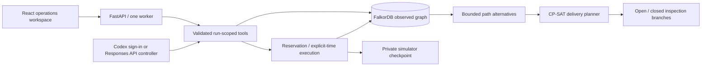

# LastMile

**Verify the uncertainty. Deliver what matters.**

LastMile is an evidence-aware relief coordination workspace for a **fictional flood in Alder Reach**. A controller investigates conflicting road reports, estimates which inspection could improve a constrained delivery plan, reserves resources and executes deliveries through an explicit-time simulator.

All data and actions are synthetic. Metrics count deliveries and relief kits. This is a local demonstration, with no emergency-service integration or real-world performance claim.


## Launch

Prerequisite: Docker Desktop running with Linux containers. From the repository root:

```powershell
docker compose up --build -d
```

Open **http://localhost:5173**. API documentation: http://localhost:8000/docs. The deterministic demonstration needs no paid API or map service. FalkorDB is exposed only at **127.0.0.1:6380**, avoiding an existing Redis on 6379. Backend and frontend ports are also bound to localhost.

**Use your existing Codex sign-in for live LLM control on Windows:** with Codex signed in and Python installed, run:

```powershell
.\scripts\start-codex.ps1
```

This starts the authenticated local Codex bridge and the Docker application. Select **Codex · ChatGPT plan**, create a run and click **One decision** or Play. No OpenAI API key is required for this mode. It consumes the signed-in Codex account's plan allowance. Codex manages its own credentials; LastMile never reads or copies `auth.json`. The script creates only an application-local bridge secret in ignored `.env`.

**Live verification completed:** `gpt-6.1-sol` selected real application tools across four cycles, delivering all **six requests / 42 kits on time**. See [actual live-run evidence](docs/live-codex-smoke.json) and [live browser screenshot](docs/screenshots/05-live-codex-desktop.png). The separate API-key adapter remains available but was not tested against a live API key.

```powershell
docker compose ps
Invoke-RestMethod http://localhost:8000/api/health
docker compose logs backend
docker compose stop
```

Normal stop/restart retains graph and simulator volumes. Keep **both** volumes together when backing up: `lastmile_graph_data` and `lastmile_simulator_data`. Do not delete volumes to restart the application.

## Demonstrate in two minutes

1. Select **Critical crossing**, World **9**, and **New run**. Keep **Deterministic demo** selected. Seed 9 is in the published benchmark suite; the live controller never receives the seed.
2. Select **Alder bridge**. Read the conflicting volunteer and neighbourhood reports. Click **Trace delivery impact** to see graph dependencies and hypothetical affected requests.
3. Click **Compare inspections**. Bridge branches have utility 116 if open and 28 if closed, with a five-minute check and synthetic open prior .65. Estimated gain is 57.2. The marsh-road check has negative value.
4. Click **Inspect road**, then **Preview plan** and **Reserve & commit plan**. Previewing holds no stock. Commit checks the graph revision and resource availability.
5. Advance in ten-minute steps. Vehicles move segment by segment; this open world completes six requests / 42 kits on time. Follow the planner decision to its exact graph evidence.
6. Click **Replay**, move to revision 0, and observe the historical time and disabled mutation controls. Return to live.
7. Create another run, preview and commit its local plan, then **Trigger capacity disruption** before dispatch. Its unstarted reservation is released. Use **One decision** to replan; completed and loaded work are preserved. The Capacity disruption scenario also has a time-scheduled vehicle announcement.
8. Open **Benchmarks** to compare all ten worlds, including ties and adverse cases. No useful inspection demonstrates budget preservation.

**One decision** runs the full deterministic tool policy. Play repeats cycles; Pause stops scheduling new cycles after the current request finishes. A manual time step advances ten simulated minutes. A controller cycle limit of 30 and a 180-minute horizon bound execution.

## What runs

- React 19 / TypeScript / Vite operations interface with SVG town map, evidence panel, inspection comparison, plan preview, event log and historical replay.
- FastAPI / Pydantic backend, official FalkorDB Python client and OR-Tools CP-SAT.
- Real FalkorDB multi-hop traversal queries provide route alternatives and dependencies. Removing the graph prevents operations; there is no fallback operational database.
- Single-process reservation and execution service. Expected revisions and idempotency keys protect commit and dispatch retries.
- Private immutable simulator checkpoints. Road conditions and physical schedules are never placed in the operational graph, public state, tool results or frontend assets.
- Live signed-in **Codex · ChatGPT plan** controller, configurable OpenAI Responses API controller, and explicitly labelled **Deterministic demo**.
- Three scenarios and a reproducible 30-run evaluation with JSON and CSV output.

## Architecture



The solver receives temporary typed snapshots and graph-derived candidate paths. These are not another authoritative graph. Replay snapshots are historical graph records and cannot be committed.

See [graph model](docs/graph-model.md), [semantics and assumptions](docs/semantics.md), [queries](queries/), [verification](docs/verification.md), [demo script](docs/demo.md) and [submission draft](docs/submission.md).

## Configuration and LLM mode

Copy `.env.example` to `.env` if configuration is needed. `.env` is ignored. Never put API credentials in frontend variables.

The interface distinguishes three modes: **Codex · ChatGPT plan**, **OpenAI API**, and **Deterministic demo**. The signed-in Codex connection is selected by default when configured; deterministic benchmark policies remain separately labelled. The Codex bridge uses the documented [Codex app-server protocol](https://learn.chatgpt.com/docs/app-server), ephemeral sessions and eight registered dynamic tools. Environment, shell, browser, plugins, connected apps and multi-agent tools are disabled for these sessions. All application actions return through authenticated backend callbacks and the same validated resource/graph operations.

The host bridge binds to `127.0.0.1:8866`; Docker Desktop accesses it through `host.docker.internal`. Both its cycle endpoint and backend callbacks require a generated shared application secret. No Codex access/refresh token is exported to Docker, the browser or Git. A request is bounded to 12 tools and 100 seconds; committed actions survive provider failure. This local integration was verified on Windows/Docker Desktop with Codex CLI `0.162.0-alpha.17.2`. Experimental app-server schemas can change; an incompatible CLI returns an explicit error. Hosted deployments should use their own API credentials or a separately registered supported sign-in integration.

| Variable | Purpose |
| --- | --- |
| `FALKOR_HOST` | Host used during manual backend development; defaults to localhost. Compose uses its service name. |
| `FALKOR_PORT` | Host database port, default 6380. Compose's backend uses internal port 6379. |
| `FALKOR_PASSWORD` | Optional password for a separately managed database. Bundled local Compose uses the isolated Docker network and localhost binding. |
| `PRIVATE_STATE_DIR` | Private simulator and process-lease directory. Compose sets `/private` on its own named volume. |
| `OPENAI_API_KEY` | Optional server-side OpenAI API key. |
| `OPENAI_MODEL` | Explicit model available to your account; no model name is assumed. |
| `LLM_PROVIDER` | Initial provider preference: `codex` or `openai`. |
| `CODEX_BRIDGE_URL` | Host bridge URL. Startup script sets `http://host.docker.internal:8866` for Docker Desktop. |
| `CODEX_BRIDGE_TOKEN` | Generated application-local callback secret. It is not a Codex or OpenAI API credential. |

For the separate **OpenAI API** mode, set `OPENAI_API_KEY` and `OPENAI_MODEL` in `.env`, then recreate the backend:

```powershell
docker compose up -d --force-recreate backend
```

The controller uses real Responses API function calls, strict schemas, validated arguments, sequential tools, 25-second provider timeouts, one SDK retry, at most eight provider invocations and a 90-second loop deadline checked between invocations. A single in-flight timeout/retry can exceed that deadline. There are no shell, URL-fetch or raw-Cypher tools. Run one cycle for a bounded smoke test. Trace summaries are not model reasoning transcripts. Provider errors are recorded by type without copying credential-bearing response bodies.

**Verification distinction:** live model/tool execution through signed-in Codex is verified. The API-key Responses adapter has protocol/failure tests but no live API-key smoke test. Enabling API-key mode uses API billing. The GitHub connection is independent of either model authentication mode.

## Manual development, including PowerShell

Use **Python 3.12** (the verified version), Node 22 and npm. Python 3.14 is not the verified OR-Tools environment.

```powershell
docker compose up -d falkordb
py -3.12 -m venv .venv
.\.venv\Scripts\python.exe -m pip install -r backend\requirements.lock.txt
$env:PYTHONPATH = 'backend'
.\.venv\Scripts\python.exe -m uvicorn app.api:app --host 127.0.0.1 --port 8000 --workers 1
```

In another terminal:

```powershell
Set-Location frontend
npm ci
npm run dev
```

If `py -3.12` is unavailable, install Python 3.12 or use its absolute executable path. On Linux/macOS use `python3.12 -m venv .venv`, `.venv/bin/python`, and `PYTHONPATH=backend`. Environment variables in `.env` are read by Docker Compose; set them in the shell for manual development. Stop the local API before starting Compose's API on the same port. A filesystem process lease prevents multiple workers using one simulator volume. This is not a distributed deployment.

## Tests and reproduction

```powershell
$env:PYTHONPATH = 'backend'
.\.venv\Scripts\python.exe -m pytest backend\tests -q
.\.venv\Scripts\python.exe -m app.evaluation
Set-Location frontend
npm run build
npx playwright install chromium
npm run test:browser
```

Backend tests require the real database on localhost:6380 and fail when it is absent. Browser tests require the API and either the Compose frontend or Vite development server running. They save screenshots under `docs/screenshots/`. They create isolated runs and do not reset unrelated runs. The evaluator creates separate graph/run IDs for each policy and seed, never changes a user's selected run, and writes `benchmarks/results.json` and `benchmarks/results.csv`. Default suite: ten worlds × three policies. Seeds, policies, fingerprints, all outcomes and regressions are published. Seeds exist only in evaluator output and run-creation input, not live controller context.

Live Codex checks are explicit opt-ins and are skipped in ordinary CI. After starting the connection, run `python scripts/smoke_codex.py` for one bounded live world, or `$env:RUN_CODEX_LIVE='1'; npx playwright test codex-live` from `frontend` to exercise the actual browser cycle. These consume the signed-in account's allowance. The live smoke result is separate from the deterministic 30-run comparison.

To reproduce inside Docker:

```powershell
docker compose exec backend python -m app.evaluation
```

That writes results inside the backend container; copy them out with `docker compose cp backend:/app/benchmarks/results.json benchmarks/results.json` and the equivalent CSV command. The UI loads backend results through `/api/benchmarks`; its **Run 30-run suite** button starts a bounded background job. Benchmark job status is process-local; persisted run state and completed result files survive in their documented locations. Image-bundled results are retained in the repository; newly generated container result files should be exported before replacing the container.

## Storage and durability

FalkorDB 4.16.0 is pinned by image digest. Compose sets `dir=/var/lib/falkordb/data`, AOF enabled, `appendfsync everysec`, and RDB `save 60 1`. AOF fsync can lose roughly the last second on a hard host failure; named volumes preserve data across ordinary restarts. The private checkpoint is created before a run's first graph write and is immutable thereafter. Current simulation time and applied observable events are in FalkorDB, so restart never regenerates a physical world. Back up the graph volume and simulator volume together. [Official persistence reference](https://docs.falkordb.com/operations/durability/persistence).

## Limits and submission responsibility

This MVP uses at most two delivery stops per vehicle, six path alternatives per location pair, twelve road hops and a two-second CP-SAT limit. `OPTIMAL` refers only to this candidate model, never an unrestricted vehicle-routing optimum. Vehicles do not reload after leaving their assigned depot. Inspections use one-step expected utility with explicit synthetic priors. Reports remain untrusted evidence; prose saying “verified” conveys no authority. The local app has no authentication and is deliberately bound to localhost.

The public repository and local setup are prepared; no live hosting or demo video is claimed. **The participant must record the required demo video, review and meaningfully contribute to the project, understand the code and submit it themselves.** AI coding assistance from Codex was used extensively to implement and verify this project. [Official event rules](https://www.wemakedevs.org/hackathons/falkordb/rules), checked October 16, 2026, require disclosure and participant understanding. Primary track: **Agents That Act on Connected Data**. Submission deadline: **October 18, 2026, 11:59 PM IST**.
