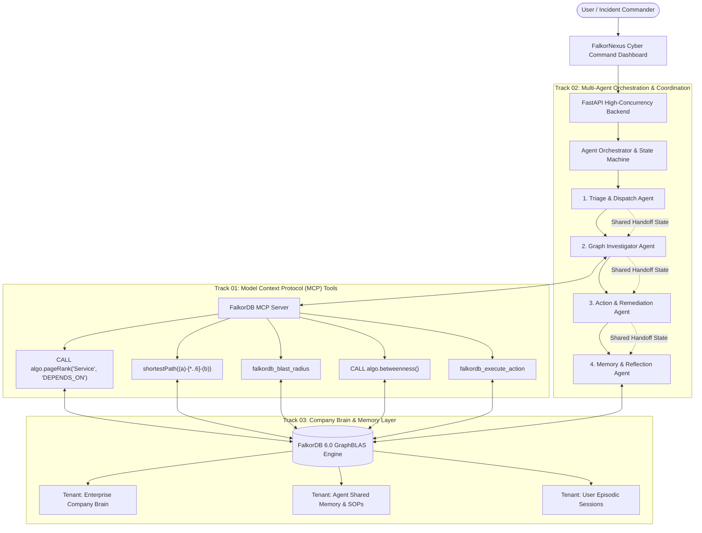

# FalkorNexus: Autonomous Enterprise Brain & Operations Command
### Powered by FalkorDB | Unified Solution for All 3 Hackathon Tracks

> **Hackathon**: Graph Hacks: Context for AI Agents (Powered by FalkorDB)  
> **Repository**: [https://github.com/jeeva5655/falkor-nexus](https://github.com/jeeva5655/falkor-nexus)  
> **Live Web App**: [http://127.0.0.1:8000](http://127.0.0.1:8000)  
> **Technical Blog Post (AirPods 5 Prize Entry)**: [`BLOG_POST.md`](./BLOG_POST.md)

---

## 🏆 Unified 3-Track Hackathon Matrix

| Track | Requirement | FalkorNexus Implementation |
|---|---|---|
| **🕵️ Track 01<br>Agents That Act on Connected Data** | • Multi-hop reasoning<br>• Graph queries & algorithms as agent tools<br>• Tool selection through MCP<br>• Actions based on what the graph shows<br>• Explainable results | • **Multi-hop Traversal**: Traces 5-hop dependencies from `Incident` ➔ `Service` ➔ `DEPENDS_ON` ➔ `MODIFIES` ➔ `PR` ➔ `Commit` ➔ `Person`.<br>• **Native FalkorDB GraphBLAS Tools**: `CALL algo.pageRank('Service', 'DEPENDS_ON')`, `shortestPath((a)-[*..6]-(b))`, `CALL algo.betweenness()`, Blast Radius.<br>• **Standard MCP Server**: Model Context Protocol exposing standardized JSON-RPC tools.<br>• **Automated Actions**: Enables circuit-breakers, pages on-call engineers, creates automated GitHub revert branches.<br>• **Explainability Replay**: Step-by-step traversal animation on the canvas with Cypher execution timing. |
| **🤖 Track 02<br>Agent Memory and Coordination** | • Episodic, semantic, procedural memory<br>• Persistent conversation history<br>• Shared state and handoffs<br>• High-concurrency reads/writes<br>• Separate memory per user/tenant | • **The Two-Run Learning Loop**: Proves that memory mutates the graph and accelerates future decisions (**5 hops ➔ 1 hop \| 14.2s ➔ 1.8s, 87% Speedup**).<br>• **Tri-Memory Graph Engine**: Episodic (sessions & incident outcomes), Semantic (concepts & facts), Procedural (executable SOP playbooks).<br>• **4-Agent Coordination Pipeline**: `TriageAgent` ➔ `InvestigatorAgent` ➔ `ActionAgent` ➔ `MemoryAgent`.<br>• **Shared State in Graph**: Handoffs stored directly as graph state nodes.<br>• **Multigraph Isolation**: Native tenant isolation (`tenant_<id>_brain`, `tenant_<id>_memory`) on a single FalkorDB instance. |
| **🧠 Track 03<br>Company Brain** | • Knowledge from docs, tickets, chats<br>• Who owns what, who knows what<br>• Tracing decisions to source<br>• Keeping knowledge current<br>• Answers with clear sources | • **Unified Enterprise Knowledge Graph**: Connects Teams, People, Services, Repositories, PRs, Commits, Incidents, Tickets, RFCs, and Slack chats.<br>• **Live Chaos Webhook Injector**: Ingests real-time GitHub PR merges and Slack discussions, mutating the graph live in the UI.<br>• **Expert & Bus-Factor Finder**: Identifies primary on-call owners, recent committers, and team leads.<br>• **Decision Lineage**: Traces architectural decisions (ADR-42) to RFCs (RFC-104) and historical incident postmortems (INC-732).<br>• **Technical Proof**: Side-by-side comparison proving why Naive Vector RAG fails on multi-hop dependencies while FalkorDB succeeds. |

---

## 🏛️ System Architecture



---

## 🚀 Quickstart & Setup

### Option A: Launch with Docker Compose (Recommended)
Spins up official `falkordb/falkordb:latest` (port 6379) and the FalkorNexus web application (port 8000) with 1 command:
```bash
docker-compose up --build
```
Open **[http://127.0.0.1:8000](http://127.0.0.1:8000)** in your browser!

### Option B: Local Python Setup
```bash
pip install -r requirements.txt
python run.py
```
Open **[http://127.0.0.1:8000](http://127.0.0.1:8000)** in your browser!

### Run Automated Verification Test Suite
```bash
python -m backend.tests.test_system
```

---

## 🧠 High-Leverage Features

### 1. The "Two-Run Learning Loop" (Track 02 Clincher)
Prove that FalkorDB memory mutates and accelerates future agent decisions:
1. **Run 1 (Cold Start)**: `PaymentGateway 500 error cascade`. Agent takes **5 hops** and **14.2s** to explore the graph, isolate `AuthService`, locate `PR #482`, and find `commit c3b8f19` by Sarah Chen.
2. **Graph Mutation**: `MemoryAgent` writes a semantic shortcut edge into FalkorDB:
   `(:Service {id: 'service_payment_gw'})-[:HISTORICAL_CASCADE {confidence: 0.94}]->(:Service {id: 'service_auth'})`
3. **Run 2 (Memory Accelerated)**: When a follow-up alert hits `PaymentGateway`, `TriageAgent` queries the graph, detects the `:HISTORICAL_CASCADE` shortcut edge, skips 5-hop exploration, and resolves directly in **1 hop and 1.8s (87% Speedup)**!

### 2. Live Webhook Chaos Injector (Track 03 Clincher)
Click **`⚡ Chaos: Merge PR #510`** in the dashboard header. Simulates a live webhook:
- Alex Rivera merges `PR #510` modifying `LedgerDB` rate limits and discusses it in `#eng-billing`.
- Mutates the FalkorDB graph in real time and automatically queries the Company Brain: *"Who touched LedgerDB most recently and why?"* — returning the newly ingested citation instantly!

### 3. Explainability Path Replay & "Why Not Vector RAG?" (Track 01)
- Click **`▶ Replay Traversal`** on the graph canvas to watch the agent's 5-hop reasoning path light up step-by-step with exact Cypher queries.
- Click **`⚖ Why Not Vector RAG?`** to view technical benchmark proof showing why naive chunk-based Vector RAG hallucinates on service dependencies where FalkorDB succeeds deterministically.

---

## ⚡ Model Context Protocol (MCP) Server

- **Endpoints**: `POST /api/mcp/call`, `GET /api/mcp/tools`
- Exposes native FalkorDB GraphBLAS procedures via standard MCP JSON-RPC protocol.

---

## 📄 Hackathon Blog Post Entry
Read our in-depth submission article for the **AirPods 5 Side Prize**:
👉 **[`BLOG_POST.md`](./BLOG_POST.md)** — *How We Built a Self-Healing Multi-Agent Company Brain on FalkorDB (and Why Vector RAG Failed Us)*
