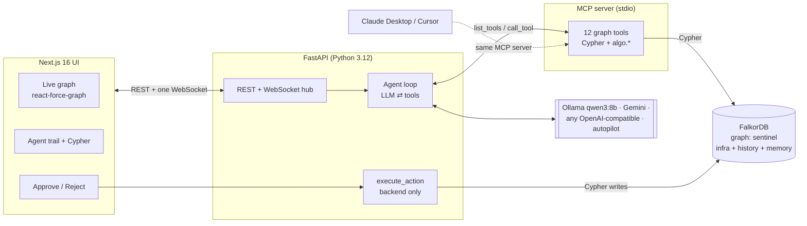
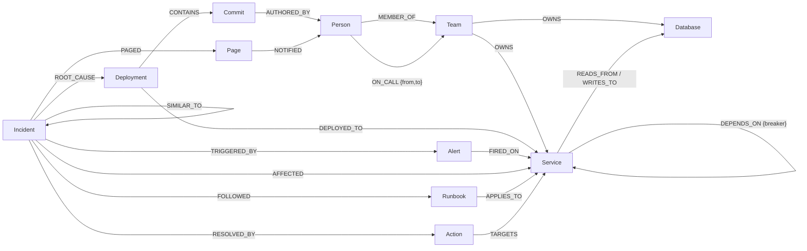

# 🛡️ SentinelGraph

> **When prod breaks, SentinelGraph walks your dependency graph in FalkorDB, finds the change that caused it,
> proposes the fix, waits for your approval, and remembers how, so the next time is faster.**

**Graph Hacks: Context for AI Agents** (WeMakeDevs × FalkorDB)  
**Tracks:** **Track 01: Agents That Act on Connected Data** · **Track 02: Agent Memory and Coordination**

[](https://github.com/kalp-cg/graph-hacks/actions/workflows/tests.yml)
[](https://github.com/kalp-cg/graph-hacks/actions/workflows/e2e.yml)

### 🎬 [Watch the 2.5-Minute Demo Video on YouTube](https://youtu.be/Ntb5FxvD-8E)
### 🌐 [Live Demo: graph-hacks-alpha.vercel.app](https://graph-hacks-alpha.vercel.app/) · [API Health](https://sentinelgraph-api-relh.onrender.com/api/health)

UI on Vercel · API + agent on Render · graph on **FalkorDB Cloud** (ap-south-1).
*The API runs on Render's free plan and sleeps when idle. If the first load says "reconnecting", give it about a
minute to wake up.* Try it: **Break production → `db-pool-exhaustion`**, then **Investigate**, then **Approve**.
Or press <kbd>/</kbd>, find any service and break it yourself.

[](https://youtu.be/Ntb5FxvD-8E)

---

## The 30-second version

1. **Break production.** One click deploys a bad change: `inventory-db-proxy v4.2.0` ("Reduce max pool size to 10")
   and alerts fire on `checkout-api`, `cart-service` and `orders-service`.
2. **The agent investigates through MCP tools that run Cypher on FalkorDB.** It finds the one dependency all three
   share and that is itself broken, then the deploy that landed there 6 minutes ago, its commit and its author,
   and whether we've seen this before. Every step shows its exact Cypher and **lights up the path on the graph**.
3. **It proposes, you decide.** It can only *propose* a rollback and a page to the on-call engineer. Nothing changes
   until a human clicks **Approve**.
4. **The graph heals.** Approving the rollback flips the root back to healthy, and recovery spreads *up* the
   dependency graph: callers recover once nothing below them is broken. The incident clock becomes an MTTR.
5. **It remembers.** The incident, its root cause and the fix are written back into the same graph. Next time,
   recall finds it by traversal and the agent goes straight to the fix (**8 → 6 steps, 67 s → 47 s** measured with
   a local 8B model).

### Not scripted: chaos mode

Press <kbd>/</kbd> (or right-click a node) to pick **any service** and break it: *ship a bad deploy*, *crash it*, or
*degrade it*. Its most
important callers start alerting and the agent has to work it out from the graph. Tests cover chaos in every
layer (edge, business, platform). The top bar keeps a **cost-of-downtime ticker**: `revenue_per_min` summed
over unhealthy services (degraded counts half), which freezes into the final bill when everything is green.


## Why a graph?

"Checkout, cart and orders are all slow" isn't a text-search problem, it's a *path* problem:

| The on-call engineer's question | How SentinelGraph answers it in FalkorDB |
| :--- | :--- |
| What do all the alerting services depend on? | Variable-length `DEPENDS_ON*0..5` from every alerting service, intersected |
| Which shared dependency is actually the cause? | Rank the unhealthy ones that have **nothing unhealthy below them** (the deepest failure) |
| What changed there, and who wrote it? | `Deployment -[:DEPLOYED_TO]-> Service`, `-[:CONTAINS]-> Commit -[:AUTHORED_BY]-> Person` |
| Who do we wake up? | `Service <-[:OWNS]- Team <-[:ON_CALL {from,to}]- Person` |
| How bad is it? | Reverse traversal (blast radius) + `algo.pageRank` + `algo.betweenness` |
| Have we seen this before? | Past `Incident`s within 2 hops downstream, weighted by proximity |

A vector store can tell you which runbook *sounds* similar. Only the graph can tell you that `cart-service`
reaches `inventory-db-proxy` through `inventory-service`, that the proxy got a deploy 6 minutes ago, and that
`auth-service` is a symptom, not the cause.

## Screenshots

| Incident injected | Agent walking the graph |
| :---: | :---: |
|  |  |
| **Every step shows its Cypher** | **Approved, healthy again, MTTR** |
|  |  |

## Architecture



- **The agent only reaches the graph through MCP.** It discovers tools with `list_tools`. The same server plugs
  into Claude Desktop or Cursor unchanged (config below).
- **The model can't mutate anything.** `propose_action` creates `(:Action {status:'pending'})`. Only the backend
  executes an action, and only after a human approves it.
- **Everything is explainable.** Every tool returns `{result, cypher, node_uids, edge_uids}`. The UI shows the
  query and lights up exactly those nodes and edges, in order.
- **One graph for everything.** Infrastructure, change history, people, alerts, incidents, actions and runbooks
  live in one FalkorDB graph, so memory is linked to the services it touched.

## Graph data model

One graph, `sentinel`. Every node has a stable `uid` (`svc:checkout-api`, `dep:inventory-db-proxy:v4.2.0`, …).
Full reference: [docs/data-model.md](docs/data-model.md).



| Node | Key properties |
| :--- | :--- |
| `Service` | `name`, `tier` (critical/high/medium/low), `status` (healthy/degraded/down), `layer` (edge/business/data/platform) |
| `Team` · `Person` | `name`, `slack_channel` · `name`, `role`, `handle` |
| `Database` | `name`, `engine`, `size_gb` |
| `Deployment` → `Commit` | `version`, `at`, `status` (live/rolled_back) → `sha`, `message` |
| `Alert` | `metric`, `value`, `threshold`, `status` (firing/resolved) |
| `Incident` | `title`, `status` (investigating/mitigating/resolved), `summary`, `steps_taken`, `learned` |
| `Action` | `kind` (rollback/open_breaker/scale_up/page_oncall), `status` (pending/executed/rejected), `reason`, `risk` |
| `Runbook` · `Page` | `title`, `steps` · `message`, `channel` |

**Direction rule:** `(checkout-api)-[:DEPENDS_ON]->(inventory-db-proxy)` means checkout calls the proxy, so failure
flows *against* the arrow. Blast radius = `(up)-[:DEPENDS_ON*1..6]->(broken)`.

Seed (deterministic, seed 42): 38 services in 4 layers, 8 teams, 18 people with on-call windows, 8 databases,
~100 deployments with commits and authors, 3 past incidents with fixes and runbooks.

### Explore it in the FalkorDB Browser

The Browser's default `MATCH (n) … LIMIT 100` only shows a slice of people and commits. These show the
interesting structure (graph `sentinel`):

```cypher
// The whole service dependency map
MATCH p=(:Service)-[:DEPENDS_ON]->(:Service) RETURN p

// What the agent sees for db-pool-exhaustion: three alerting services converge on one dependency
MATCH p=(a:Service)-[:DEPENDS_ON*1..3]->(:Service {name:'inventory-db-proxy'})
WHERE a.name IN ['checkout-api','cart-service','orders-service'] RETURN p

// Blast radius: everything that breaks if kafka-bus goes down
MATCH p=(:Service)-[:DEPENDS_ON*1..6]->(:Service {name:'kafka-bus'}) RETURN p

// Memory: past incidents linked to what they touched, what caused them and what fixed them
MATCH p=(:Incident)-[:AFFECTED|ROOT_CAUSE|RESOLVED_BY|FOLLOWED|SIMILAR_TO]->() RETURN p

// Who gets paged for inventory-db-proxy
MATCH p=(:Person)-[:ON_CALL]->(:Team)-[:OWNS]->(:Service {name:'inventory-db-proxy'}) RETURN p

// The most depended-on services
CALL algo.pageRank('Service','DEPENDS_ON') YIELD node, score
RETURN node.name AS service, score ORDER BY score DESC LIMIT 10
```

## FalkorDB features used

| Feature | Where |
| :--- | :--- |
| Variable-length traversal `*0..5`, multi-source intersection | `find_common_cause`, `blast_radius`, `trace_dependencies`, `recall_similar` |
| `shortestPath()` | path from each alerting service to the root cause (drawn on the graph) |
| `algo.pageRank` | `critical_services`, node size in the UI |
| `algo.betweenness` | `chokepoints`, dashed ring on single points of failure |
| `algo.SPpaths` (weighted) | `failure_path` |
| Parameterized Cypher everywhere | LLM values never reach a query string; depth is clamped before building `*1..N` |
| Writes: `CREATE` / `MERGE` / `SET` | actions, pages, breakers, rollbacks, incident memory |
| Indexes | `uid` / `name` / `at` / `status` / `id` lookups |

## The agent

**Protocol** (system prompt, [`agent/prompts.py`](backend/sentinel/agent/prompts.py)):
alerts → common cause → recall memory → recent changes on the suspect → (context, blast radius) → propose fix +
page → conclude → report with cited uids.

**Guards that make a small model reliable:**
- *Nudges, once each:* if the model tries to finish without proposing anything, or without paging a human.
- *Memory-guided planning:* when recall returns an incident whose root cause equals the suspect the graph found,
  the loop adds a `memory_match` note to that tool result ("same root cause, fixed by rollback + page, 8 steps").
  This is what makes a local 8B model actually take the shortcut.
- *Rollback guard:* `propose_action(rollback)` is refused when the service has no deploy in the last 2 h, so the
  red-herring scenario can't trick it into rolling back an unrelated change.
- *Autopilot fallback:* a deterministic policy with the same interface as an LLM. If the model errors (rate
  limit, outage), autopilot takes over mid-run and the UI says so. It also lets the demo run with zero API keys.

**LLM providers** (`LLM_PROVIDER`): `ollama` (local; qwen3:8b runs on a 6 GB laptop GPU), `gemini`,
`openai` (any OpenAI-compatible endpoint: Groq, OpenRouter, vLLM, …), `autopilot`.

### Scenarios and measured results

| Scenario | Alerts on | Correct answer | qwen3:8b result |
| :--- | :--- | :--- | :--- |
| `db-pool-exhaustion` | checkout-api, cart-service, orders-service | `inventory-db-proxy` deploy **v4.2.0** by Priya, rollback + page | ✅ 7 steps, ~60 s |
| `bad-config-push` | auth-service, user-profile | `feature-flags` **v4.0.3** by Eva; `auth-service` is degraded but a *symptom* | ✅ 7 steps, ~58 s |
| `cache-stampede` | search-service, recommendations | `redis-cache`, **no deploy**. The only recent deploy (email-sender) is a red herring: open breaker + scale up | ✅ 6 steps, ~46 s: picked redis-cache, no rollback, matched INC-0063 (proposed the breaker but not the scale-up) |
| `kafka-rebalance-storm` | payments-api, notifications, inventory-service | `kafka-bus` **v4.1.0** by Dan. No seeded memory, so it shows learning | ✅ **8 steps / 67 s, then repeat: 6 steps / 47 s** |

## Run it

### Option A: everything in Docker (no API keys needed)

```bash
git clone https://github.com/kalp-cg/graph-hacks.git && cd graph-hacks
docker compose up --build
```

Open **http://localhost:3001**, click a scenario under *Break production*, then **Investigate**, then **Approve**.
API at http://localhost:8100, FalkorDB Browser at http://localhost:3000. The compose default is
`LLM_PROVIDER=autopilot`. To use a real model:

```bash
LLM_PROVIDER=gemini GEMINI_API_KEY=... docker compose up --build
# or a local Ollama (it must listen on 0.0.0.0 to be reachable from the container):
OLLAMA_HOST=0.0.0.0 ollama serve   # then:  LLM_PROVIDER=ollama docker compose up --build
```

### Option B: local development

Prerequisites: Docker or Podman, Python 3.12, Node 20+, optionally [Ollama](https://ollama.com) with `qwen3:8b`.

```bash
cp .env.example .env
docker compose up -d falkordb                     # FalkorDB on :6380

cd backend
python3.12 -m venv .venv && source .venv/bin/activate
pip install -r requirements.txt
python -m sentinel.seed --reset                   # healthy baseline
uvicorn sentinel.api.main:app --port 8100         # API + WebSocket

cd ../frontend
cp .env.example .env.local && npm install
npm run dev -- -p 3001                            # http://localhost:3001
```

From the terminal, no UI:

```bash
cd backend
python -m sentinel.agent.cli --scenario db-pool-exhaustion --provider ollama --approve
pytest -q                                         # 55 tests against a real FalkorDB (graph 'sentinel_test')
```

### Deploy (FalkorDB Cloud + Render + Vercel)

1. **FalkorDB Cloud:** create an instance and seed it once from your machine:
   `FALKORDB_HOST=… FALKORDB_PORT=… FALKORDB_USERNAME=… FALKORDB_PASSWORD=… python -m sentinel.seed --if-empty`
   (the API container also seeds on start if the graph is empty).
2. **Render (API):** *New → Blueprint →* this repo. [`render.yaml`](render.yaml) builds `backend/Dockerfile` and asks
   for the secrets: `FALKORDB_HOST`, `FALKORDB_PORT`, `FALKORDB_USERNAME`, `FALKORDB_PASSWORD`, `GEMINI_API_KEY`.
   Check `https://<service>.onrender.com/api/health`.
3. **Vercel (UI):** import the repo, set **Root Directory = `frontend`**, add env
   `NEXT_PUBLIC_API_URL=https://<service>.onrender.com`, deploy.

On Render's free plan the API sleeps after ~15 min idle, so the first request takes ~1 min to wake it.

### Use the tools from Claude Desktop / Cursor

```json
{
  "mcpServers": {
    "sentinelgraph": {
      "command": "/abs/path/graph-hacks/backend/.venv/bin/python",
      "args": ["-m", "sentinel.mcp_server"],
      "cwd": "/abs/path/graph-hacks/backend"
    }
  }
}
```

### Configuration

| Variable | Default | |
| :--- | :--- | :--- |
| `FALKORDB_HOST` / `FALKORDB_PORT` | `localhost` / `6380` | `FALKORDB_USERNAME` / `FALKORDB_PASSWORD` for FalkorDB Cloud |
| `GRAPH_NAME` | `sentinel` | |
| `LLM_PROVIDER` | `ollama` (`autopilot` in compose) | `ollama` · `gemini` · `openai` · `autopilot` |
| `OLLAMA_MODEL` / `LLM_MODEL` | `qwen3:8b` / `gemini-3.1-flash-lite` | |
| `PAGER_WEBHOOK_URL` | empty | Discord/Slack-compatible webhook: `page_oncall` really pings |
| `AUTOPILOT_DELAY_S` | `0.9` | per-step pause so viewers can follow |
| `NEXT_PUBLIC_API_URL` | `http://localhost:8100` | where the browser reaches the API |

## API

| Method | Path | |
| :--- | :--- | :--- |
| GET | `/api/health` · `/api/graph` · `/api/incidents` · `/api/scenarios` · `/api/actions` | read models |
| POST | `/api/scenarios/{name}` | soft reset (keeps learned memory) + inject |
| POST | `/api/chaos/{service}?mode=down\|degraded&deploy=true` | break any service (unscripted) |
| POST | `/api/reset?keep_memory=true\|false` | |
| POST | `/api/runs` `{provider?, question?}` | start an investigation (one at a time) |
| POST | `/api/actions/{uid}/approve` · `/reject` | the human in the loop |
| WS | `/ws` | `run_started`, `tool_call`, `tool_result` (with cypher + uids), `action_proposed`, `final`, `action_executed`, `graph_update` |

## Project layout

```
backend/sentinel/
  seed/        catalog, generator (seed 42), history, memory, indexes, scenarios + soft reset, CLI
  tools/       read, rootcause, algorithms, memory, actions, health (recovery), incidents
  mcp_server.py   12 tools over stdio
  agent/       llm (providers), mcp_client, loop, prompts, autopilot, cli
  api/         FastAPI app + graph read models
backend/tests/ 55 tests: seed, tools, actions, chaos, agent loop over real MCP, API + WebSocket
frontend/src/  Dashboard, GraphCanvas, AgentTrail, ControlPanel, TopBar, useRunSocket
docs/          data model, screenshots, demo
```

CI runs the backend suite against a FalkorDB service container on every push.

## Honest limitations

- The infrastructure is a realistic simulation (seeded topology, injected incidents), not a live Kubernetes
  cluster. Ingesting real topology (OpenTelemetry service graph, docker-compose files) is the obvious next step.
- A local 8B model takes ~45–90 s per investigation and needs the guards above. Bigger hosted models are faster
  and need fewer nudges.
- Recovery is modelled by graph traversal over service status, not by real health checks.

## Testing

Three layers, all against a real FalkorDB, nothing mocked:

| Layer | What | Where |
| :--- | :--- | :--- |
| Backend | 57 pytest tests: seed determinism, every tool, actions incl. concurrent approvals, chaos in every layer, the agent loop over a real MCP stdio session, API + WebSocket | `backend/tests`, CI `tests` |
| End-to-end | 11 Playwright tests driving the browser through the full stack: incident lifecycle, reject, red herring, memory repeat, chaos via search, reset ≠ recovery, one run at a time, **two viewers in sync over the WebSocket**, late-joiner replay, **a sleeping API that recovers by itself**, double-click approve runs once | `e2e/tests`, CI `e2e` |
| Production | the same e2e suite pointed at the live Vercel + Render + FalkorDB Cloud deployment: 11/11 passing | `E2E_BASE_URL=… E2E_API_URL=… npx playwright test` |

Run the e2e suite locally (stack running on :3001 / :8100):

```bash
cd e2e && npm install && npx playwright install chromium && npx playwright test
```

Bugs these tests caught (each fixed with a regression test): two simultaneous approvals executed an action four
times; the cost ticker never grew; the page stayed empty forever if the API was asleep at load; a reset was shown
as a recovery; recovery "healed" a root cause after a page; a search typed before the graph loaded did nothing on
remote hosting; FalkorDB 4.x rejected a query style the dev build accepted.

## 🏆 Hackathon Submission (WeMakeDevs × FalkorDB)

- **Event:** [Graph Hacks: Context for AI Agents](https://www.wemakedevs.org/hackathons/falkordb)
- **Tracks Entered:**
  - **Track 01: Agents That Act on Connected Data** (Primary)
  - **Track 02: Agent Memory and Coordination** (Graph topological memory)
- **Demo Video:** [https://youtu.be/Ntb5FxvD-8E](https://youtu.be/Ntb5FxvD-8E)
- **Technical Blog Post (AirPods 5 Side Prize):** [How I Built an AI Incident Commander That Thinks in Graphs (DEV Community)](https://dev.to/0xkalp/how-i-built-an-ai-incident-commander-that-thinks-in-graphs-and-solves-3-am-outages-in-90s-2lc9)
- **Live Deployment:** [https://graph-hacks-alpha.vercel.app](https://graph-hacks-alpha.vercel.app)
- **Graph Engine:** FalkorDB Cloud (ap-south-1) with native GraphBLAS matrix acceleration
- **AI Assistant Disclosure (Rule 11):** Developed with AI-assisted pair programming (Antigravity / Claude) for testing and boilerplate. All graph modeling, Cypher path traversal logic, algorithm selection (PageRank & Betweenness), and MCP tool architecture were designed and verified by our team.

## License

MIT
