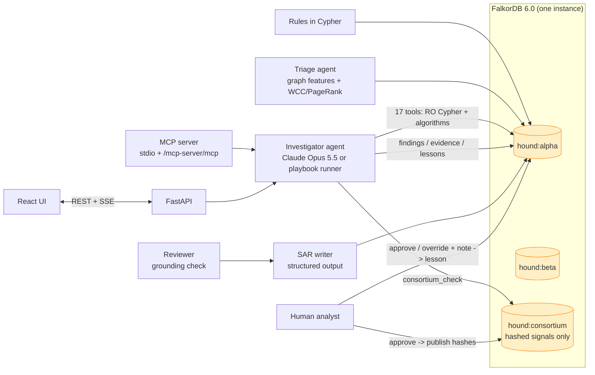
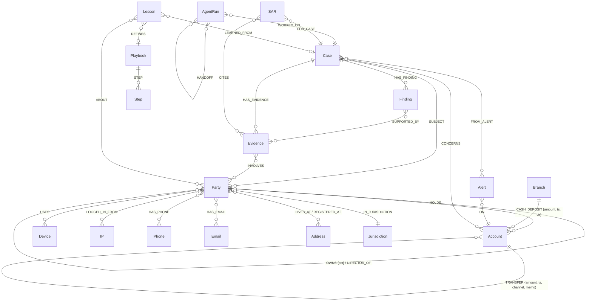

# Hound 🐕

**AML investigation agents that follow the money through FalkorDB, remember every case, and write SARs where every sentence is backed by a Cypher query.**

Graph Hacks 2026 (WeMakeDevs × FalkorDB) · **Tracks: 01 Agents That Act on Connected Data + 02 Agent Memory and Coordination**

[](https://github.com/manav-Mnv/hound-aml/actions/workflows/ci.yml) `FalkorDB 6.0 (Rust engine)` · `Claude Opus 5.5` · `MCP` · `Python / FastAPI` · `React + Cytoscape` · all data synthetic

> Live demo: **[hound-99l2.onrender.com](https://hound-99l2.onrender.com)** (free tier: first load after idle takes ~1 min) · Demo video: _add link_ · Blog post: [docs/BLOG.md](docs/BLOG.md)

---

## The problem

Banks run threshold rules over transactions. The rules fire constantly and are mostly wrong: a NICE Actimize industry survey found **almost 95% of alerts end as false positives** ([report, archived copy](https://web.archive.org/web/20240508024800/https://www.niceactimize.com/Documents/aml_ai_in_aml_insights_report.pdf)). Each alert is worked by an analyst who stitches together accounts, devices, counterparties and old cases by hand, often while a colleague works a related alert on the same ring. Institutions filed about **4.7 million SARs in FY2024** ([ABA Banking Journal on FinCEN's figures](https://bankingjournal.aba.com/2025/06/fincen-releases-figures-on-bsa-filings/)), and when it goes wrong it is expensive: TD Bank paid **about $3 billion** in 2024 after laundering networks moved $670M+ through its accounts ([NBC News](https://www.nbcnews.com/business/business-news/td-bank-pleads-guilty-money-laundering-case-will-pay-3-billion-penalti-rcna174912), [CBC](https://www.cbc.ca/news/business/td-bank-penalties-1.7348819)).

The answers analysts need are about connections, which is exactly what a graph stores: *who else uses this phone, where did the money go next, who ultimately owns this supplier, have we seen this before?* The industry is moving the same way: FIS and Anthropic announced a Financial Crimes AI Agent in May 2026 ([FIS](https://www.fisglobal.com/about-us/media-room/press-release/2026/fis-brings-agentic-ai-to-banking-with-anthropic-starting-with-financial-crimes)) and Nasdaq Verafin an Agentic AML Analyst in June 2026 ([Verafin](https://verafin.com/news/nasdaq-verafin-announces-expansion-of-its-agentic-ai-workforce/)). Full fact-checked research: [docs/MARKET_RESEARCH.md](docs/MARKET_RESEARCH.md).

## What Hound does

```
71 alerts from 6 rules  ->  triage agent (graph features, 0.2s)  ->  43 case candidates
   -> investigator agent (Claude + 17 Cypher tools + memory)  ->  findings with evidence
   -> SAR writer -> reviewer (grounding check, revise loop)    ->  human approves
   -> hashed identifiers shared with other banks (314(b)-style)
```

| | Rules alone | Hound (offline playbook mode) |
|---|---|---|
| Alerts to review | 71 (42% true) | 49 cases after triage + merge |
| False-positive alerts | 41 left for analysts | **41 / 41 closed, each with a cited rationale** |
| Laundering schemes escalated | n/a | **5 / 5, 0 false SAR cases** |
| Accounts found that no rule flagged | 0 | **5** (the smurfs) |
| Time for the whole queue | analyst-days | ~30 s |

Reproduce with `uv run hound eval --mode offline`. Ground truth is kept in `backend/data/ground_truth.json`, never in the graph, so agents cannot see it. The synthetic set is deliberately richer in true positives than real life so each typology is exercised.

**What makes it different from "chat with a fraud graph":**

- **The graph decides, not just displays.** Variable-length time-ordered paths, cycle detection, WCC rings, PageRank collectors, betweenness brokers, label-propagation communities, ownership chains for the OFAC 50% rule. Remove FalkorDB and nothing works.
- **Every claim is traceable.** Each tool call is stored as an `(:Evidence)` node holding the exact Cypher and parameters, linked to the entities it touched. Findings must cite evidence ids (the tool rejects ones that don't exist in the case). SAR sentences cite evidence; a reviewer agent rejects sentences whose amounts are not in the cited evidence and sends them back for revision.
- **Memory lives in the graph, attached to the entities.** Prior cases, analyst lessons and playbooks are nodes linked to the same `Party`/`Account` nodes as the transactions. Recall is a traversal: "a party sharing this device was in case X", "an analyst cleared this payroll processor in August".
- **Agents coordinate through the graph.** Triage → investigator → SAR writer → reviewer, each an `(:AgentRun)` with `HANDOFF` edges. Open cases de-duplicate new alerts on the same ring.
- **One FalkorDB, many isolated graphs.** `hound:alpha` and `hound:beta` are two banks that cannot see each other; `hound:consortium` holds only HMAC hashes of risky identifiers. Alpha's investigator finds that a mule's phone was reported by Beta in September, without either bank sharing customer data.
- **Real AML domain logic**: CTR threshold & structuring (31 CFR 1010.311, 31 U.S.C. 5324), OFAC 50% rule with aggregation through blocked entities, FinCEN 5W narrative structure, 314(b) sharing, namesake handling in name screening, benign explanations (payroll processors, cash businesses, title companies, tuition).

## Screens

Investigate (live graph grows as the agent calls tools, trace with Cypher, SAR with clickable citations, human approval) · Cases · Memory graph + playbooks · Consortium · Benchmark · Graph model & rule Cypher.

## Architecture



## Graph data model



- `Party` nodes carry `:Person` or `:Company`, plus `:Customer` (KYC'd at this bank) and `:Sanctioned` where they apply. `Account` carries `:External` for accounts at other institutions.
- Nightly analytics write `pagerank`, `betweenness`, `community` (label propagation) on accounts and `identity_cluster` (WCC) on parties.
- Consortium graph: `(:Institution)-[:REPORTED {typology, case_ref, at}]->(:Signal {hash, kind})`.

## Cypher the product depends on

Rules (all six in `backend/src/hound/rules.py`, visible in the UI's *Model* view). Example, pass-through:

```cypher
MATCH (:Account)-[i:TRANSFER]->(a:Account)
WHERE NOT a:External AND i.amount >= 500
OPTIONAL MATCH (a)-[o:TRANSFER]->(:Account)
WHERE o.ts >= i.ts AND o.ts <= i.ts + $h48 AND o.channel <> 'card'
WITH a, i, sum(o.amount) AS out48
WITH a, sum(i.amount) AS inflow, count(i) AS n,
     sum(CASE WHEN out48 > i.amount THEN i.amount ELSE out48 END) AS moved
WHERE inflow >= 5000 AND moved / inflow >= 0.8 AND (n >= 2 OR inflow >= 50000)
RETURN a.id AS account, inflow, moved, moved / inflow AS ratio
```

Smurfs: cash deposited elsewhere and forwarded to the subject within 48 hours:

```cypher
MATCH (b:Branch)-[c:CASH_DEPOSIT]->(sa:Account)-[t:TRANSFER]->(a:Account {id: $id})
WHERE t.ts >= c.ts AND t.ts - c.ts <= 172800 AND t.amount >= 0.8 * c.amount AND sa.id <> a.id
MATCH (s:Party)-[:HOLDS]->(sa)
RETURN s.name, sa.id, count(c) AS deposits, sum(c.amount) AS cash_in, sum(t.amount) AS forwarded
```

Mule ring: WCC over the identity graph, keep the component containing the subject:

```cypher
CALL algo.WCC({nodeLabels: ['Person','Company','Device','IP','Phone'],
               relationshipTypes: ['USES','LOGGED_IN_FROM','HAS_PHONE']}) YIELD node, componentId
WITH componentId, collect(node) AS members
WHERE any(m IN members WHERE m.id = $id)
UNWIND members AS m WITH m WHERE m:Party
RETURN m.id, m.name, m.onboarded
```

Round-tripping: time-ordered loops back to the account:

```cypher
MATCH p = (a:Account {id: $id})-[:TRANSFER*2..5]->(a)
WITH p, relationships(p) AS rs
WHERE all(r IN rs WHERE r.amount >= $min)
  AND all(i IN range(0, size(rs) - 2) WHERE rs[i+1].ts >= rs[i].ts AND rs[i+1].ts - rs[i].ts <= 14 * 86400)
RETURN [x IN nodes(p) | x.id], [r IN rs | r.amount]
```

OFAC 50% rule: ownership chains up to 4 hops, then a fixed point (an entity is blocked when blocked owners hold ≥50% in aggregate):

```cypher
UNWIND $ids AS tid
MATCH (t:Party) WHERE t.id = tid
MATCH path = (o:Party)-[:OWNS*1..4]->(t)
UNWIND relationships(path) AS r
WITH DISTINCT startNode(r) AS owner, endNode(r) AS owned, r.pct AS pct
RETURN owner.id, owner:Sanctioned AS listed, owned.id, pct
```

Follow the money: one hop per query with a beam (keeps hubs like payroll processors from exploding), each hop later than the previous within a window:

```cypher
UNWIND $frontier AS f
MATCH (a:Account {id: f.id})-[t:TRANSFER]->(b:Account)
WHERE t.amount >= $min AND t.channel <> 'card' AND t.ts >= f.ts AND t.ts <= f.ts + f.win
RETURN f.pid, b.id, b:External, b.country, t.amount, t.ts
```

Memory recall: cases on parties that share an identifier with the subject:

```cypher
UNWIND $ids AS x
MATCH (p:Party {id: x})-[:USES|LOGGED_IN_FROM|HAS_PHONE|LIVES_AT]->(i)<-[:USES|LOGGED_IN_FROM|HAS_PHONE|LIVES_AT]-(q:Party)
WHERE q.id <> x
MATCH (c:Case)-[:SUBJECT]->(q)
RETURN DISTINCT c.id, c.disposition, c.summary, labels(i)[0] AS shared
```

Graph algorithms used: `algo.pageRank`, `algo.betweenness` (sampled, seeded), `algo.labelPropagation`, `algo.WCC`. The model can also run its own `run_cypher`, executed through `GRAPH.RO_QUERY` so FalkorDB itself rejects writes.

## Agents and tools

| Agent | Does | Runs as |
|---|---|---|
| Triage | Scores every alert from graph features (shared identifiers, new accounts, consortium hits, prior FP cases, ownership exposure, PageRank) and groups alerts by identity cluster or money links (union-find) | deterministic, ~0.2 s for the queue |
| Investigator | Reads its typology playbook + lessons from the graph, calls tools, records findings, consolidates related alerts, saves lessons, submits a disposition | Claude Opus 5.5 (adaptive thinking, tool use); falls back to the offline playbook runner |
| SAR writer | Drafts a FinCEN-style narrative (who/what/when/where/why/how) as structured JSON, every sentence citing evidence | Claude structured output; template offline |
| Reviewer | Checks every sentence cites case evidence and every amount appears in it; requests one revision | deterministic |
| Human | Approves the SAR (publishes hashed identifiers to the consortium) or overrides; the note becomes a lesson | UI |

Tools (17): `get_alert, customer_profile, trace_money_flow, pass_through_analysis, find_cycles, counterparty_summary, cash_structuring_profile, identity_cluster, shared_identifiers, corporate_network, network_position, peer_comparison, sanctions_exposure, screen_names, recall_memory, consortium_check, run_cypher` plus write tools `record_finding, consolidate_alerts, remember, submit_disposition`.

## Run it locally

Requirements: Python 3.11+, [uv](https://docs.astral.sh/uv/), Node 20+, and FalkorDB.

```bash
docker run -d -p 6379:6379 falkordb/falkordb-server:6.0.2
```

```bash
cd backend && uv sync && uv run hound seed
```

```bash
cd frontend && npm ci && npm run build
```

```bash
cd backend && uv run hound serve --port 8000
```

Open http://localhost:8000. Optional: put `ANTHROPIC_API_KEY=...` in `backend/.env` to run the investigator and SAR writer on Claude; without it everything runs in offline playbook mode.

Other commands: `uv run hound investigate` (top alert, streams the trace), `uv run hound eval --mode offline|auto`, `uv run python -m pytest tests`.

Everything in one container: `docker build -t hound . && docker run -p 7860:7860 hound`.

## Use Hound from Claude Desktop / any MCP client

stdio:

```json
{ "mcpServers": { "hound": { "command": "uv", "args": ["run", "--project", "/path/to/backend", "hound", "mcp"] } } }
```

Remote (deployed app): streamable HTTP at `https://<your-app>/mcp-server/mcp`. Tools: `list_alerts, investigate_alert, get_case, customer_profile, trace_money_flow, identity_cluster, sanctions_exposure, find_cycles, cash_structuring_profile, consortium_check, recall_memory, run_cypher`.

## Deploy

[](https://render.com/deploy?repo=https://github.com/manav-Mnv/hound-aml)

- **Render (free):** click the button (or New → Blueprint → this repo). It uses `render.yaml` and the root `Dockerfile`; set `ANTHROPIC_API_KEY` if you want live Claude runs. Free instances sleep when idle, so the first request after a while takes about a minute.
- **Hugging Face Space (needs HF PRO for Docker Spaces):** add repository secrets `HF_TOKEN` (write) and optionally `ANTHROPIC_API_KEY`, then run the `Deploy to Hugging Face Space` workflow manually.

The container starts FalkorDB, generates both banks (~10 s), and serves the app on `$PORT` (7860 default). Live Claude runs are capped per hour (`HOUND_LIVE_RUNS_PER_HOUR`).

## Data

All data is synthetic and generated by `backend/src/hound/world/generator.py` (seeded, reproducible): phone numbers in the reserved 555-01xx range, RFC 2606 e-mail domains, RFC 5737/3849 documentation IPs, and fictional high-risk jurisdictions using ISO user-assigned codes (XQ, XT, XV) so no real country is labelled. Sanctions designations are fictional (`SYN-SDN-*`). No private, personal or restricted data is used.

## FalkorDB 6.0 notes from building this

Built on the new Rust engine (6.0.1). Two behaviours we hit and worked around (repros in [docs/FALKORDB_NOTES.md](docs/FALKORDB_NOTES.md)):
1. `UNWIND $ids AS tid MATCH p=(o)-[:R*1..4]->(t:L) WHERE t.id = tid` returns no rows; binding `t` in a separate `MATCH` first works.
2. In one aggregation with `OPTIONAL MATCH` + `sum()` + several `collect()`s, a `collect` column returned the row count instead of a list; aggregating before the `OPTIONAL MATCH` avoids it.

## AI assistance disclosure

An AI coding assistant was used during development, as allowed by rule 11. The idea, AML domain design and verification were done by the team; all code was reviewed, run and tested (unit test with a scripted model, end-to-end UI run, offline benchmark).

## Limitations

Synthetic data and a small rule set; the consortium uses keyed hashing, which a production deployment would replace with private set intersection; the grounding reviewer checks citations and amounts, not every qualitative claim; Hound recommends, a human decides.

## License

MIT
