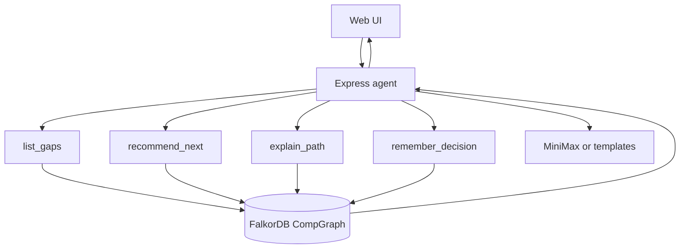

# CompGraph

**Competition advisor agent** whose context layer is **FalkorDB**.  
Ask “what should I enter next, and why?” — answers come from **multi-hop Cypher paths** (Person → Resource → Requirement → Competition), not from LLM narration alone.

Built for [Graph Hacks: Context for AI Agents](https://www.wemakedevs.org/hackathons/falkordb) (WeMakeDevs × FalkorDB), Oct 15–18 2026 IST.

| | |
|---|---|
| Team | Solo — **AGPRKA** (@qinheyi) |
| Tracks | **Company Brain** (primary) · **Agents That Act on Connected Data** (secondary) |
| License | MIT |
| Stack | Node.js + Express + FalkorDB + optional MiniMax |

## Why the graph is load-bearing

| Question | Without FalkorDB | With FalkorDB |
|---|---|---|
| What am I missing for contest X? | LLM guesses | Multi-hop `REQUIRES` vs ready `SATISFIES` |
| What should I enter next? | Ranking prompt | Fewest gaps + soonest deadline + decision history |
| Why? | Chat text | Returned Cypher path evidence |
| What did I decide last session? | Lost context | `Decision` nodes written back (`remember_decision`) |

If you remove FalkorDB, `list_gaps` / `recommend_next` / `explain_path` / session memory stop working.

## Architecture



## Graph model

```
                    ┌──────────────┐
                    │ Competition  │
                    └──────┬───────┘
                           │ REQUIRES
                           ▼
┌────────┐  HAS  ┌──────────┐  SATISFIES  ┌──────────────┐
│ Person │──────▶│ Resource │────────────▶│ Requirement  │
└───┬────┘       └──────────┘             └──────────────┘
    │ DECIDED
    ▼
┌──────────┐  ABOUT  ┌──────────────┐
│ Decision │────────▶│ Competition  │
└──────────┘         └──────────────┘
```

**Nodes:** `Person`, `Competition`, `Requirement`, `Resource`, `Decision`, optional `Project`  
**Edges:** `HAS`, `SATISFIES`, `REQUIRES`, `DECIDED`, `ABOUT`, `COULD_ENTER`, `SIMILAR_TO`, `SAME_HOST`

Eligibility gap = a `Requirement` on a competition with **no**  
`(Person)-[:HAS]->(:Resource {status:'ready'})-[:SATISFIES]->(Requirement)`.

Seed data is **synthetic** public-metadata twins (no secrets, no private notes). See [`cypher/seed-synthetic.cypher`](cypher/seed-synthetic.cypher).

## Core Cypher (product-critical)

```cypher
// list_gaps — unmet requirements
MATCH (c:Competition {id: $cid})-[:REQUIRES]->(req:Requirement)
OPTIONAL MATCH (:Person {id: 'self'})-[:HAS]->(r:Resource)-[:SATISFIES]->(req)
WHERE r.status = 'ready'
WITH req, collect(r) AS ready_resources
WHERE size(ready_resources) = 0
RETURN req.kind AS missing, req.detail AS detail;

// explain_path — multi-hop evidence
MATCH (c:Competition {id: $cid})
OPTIONAL MATCH (:Person {id: 'self'})-[:HAS]->(r:Resource)-[:SATISFIES]->(req:Requirement)<-[:REQUIRES]-(c)
RETURN collect({resource: r.kind, status: r.status, satisfies: req.kind}) AS evidence;
```

Full set: [`cypher/queries.cypher`](cypher/queries.cypher).

> **FalkorDB tip:** there is no `datetime()` — store ISO strings for `deadline` / `at`. Avoid bare `;` inside string properties when bulk-loading.

## Agent tools

| Tool | Role |
|---|---|
| `list_gaps(competitionId)` | Missing requirements |
| `recommend_next()` | Rank by fewest gaps, then deadline |
| `explain_path(competitionId)` | Path evidence + gaps |
| `remember_decision(...)` | Write a `Decision` node (session memory) |
| `list_decisions` / `list_competitions` | History & catalog |

Optional MiniMax polish (`MINIMAX_API_KEY`); otherwise deterministic templates.

## Quick start (local — full product)

Requires Docker (on some hosts: `sudo docker`).

```bash
git clone https://github.com/qinheyi/compgraph.git
cd compgraph
npm install

# 1) Start FalkorDB
docker compose up -d          # or: sudo docker compose up -d

# 2) Load schema + synthetic seed into graph "CompGraph"
./scripts/load.sh             # uses sudo docker if needed

# 3) Run API + UI
npm start                     # http://127.0.0.1:8787
```

Optional:

```bash
export MINIMAX_API_KEY=...    # polish answers; omit for templates
```

### Verify graph

```bash
docker exec compgraph-falkordb redis-cli GRAPH.QUERY CompGraph \
  "MATCH (c:Competition) RETURN count(c)"
```

## Screenshots


## Demo / deploy

- **Preferred for judges who want one click:** open the Vercel demo URL (read-only, embedded demo responses — banner shows `DEMO`). Session memory writes require local FalkorDB.
- **Full fidelity:** run the Quick start above (LIVE mode talks to FalkorDB on `:6379`).

Vercel hosts the UI + demo API only (no free public FalkorDB without extra accounts). Local Compose is the complete, reproducible path.

```bash
# Force demo mode locally
COMPGRAPH_DEMO=1 npm start
```

## Project layout

```
cypher/           schema, seed, reference queries
scripts/load.sh   reload CompGraph graph
server/           Express API, tools, LLM, demo fallback
web/              one-page UI + SVG path viz
docs/             architecture notes
```

## AI disclosure

CompGraph development used AI coding assistants (Grok Bot / Cursor agents) for scaffolding and docs. Graph model, Cypher, tool contracts, and verification were directed and checked by **Qin HEYI**.

## Submission extras

- English write-up: [`SUBMISSION_DRAFT_EN.md`](SUBMISSION_DRAFT_EN.md)
- Demo video script (≤3 min): [`DEMO_VIDEO_SCRIPT.md`](DEMO_VIDEO_SCRIPT.md)

## License

MIT © 2026 Qin HEYI
