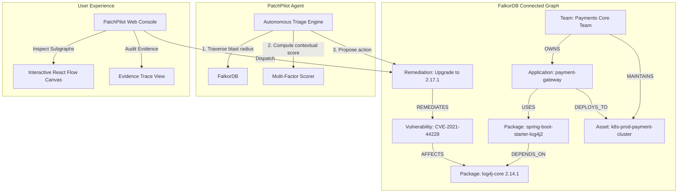

# 🛡️ PatchPilot — Graph-Powered Vulnerability Triage and Remediation Agent

> **WeMakeDevs Graph Hacks | Track 01: Agents That Act on Connected Data**  
> Powered by **FalkorDB** & Cypher graph intelligence.

[](https://python.org)
[](https://fastapi.tiangolo.com)
[](https://falkordb.com)
[](https://react.dev)
[](https://typescriptlang.org)
[](#testing)

---

## 💡 The Problem

Security teams are overwhelmed by thousands of vulnerability alerts. Today's triage suffers from critical blind spots:

1. **CVSS Is Blind to Runtime Reality**: A CVSS 9.8 vulnerability in an isolated, internal dev sandbox triggers emergency pages, while a CVSS 7.2 vulnerability directly exploitable on a public-facing payment gateway gets queued for the next sprint.
2. **Transitive Dependency Blindness**: Modern applications inherit hundreds of transitive packages. Point-in-time SBOM scanners fail to connect deep dependency trees to running cloud infrastructure and ownership.
3. **Disjointed Remediation**: Triage results rarely map to the exact team that owns the service, leading to days of cross-team Slack pinging.

---

## ⚡ The PatchPilot Solution

**PatchPilot** transforms vulnerability triage by modeling software security as a **connected property graph in FalkorDB**:

`Vulnerability ➔ Package (Transitive) ➔ Application Service ➔ Cloud Infrastructure Asset ➔ Team Owner`

By navigating this connected graph in real-time with Cypher queries, PatchPilot:
- Traces multi-hop dependency paths from CVE to internet-facing workloads.
- Computes an **Evidence-Backed Priority Score (0-100)** incorporating reachability, exposure, asset criticality, and wild exploitation.
- Employs an **Autonomous Investigation Agent** that formulates step-by-step reasoning and tailored remediation actions.
- Automatically routes remediation proposals to the verified team owners with exact patch targets.

---

## 🏛️ Architecture & Graph Schema



### Graph Node Types
| Node Label | Key Properties | Role |
| :--- | :--- | :--- |
| `Vulnerability` | `id`, `cve_id`, `severity`, `cvss_score`, `epss_score`, `has_exploit`, `patch_version` | Security vulnerability record |
| `Package` | `name`, `version`, `ecosystem` | Software library in dependency tree |
| `Application` | `name`, `language`, `tier`, `repo_url` | Enterprise microservice or workload |
| `Asset` | `name`, `type`, `environment`, `exposure`, `criticality` | Deployment target (e.g. k8s, ec2, db) |
| `Team` | `name`, `email`, `slack_channel`, `on_call` | Engineering ownership |
| `Remediation` | `action_type`, `status`, `target_package`, `recommended_version` | Concrete remediation lifecycle action |

---

## 🚀 Quick Start

### 1. Run with Docker Compose (Recommended)

```bash
# Clone and navigate to repo
git clone https://github.com/your-org/patchpilot.git
cd patchpilot

# Start FalkorDB and Backend in Docker
docker compose up -d
```

- **Backend API**: `http://localhost:8000`
- **Swagger Docs**: `http://localhost:8000/docs`
- **FalkorDB**: `localhost:6379`

### 2. Run Locally for Development

**Prerequisites**: Python 3.11+, Node.js 18+, Docker (for FalkorDB).

```bash
# Step 1: Start FalkorDB
docker run -p 6379:6379 -it --rm falkordb/falkordb:latest

# Step 2: Start Backend
cd backend
python3 -m venv venv
source venv/bin/activate
pip install -r requirements.txt
uvicorn app.main:app --reload --port 8000

# Step 3: Start Frontend
cd ../frontend
npm install
npm run dev
```

Visit **`http://localhost:5173`** to access the PatchPilot console.

---

## 🔬 Core Features & Workflows

### 1. Portfolio Overview & Health Dashboard
- Real-time aggregation of total CVEs, impacted packages, vulnerable microservices, and exposed production assets.
- FalkorDB status indicators and live query latency measurements.

### 2. Autonomous Investigation Engine
- Select any vulnerability or trigger via API.
- Live multi-stage execution tracker:
  1. Vulnerability ingestion & severity extraction
  2. Transitive dependency graph expansion (1-5 hops)
  3. Asset exposure and criticality analysis
  4. Team code-ownership resolution
  5. Multi-factor priority score calculation
  6. Automated remediation plan formulation

### 3. Interactive React Flow Dependency Canvas
- Full interactive graph visualizer with color-coded node taxonomy.
- Click any node (Vulnerability, Package, Application, Asset, Team) to inspect graph metadata and connection edges.

### 4. Remediation Dispatch & Lifecycle
- One-click action generation:
  - **Upgrade Package** (with safe version targeting)
  - **Apply WAF / Network Rule** (zero-downtime mitigation)
  - **Isolate Asset**
- Assigns to responsible team's on-call engineer and stores tracking record directly in FalkorDB.

---

## 🧪 Testing

The test suite validates FalkorDB graph queries, prioritization algorithms, evidence path resolution, and API endpoints:

```bash
cd backend
./venv/bin/pytest -v
```

**Results: 45 passed in 4.42s** (100% pass rate).

---

## 📂 Project Structure

```
patchpilot/
├── backend/
│   ├── app/
│   │   ├── agent/            # Autonomous investigation & triage engine
│   │   ├── api/              # FastAPI REST endpoints
│   │   ├── core/             # Configuration & priority scoring logic
│   │   ├── db/               # FalkorDB client connection & lifecycle
│   │   ├── graph/            # Cypher queries & synthetic data seeder
│   │   ├── schemas/          # Pydantic models & validation
│   │   └── main.py           # FastAPI entrypoint
│   ├── tests/                # Automated pytest suite (45 unit & integration tests)
│   ├── Dockerfile
│   └── requirements.txt
├── frontend/
│   ├── src/
│   │   ├── components/       # Graph canvas, badges, modals, score cards
│   │   ├── pages/            # Overview, Investigate, Graph, Remediations, Status
│   │   ├── services/         # Typed API client
│   │   ├── App.tsx
│   │   └── index.css         # Dark theme & styling
│   ├── package.json
│   └── vite.config.ts
├── docs/
│   ├── architecture.md       # Full architecture & scoring formulas
│   ├── cypher_queries.md     # Complete FalkorDB Cypher query catalog
│   └── demo_guide.md         # 3-minute hackathon demo walkthrough
├── scripts/
│   └── seed_graph.py         # Standalone synthetic data seeder
├── docker-compose.yml
└── README.md
```

---

## 🏆 Hackathon Alignment: Track 01

| Requirement | PatchPilot Implementation |
| :--- | :--- |
| **Agents That Act on Connected Data** | Autonomous agent queries FalkorDB graph to discover transitive paths, assess runtime asset exposure, and trigger remediations. |
| **FalkorDB as Core Graph Engine** | Uses FalkorDB graph database with optimized Cypher queries for blast radius, multi-hop reachability, and relationship traversal. |
| **Explainability & Proof** | Every priority score is backed by an interactive visual evidence path and step-by-step reasoning timeline. |
| **Production Ready** | Full test coverage (45 passing tests), Dockerized services, deterministic fallback when LLM keys are absent, and typed REST API. |

---

## 📄 License

MIT License. Built for WeMakeDevs Graph Hacks 2026.
