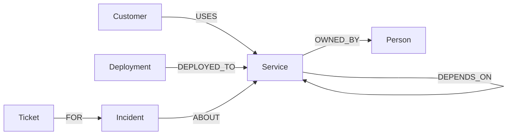

# BlastRadius

**One alert. The whole picture. A response you can explain.**

BlastRadius investigates a software incident by following service dependencies in **FalkorDB**. It connects recent deployments to exposed customers, finds the response owner, recalls previous incidents, and creates a local incident ticket with evidence attached.

Built for Graph Hacks 2026 · Team cloud9 · Primary track: **Agents That Act on Connected Data**.


[Watch the two-minute walkthrough](docs/walkthrough.mp4) · [Review the graph queries](docs/queries.cypher) · [Read the validation record](docs/verification.md)

## Run it

Install and start Docker Desktop (or Docker Engine with Compose), then run from this repository:

```sh
docker compose up --build -d --wait
```

Open **http://localhost:4317**. No account or model key is needed for the graph policy agent. The first build downloads the images and dependencies. Ports 4317 and 6388 must be free.

```sh
docker compose logs app
docker compose stop
```

The named `graph-data` volume retains incidents, tickets, graph changes, and outcomes. Do not delete that volume if you want to keep memory. The seed is idempotent and does not reset existing work. The optional dependency can be toggled off in the interface.

For development with Node 22+ and pnpm 11:

```sh
docker compose up -d --wait graph
pnpm install --frozen-lockfile
pnpm start
```

Stop the Compose `app` service first if it already owns port 4317. Copy `.env.example` to `.env` to override local settings. In Compose, the graph host and port are set to the container service automatically.

## The 90-second proof

1. Choose **Checkout error rate above 25%** and run the investigation.
2. Observe **Payments**, **3 customers**, and **$420k annual revenue exposed**. The candidate is `payments v1.4.2`, eight minutes before the synthetic incident clock, with a 28-percentage-point error increase.
3. Click a source reference to inspect its synthetic source record. Click **Trace Northstar Retail** to highlight its multi-hop path.
4. Toggle **Add dependency**, which writes `Analytics → Payments` to FalkorDB. The old report is explicitly marked stale.
5. Run again. Exposure becomes **4 customers / $630k**. The new path is `Cedar Health → Analytics → Payments`.
6. Create a local ticket. Save an observed outcome in **Response desk**. Reload and open the report in **Incident memory**.
7. With the what-if dependency **off**, choose **Analytics freshness delayed**. The agent declines to recommend a rollback because no recent deployment meets the filter.

All amounts are synthetic annual contract exposure, not actual losses. No rollback, email, or external ticket is executed.

## Two execution modes

- **Graph policy agent (default, verified):** a deterministic tool loop calls FalkorDB for candidate changes, customer paths, ownership, and incident memory. An explicit policy ranks changes by error increase, then recency. A change below a ten-point error increase is weak evidence. The policy is intentionally inspectable; it is not represented as a model call.
- **AI tool agent (optional):** a configured model chooses among four bounded graph tools, then returns a structured deployment, customer, and response selection. The app validates that selection against the retrieved graph rows and renders the factual report from those rows. Configure `LLM_API_KEY`, `LLM_BASE_URL`, and `LLM_MODEL` in `.env`, restart/recreate the app, then choose **Response desk → Run AI tool agent**. Live checks with **Qwen 3.8 27B on Groq's Free plan** passed for the baseline, added dependency, and insufficient-evidence cases. Results and actual tool traces are recorded in `docs/live-ai-*-check.json` and `docs/live-ai-check.json`.

Example `.env` (keep the real key out of Git):

```dotenv
LLM_API_KEY=your-key-here
LLM_BASE_URL=https://api.openai.com/v1
LLM_MODEL=gpt-4.1-mini
```

```sh
docker compose up -d --force-recreate app
```

API use can incur provider charges on a paid plan. Only the synthetic alert and requested synthetic graph results are passed to the configured provider. The model has no arbitrary Cypher, shell, production actions, or messaging tool. The six-turn loop permits at most twelve tool calls, validates all service identifiers, and rejects unknown tools. Final selections must match a retrieved deployment and the exact customer set; weak evidence cannot authorize the rollback response category. Prose or extra invented fields are rejected. The final narrative is rendered from database rows, not freely generated factual claims. This checks fidelity to retrieved records, not whether the source data or causal hypothesis is true.

For a provider with a Free plan, see the [Groq setup instructions](docs/provider-setup.md). Paid API usage is optional; free-plan quotas still apply.

## Graph model



Services, customers, deployments, owners, prior incidents, tickets, and new incident outcomes live in FalkorDB. There is no secondary document/vector store or cached answer fixture. The SVG is a rendering of database results.

The seed contains eight services, six customers, five deployments, seven owners, and one historical incident. Every topology edge has a source reference. Synthetic source records are in `src/sources.js` and exported under `data/`. The fixed incident clock is **October 16, 2026, 15:45 IST**; deployment recency is relative to that clock so the demo remains repeatable.

### Core graph queries

The full executable catalog is [`src/queries.js`](src/queries.js). A readable copy is in [`docs/queries.cypher`](docs/queries.cypher).

Find reachable recent changes:

```cypher
MATCH p=(alerted:Service {id:$service})-[:DEPENDS_ON*0..6]->(s:Service)
        <-[:DEPLOYED_TO]-(d:Deployment)
WHERE d.minutesAgo <= 60 AND d.errorDelta > 0
RETURN d.id, d.name, d.errorDelta, d.minutesAgo, length(p)
ORDER BY d.errorDelta DESC, d.minutesAgo ASC
```

Find customer exposure and the actual paths:

```cypher
MATCH p=(c:Customer)-[:USES]->(:Service)-[:DEPENDS_ON*0..6]->
        (s:Service {id:$service})
RETURN c.id, c.name, c.arr,
       [n IN nodes(p) | n.id] AS path,
       [r IN relationships(p) | r.source] AS sources
```

Customers are deduplicated before revenue is summed; the shortest returned path per customer is displayed. Traversals are bounded to six service dependency hops. All query inputs are parameters, not model-written query text.

### Why the graph changes the decision

The alert is about Checkout, but the highest-signal reachable deployment belongs to Payments. Walking upstream from that candidate includes Subscriptions customers even though they were absent from the original alert. Adding one dependency makes another customer reachable and changes the response plan's coordination step. Owner selection and recalled procedures also follow the selected service. Without FalkorDB, investigation and memory operations fail; the app has no in-memory fallback.

## Validation

With FalkorDB running, install development dependencies as above and run:

```sh
pnpm test
pnpm evaluate
```

Tests use isolated, uniquely named graphs and remove only those test graphs. Evaluation writes `docs/evaluation.json`.

The included evaluation checks candidate selection and exact customer exposure on **five fixed synthetic scenarios**, plus the dependency mutation. It is a regression check, not a general accuracy benchmark or evidence that the model can diagnose real outages. Integration tests also cover persisted outcomes, reopening memory through a new database connection, idempotent tickets, invalid scenarios, and rejecting unsupported model tools. The optional model test uses a simulated provider and says so explicitly.

Separately, `node scripts/live-check.js`, `node scripts/live-check.js changed`, and `node scripts/live-check.js analytics` run real provider checks against the local app. These are **not part of the key-free test suite** and use the configured provider quota. The three included live checks verify exact selected customers and response categories. The AI selection and its trace are persisted with the report and can be reopened from incident memory.

## Architecture and boundaries

Browser → local Node HTTP server → official FalkorDB client → FalkorDB graph. The optional model receives only bounded tool outputs. Writes and investigations are serialized in this single-user app to keep a report internally consistent while a dependency changes.

- Frontend: semantic HTML, CSS, JavaScript, SVG; no frontend build tool.
- Server: Node.js built-in HTTP and fetch; `falkordb` is the only application dependency.
- Persistence: FalkorDB with append-only storage and a named Docker volume.
- Actions: local ticket creation and recorded outcomes only.
- Deployment: verified local Docker setup; not a publicly hosted, authenticated service.
- Limits: synthetic telemetry, fixed incident clock, heuristic ranking, bounded traversal, no access control/multi-tenancy, no live observability, and no causal proof. Store only demo data here.

## Submission materials

- [`docs/blog.md`](docs/blog.md): blog draft with reproducible experiment and limitations.
- [`docs/demo-script.md`](docs/demo-script.md): demo narration and recording plan.
- [`docs/submission.md`](docs/submission.md): submission text and remaining human steps.
- [`docs/explain-it.md`](docs/explain-it.md): architecture walkthrough and practice questions.
- [`docs/verification.md`](docs/verification.md): validation record.
- [`AI_DISCLOSURE.md`](AI_DISCLOSURE.md): coding-assistant disclosure.

## AI assistance and participant responsibility

Codex assisted with the initial implementation, tests, interface, provider validation, and draft materials. The participant must review and understand the code, reproduce the demo, add meaningful technical decisions or improvements, and accurately describe their own contribution before submission. See `AI_DISCLOSURE.md`. A functioning app is not a guarantee of eligibility or a prize.

MIT licensed. Synthetic names, companies, contracts, and measurements are fictional.
